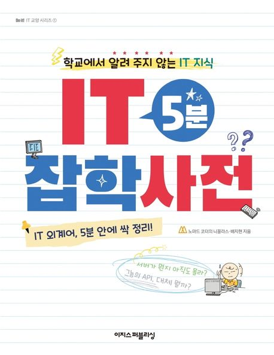
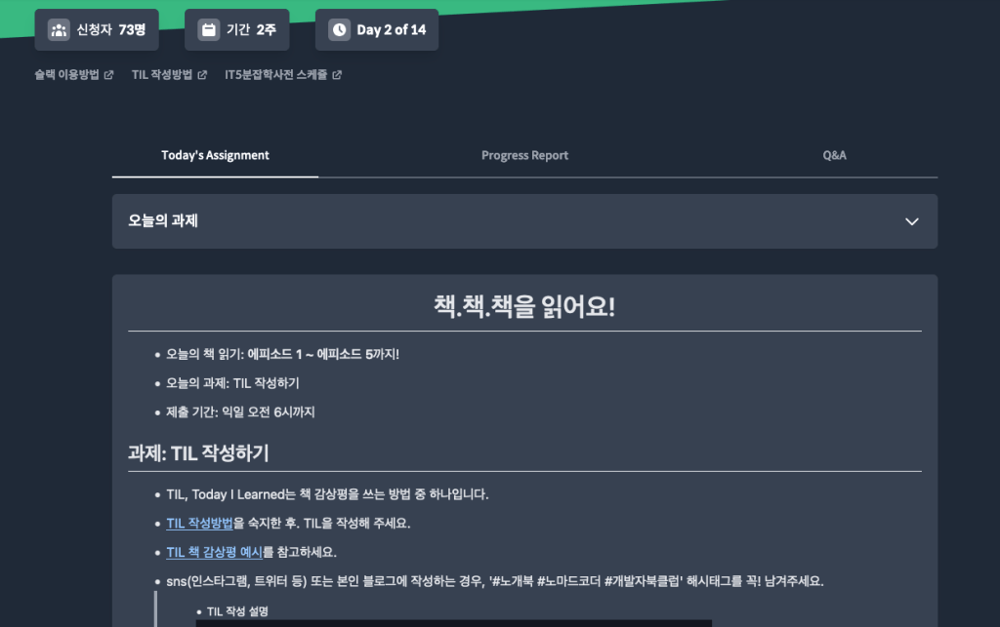

※ 본 글은 블로그 이전으로 인해 기존 글을 옮겨온 것입니다. (작성일: 2024년 11월 9일)

[IT 5분 잡학사전](https://search.shopping.naver.com/book/product/XHc1fYCxHebh3cSg4e6bGdfEtVN73m7Pg5N%2Fssd3Evk%3D)

니꼴라스,배지현 · 2022 · 이지스퍼블리싱

---

이 책을 읽게 된 계기는 노마드코더 챌린지 덕분이었다. 노마드코더의 니꼬쌤은 개발자들에게 유용한 정보를 전달하는 [유튜버](https://www.youtube.com/@nomadcoders)로, 프로그래밍에 관심이 있는 사람이라면 아마 한 번쯤 들어봤을 것이다. (영상의 시작 부분마다 “안녕하세요, 니꼴라스 쌤입니다~!“라고 인사하는데, 은근히 중독성이 있다.) 니꼴라스는 유튜버이자 강의도 진행하는 강사이다. 현재 나는 노마드코더에서 웹 관련 강의를 수강 중이다.

강의를 듣는 것뿐만 아니라 직접 참여할 수 있는 챌린지도 진행하는데, 이번에는 이 책을 읽고 배운 점을 소개하는 챌린지에 참여하게 되었다. 사실, 2주 동안 매일 배운 것들(Today I Learned; TIL)을 포스팅하는 것이 목표였지만, 책의 내용이 술술 읽혀 하루 만에 다 읽어버리고 말았다.

책을 간단히 소개하자면, 가격은 만 원이고 평소에 이북으로 책을 읽는 나는 할인 쿠폰을 받아 9천 원에 구매할 수 있었다. 약 200페이지 정도로 두껍지 않으며, 크게 5개의 파트로 구성되어 있고, 세부적으로는 45개의 파트로 나누어져 있다. 각 파트의 분량이 많지 않아 가벼운 마음으로 읽기에 좋다. 각 파트 사이에는 소소한 팁들과 니꼬쌤의 조언들이 적혀 있는데, 생각보다 힘이 되는 말들이 많아 상당히 유익했다. 이 책은 비전공자도 쉽게 이해할 수 있을 정도로 비유와 설명이 잘 되어 있어, 딱딱한 전공 서적보다 흥미를 끌 수 있는 내용들이 많다. 다만, 내용의 깊이가 그닥 심도있게 다루는 것이 아니라서 면접 준비용으로는 추천하지 않지만, 입문용으로는 아주 적합하다고 생각한다.

아래부터는 내가 책을 읽으면서 알게된 내용, 인상 깊었던 내용들이다.

---

“새로운 프로그래밍 언어를 공부하면 그 언어에 담긴 철학, 코드 구조, 개념, 패턴 등을 배우는데, 그 내용이 정말 중요하다” (p. 26)

“C언어와 C++의 가장 큰 차이점은 ‘객체 지향인지 아닌지’다. 객체 지향은 절차 지향, 함수형 프로그래밍과 함께 프로그래밍 언어를 바라보는 관점 또는 사용하는 방식이다.” (p. 36)

코드에서 오류가 발생하더라도, 책이나 인터넷 문서 탓만 하면 안된다. 외부 요인만 탓하면 발전할 수 없다. 생각을 바꾸자. 코드가 작동하지 않는 이유는 ‘코드를 입력한 나 자신때문이다’. (p. 40)

무언가를 만들고 창조해야 프로그래밍 실력이 는다. (p. 42)

컴필레이션(complilation)은 코드 전체를 받아서 한번에 기계어로 해석하는 것이고, 인터프리테이션(interpretation)은 코드를 실시간으로 기계어로 해석하는 것을 의미한다. 그래서 컴필레이션 방식으로 동작하는 코드가 인터프리테이션 방식으로 동작하는 코드보다 빠르다. (p. 62)

라이브러리와 프레임워크의 공통점은 누군가 미리 작성해 놓은 코드이고, 우리의 개발 속도를 더 빠르게 만들어 주는 도구라는 것이다. 쉽게 말해 개발 속도를 더 빠르게 만들어 주는 도구이다. 차이점은 ‘누가 누구를 제어하는가?’로 구분지을 수 있다. 어떤 도구에 대해서 모든 결정을 다 내리고 있으면 라이브러리이고 반대로 누군가 정한 규칙에 따라 도구를 사용하고 있다면 프레임 워크이다. (p. 70)

기한 없이 공부하지 마라. 공부하기로 마음을 먹었다면 목표와 함께 기한을 꼭 설정해두자. (p. 84)

쿠키(cookie)는 우리가 웹 사이트를 방문할 때 브라우저를 통해 컴퓨터에 저장되는 기록물이다. (p. 101)

서버는 인터넷에 연결되어 있고 24시간 내내 주소 입력을 기다리는 컴퓨터이다. 서버리스는 직접 관리하지 않는 서버를 의미한다. 대표적으로 AWS, 구글 클라우드, 테라폼이 있다. (p. 123)

알고리즘이란 컴퓨터에게 내리는 지시 사항을 나열한 것이다. (p. 133)

시간 복잡도는 프로그램의 작업 속도가 얼마나 빠른지 측정하는 방법이다. (p. 137)

이진 탐색 알고리즘은 배열을 반씩 나누며 탐색 범위를 좁혀가는 방식으로 시간 복잡도는 O(logN)이다. 거대한 배열을 다룰 때 효과적이다. 이진 탐색 알고리즘을 사용하고 싶다면 배열은 항상 정렬되어 있어야 한다. (p. 153)

정렬 알고리즘에는 버블 정렬(bubble sort), 선택 정렬(selection sort), 삽입 정렬(insertion sort) 가 있다. 세 방식 모두 시간 복잡도는 O(N^2)이다. (p. 156 – p. 160)

버블 정렬은 인접한 두 요소를 비교하여 순서가 맞지 않으면 서로 교환하는 과정을 반복한다.

선택 정렬은 전체 데이터 중에서 가장 작은 데이터 또는 가장 큰 데이터의 위치를 따로 기억하는 방식이다.

삽입 정렬은 데이터를 하나씩 확인하며, 현재 데이터가 앞쪽의 정렬된 부분 중 알맞은 위치에 삽입되도록 반복한다.

스택(Stack)은 위에서 데이터를 쌓고 위에서부터 데이터를 빼는 구조이다 – LIFO (Last In, First Out). 큐(Queue)는 위로 데이터를 쌓고 아래에서부터 데이터를 빼내는 선입선출의 구조이다 – FIFO (First In, First Out). (p. 165)

해시 테이블은 키와 값을 짝지어 모은 것인데, 이를 통해 우리가 데이터를 더 쉽게 정리할 수 있게 해준다. (p. 167)

프로그램은 책임 있게 만들어야 한다. 개발자는 자신이 만든 프로그램에 완벽하게 책임을 져야 한다. 그리고 끊임없이 관리해야 한다. 시스템은 한번 구축하면 끝이 아니다. 개발자라면 코드를 살아 있는 생명체처럼 대해야 한다. 꾸준히 관리 해야 한다. (p. 181)

데이터베이스란 쉽게 말해 데이터를 보관하는 창고와도 같다. (p. 183 – p. 193)

SQL은 Structured Query Language의 줄임말이다. SQL은 데이터베이스에 어떤 질문 또는 문의를 하기 위해 어떤 구조를 가진 언어이다. 즉, SQL은 데이터를 다루는 언어이다.

DBMS(Database Management System)은 말 그대로 데이터베이스 관리 시스템을 의미한다. 즉, SQL로 데이터베이스와 상호작용을 하려면 DBMS를 거쳐야 한다. DMBS의 종류에는 MySQL, PostgreSQL, SQLite, Oracle, MariaDB 등이 대표적이다.

ORM(Object Relational Mapping)은 개발자에게 SQL 번역기 같은 도구이다. 사용자에게 익순한 프로그래밍 언어로 SQL을 사용할 수 있도록 도와준다. 파이썬에는 장고(Django), 라라벨에는 엘리퀀트 ORM, NodeJS에는 시퀄라이즈 ORM 이나 타입 ORM 이라는 도구가 있다.

NoSQL은 비관계형 데이터베이스이며, 도큐먼트 데이터베이스(document DB), 키값 데이터베이스(key-value DB), 그래프 데이터베이스(graph DB)등 다양한 유형이 있다.

데이터 형식이 매우 자유로운 도큐먼트 데이터베이스: JSON 도큐먼트 형태는 대괄호와 중괄호로만 구성하면 되고, 데이터마다 구성이 같을 필요가 없다. 개발자가 원하는 어떤 모양, 어떤 종류의 데이터라도 저장할 수 있다는 장점이 있다 (예: 몽고DB).

읽고 쓰는 속도가 엄청 빠른 키값 데이터베이스: 한 행의 열이 엄청 넓은 데이터베이스로, 속도가 정말 빠르다는 장점을 지니고 있어 대용량 데이터를 저장해야하는 프로젝트에서 주로 사용된다. (예: 카산드라DB, 다이아모DB)

노드로 관계를 표현하는 그래프 데이터베이스: 테이블 열이나 도큐먼트가 아닌, 노드와 엣지(간선)라는 개념을 사용하여 데이터 간의 관계를 표현하는 데이터베이스이다. 복잡한 관계 데이터를 처리하는 데 적합하다 (예: 네오4j).

기술에는 좋고 나쁨이 없다. 용도에 맞게 쓰면 되니까 비교해 보면서 우위를 따지는 실수를 하지 않도록 하자.

깃(git)은 파일 이력을 관리하는 프로그램, 깃허브(github)는 파일과 깃으로 관리한 이력을 저장하고 공유하는 공간. (p. 196)

함수형 프로그래밍과 객체 지향 프로그래밍 (p. 212 – p. 222)

선언형 프로그래밍은 원하는 결과값을 선언하는 것이다. (예: CSS)

명령형 프로그래밍은 원하는 결과값에 어떻게 도달하는지 선언하는 것이다.

함수형 프로그램은 함수 중심으로 코드를 적는 방식으로 선언형 프로그래밍 컨셉을 유지한다.

도커(Docker)는 어떤 컴퓨터에서도 같은 개발 환경을 준비할 수 있도록 해주는 도구이다. 도커가 동작하는 환경을 컨테이너라고 한다. (p. 238)

나무가 아닌 숲을 보라. 할 수만 있다면 무료로 일하면서 실무 경험을 쌓아보라. (p. 267)

---

앞서 말한 대로 지루하지 않고 술술 읽히는 책이라 하루 만에 끝낼 수 있었다. 2주 동안 진행해야 하는 챌린지를 하루 만에 마치니 당황스럽기도 하고, 너무 쉽게 끝낸 느낌도 들지만, 챌린지 덕분에 독서를 할 수 있어서 기분이 좋다. 요즘 부트캠프에서 개발자들이 마치 찍어내듯 양성되는 걸 자주 보는데, 무작정 코드를 복사하고 비슷한 이력서를 제출하는 것보다 스스로 생겨나는 호기심이 정말 중요하다고 생각한다. 그런 면에서 이 책은 그런 호기심을 자극해 주기 때문에 입문자에게 추천할 만하다.

#IT5분잡학사전

#니꼴라스
