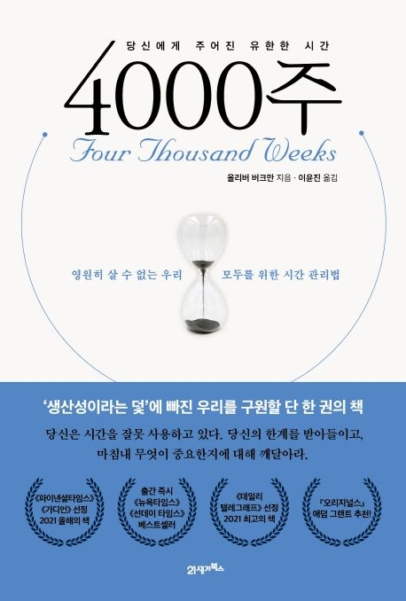

※ 본 글은 블로그 이전으로 인해 기존 글을 옮겨온 것입니다. (작성일: 2024년 8월 1일 15:01)

[4000주](https://search.shopping.naver.com/book/product/JpoZ6E3%2FquxBfWMPgRKUbgeOYIFQP9pGLA2q%2B5j55X4%3D)

올리버 버크먼 · 2022 · 21세기북스

1\. 사람의 기대수명이 80살이라고 가정할 때 이를 주 단위로 환산한다면 4000주이다. 이 책은 시간을 어떻게 활용하면 좋을까에 대한 자기 계발서와 같이 방법론적인 내용보다는 그보다 더 본질적으로 인간은 한정된 시간 속에서 살아가는 존재임을 강조한다. 책 제목이 4000주인 이유도 그에 있다. 아마도 현재 2030 세대는 더 건강한 음식을 챙겨 먹고 운동도 많이 하고 있으니 기대수명이 더 높을 것으로 예상한다. 노후에는 의료기술도 발달될 것이니 100세까지는 거뜬히 살 수 있을 거라고 기대한다. 이 책에서 말하는 80세보다 20년이 더 늘어났으니 아마도 우리가 살 수 있는 시간은 약 5000주에 가깝지 않을까 싶다.

2\. 사후세계가 있다고 믿는 사람들을 제외하고 대부분의 사람들은 '**인간은 누구나 죽는다**.'는 사실에 반박하지 못할 것이다. 자연스럽게 받아들인다. 어찌보면 이것은 인생의 진리와도 같다.

3\. **그리고 시간에 대해서도 진리와 같은 두 가지가 있다. 첫번째로 시간은 누구에게나 똑같이 공평하게 24시간이 주어진다. 두번째로는 시간은 멈출 수는 없다는 것이다.** **즉, 시간은 계속해서 흐른다.** 우리는 매일매일 아무런 가치를 지불하지 않아도 24시간이라는 선물이 주어진다. 아무런 대가성이 없기 때문에 우리는 종종 시간의 소중함을 잊고 지낸다. 특히 자본주의 사회에서 젊은 세대들에게 **시간이란 돈 / 목적을 달성하기 위한 수단 / 투자의 개념에 더 가깝다.** 많은 이들이 '워라벨' 혹은 '갓생 살기'를 추구하면서 미라클 모닝, 주말 스터디 모임 등등 각종 수단들을 통해 시간을 최대한 효율적으로 살기에 힘을 쓰고 있다.

4\. 개인적으로 열심히 사는 사람들에 대해서는 굉장히 리스펙 하지만 그들처럼 살지 않는다고 해서 내가 뒤쳐지고 있다거나 좌절감, 패배감을 느끼지는 말자. **내 시간은 온전히 내 것임을 인지하자. 현재에 집중하자. 과거에 좌절하지말고 다가올 미래에 불안 해하지 말자.**

5\. 이 책은 요즘 바쁜 삶을 살고 있는 직장인 혹은 사회초년생들에게 추천한다. 이 책을 읽으면서 시간을 멈추지 않는 컨베이너 벨트에 비유하여 설명하는 것이 감명 깊었다. 아마 나중에 아이가 생긴다면 시간에 대한 소중함을 교육할 때 이렇게 빗대어서 설명해 주면 좋을 것 같다는 생각이 들었다. 그리고 세상에서 가장 어려운 것은 아무것도 안 하는 것이라는 구절이 인상 깊었다. 맨 마지막 파트에서는 시간을 보다 알차게 사용할 수 있는 방법 10가지가 소개되어 있는데 이도 가볍게 읽어보기를 추천한다.

#올리버버크먼

#4000주
