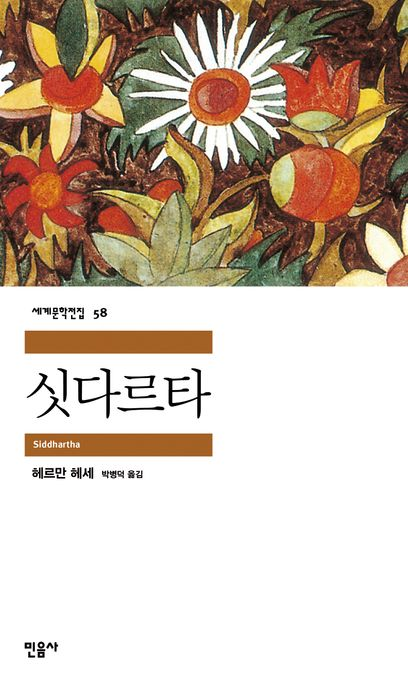

[싯다르타](https://search.shopping.naver.com/book/product/8OWObOT8L4WJVNFy%2Boj1a5bf0zilfO3mQKuvyJ7cG1I%3D)

헤르만헤세 · 2002 · 민음사

---

교보문고 인기도서 상위권에 등재 되어 있어서 호다닥 구매해서 읽은 책

책의 제목인 싯다르타는 불교의 창시자인 석가모니의 본명이다.

부유한 집안의 왕자로 태어났지만 그 직위를 떨치고 인생을 탐험하고자 수행자로 집을 나서면서 친구와 여성, 스승들을 만나면서 진리를 탐구하고 방탕한 삶도 직접 살아보며 결국에는 성찰을 한다. 경험을 통해 느낀 바들을 표현해내는 그런 내용이다. 요약하자면 "현재가 가장 중요하다.", "나 자신을 되돌아봐라", "삶은 배움의 연속이다." 이런 내용이 핵심이지 않을까 싶다.

책 분량의 70%는 구구절절 스토리가 나오고 마지막 장에서 싯다르타가 옛 친구(고빈다)를 오랜만에 만나서 하는 장면이 거의 킬링포인트였다.

> 지식은 전달할 수 있지만, 지혜는 전달 할 수 없다.

내용 전체가 잔잔해서 기억에 남는 말은 없었다.

무엇보다 생소한 단어들이 많이 등장해서 지루했다.

왜 인기도서에 있었는지 나는 잘 모르겠ㄷㅏ...

내 취향은 아닌듯

#헤르만헤세

#싯다르타
