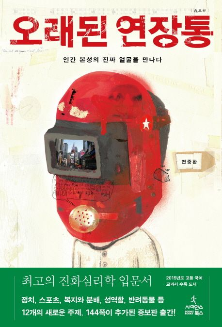

※ 본 글은 블로그 이전으로 인해 기존 글을 옮겨온 것입니다. (작성일: 2024년 7월 29일 12:13)

[오래된 연장통](https://search.shopping.naver.com/book/product/kZxr0zBzOFwujgINUqr7nOpImkQ50B2hAR%2Ff079FUD4%3D)

전중환 · 2014 · 사이언스북스

1\. <오래된 연장통>은 진화심리학의 입문서로 유명하다고 들은 적 있다. 우연히 북카페에 방문했을 때 눈에 들어와서 읽기 시작했다. 이 책은 2014년에 출판되었는데 당시에 방영했던 각종 티비 프로그램들과 연예인들을 글에 등장시키는데 다행히도 동일한 세대여서 책 읽는데 어려움 없이 술술 읽혔다. 전문적인 단어가 등장하지 않고 일상생활에서 깊은 호기심을 갖게 되면 할 수 있는 생각들에 대한 풀이를 해준다는 느낌이 많이 드는 책이었다. 약 40개에 달하는 다양한 사례들을 통해 인류의 진화는 ‘자연 선택론’과 ‘심리 기제’에 의해 이루어진 것이라고 설명하고 있다. 읽는 내내 신기한 점들도 많았지만 그럴싸한 이야기들인 것 같았다. 과연 이 내용이 과학적으로 증명된 것인가?라는 생각이 많이 들었다. 그러나 어디 가서 흥미롭게 이야기해 볼 만한 내용이긴 하지만 한편으로는 민감한 내용인 것 같아 가볍게 읽어보는 것을 추천한다.

2\. _다음을 읽고 물음에 답하라. 민준이라는 남자는 매주 슈퍼마켓에 들러서 냉동 통닭을 한 마리 산다. 닭을 요리하기 전에, 민준은 통닭과 성관계를 가진다. 그러고 난 다음 통닭을 요리해 먹는다. Q. 민준의 행동은 도덕적으로 용납될 수 있을까? (p.187)_ 에 대한 내용을 읽고 나서 약간 머리가 띵해짐과 동시에 도덕이 무엇인가에 대해서 고민해 보게 만들었다.

3\. 대한민국에서는 저출산/고령화 시대에 대해서 뉴스가 시도때도 없이 나오고 한국 사람이라면 누구나 처참한 현실을 맞이할 것이라는 알고 있다. 하지만 이 책에서는 인구감소 현상이 농경사회에서 현대사회로 발전하면서 이러한 현상이 자연스럽게 이루어지고 있는 것처럼 암시(?)했다. 사실, 인구감소현상은 전 세계가 겪고 있는 문제이지만 우리나라는 그중에서 1위를 달리고 있으니 국민들은 더욱더 걱정을 하고 있는 것 같다. 하지만 과거부터 이는 기정사실화된 것과 다름없는 이야기이지만 아이러니하게도 지금에서야 논란거리가 된 것이 이상할 정도이다. 국가 입장에서는 가라앉는 배임을 인지했었더라면 가라앉지 않도록 보수를 하거나 천천히 가라앉도록 하는 것이 그들의 역할이다. 아무런 조치 없이 방관하며 다가오는 죽음을 기다리는 행위만큼 멍청한 짓이 없겠지만 더 빠르게 가라앉게 하는 멍청한 선택을 하지 않도록 조심해야한다.

4\. 결국 인류는 발전하면서 옳은, 이로운 선택들을 해오면서 진화해왔다고 한다. 최근 유아인 '동성 성폭행' 논란 또는 프랑스 올림픽에서의 '동성애에 관한 퍼포먼스'들을 보면 동성애의 존재 유무가 과연 자연선택론에 의해 어떤 이점이 있을까 에 대한 의문이 든다.

#진중환

#오래된연장통
