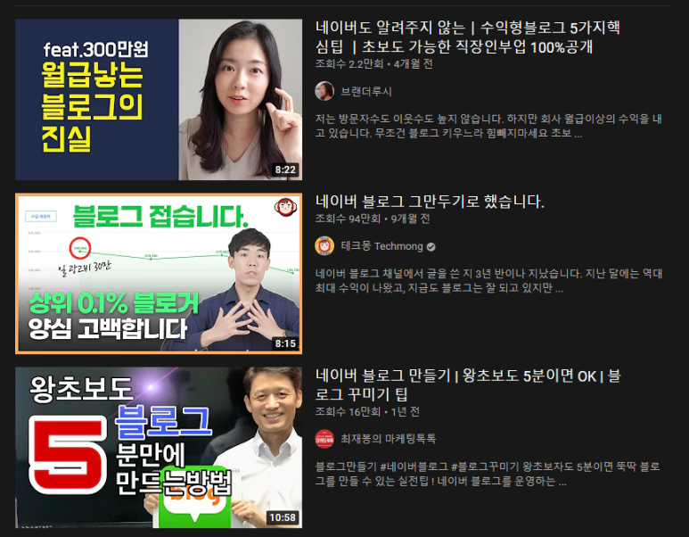

---
categories:
  - life-thoughts/opinions-is-my-own
date: 2021-03-23
description: Most of us have probably seen videos or posts like these at least once.
lang: en
last_updated: 2026-11-14
naver_date: 2026-10-06
naver_url: https://blog.naver.com/martin-lee/224432479721
tags:
  - first-post
  - blogging
  - personal-thoughts
  - reflections
  - smart-blogging
  - blog
title: Thoughts on Blogging in the 21st Century
translation_key: 2021-03-23-blogging-in-the-21st-century
---

※ This post was carried over when I moved my blog. (Originally written: March 23, 2021, 20:46)

"One post a day"

"Make 1 million won a month from blogging"

"How to increase your blog views"

... Most of us have probably seen videos or posts like these at least once.

And there have probably been a lot more people starting blogs lately.

"Can you make money from a blog? Isn't that just because famous people are doing it??

I don't have the talent, and I think it's too late to start..."

If that's what you're thinking, please just give it a try. It's still not too late.

I'd been thinking about it and putting it off since last year myself, until it suddenly came to mind and I started writing this.

A blog can make money.

Because in the information age, **information = money**, directly.

To put the main point of this post simply: **'Knowledge is power.'**

**'What you know = experience = knowledge = information = money'**

If you stubbornly hold your ground on your own because you hate the condescending "Back in my day..." culture, you'll eventually get left behind.

Just ten years ago, there were older people who couldn't use smartphones,

but in a few years, we may reach a point where people find it strange if someone doesn't have an electronic device. Let's start before it's too late.

Whether it's a blog, YouTube, or something else, you should have at least one building of your own in the digital world.

There was a reason adults kept nagging us to study when we were young.

The kids who grew up listening to that became lawyers, judges, doctors, and instructors, and now they're all rich.

What about now?

As long as you know how to use the internet, you can learn to cook, use computers, or sing, beyond your schoolwork.

Even outside what you learned in school, if you can search well enough, you can pass yourself off as a pretty convincing armchair expert.

From your bedroom, of course.

The point is that the information age is absolutely overflowing with information.

So we need to learn how to take it in and interpret it,

and develop the ability to filter out the right information, understand it, and make it our own.

I've been part of the subordinate class under capitalism, but I don't want to stay there. Here's hoping I can move up into the ruling class...

A 21st-century blog is a place where you can record and share those things.

#FirstPost #Blogging #PersonalThoughts #Reflections #SmartBlogging #blog
