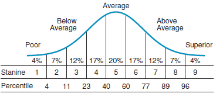
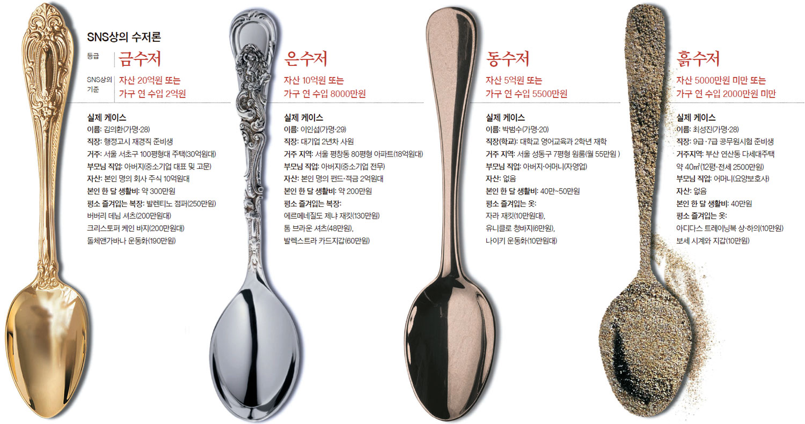

---
categories:
  - life-thoughts/opinions-is-my-own
date: 2021-06-05
description: First, here is what you find when you look up the meaning of “ordinary.”
lang: en
last_updated: 2026-11-14
naver_date: 2026-10-06
naver_url: https://blog.naver.com/martin-lee/224432480535
tags:
  - life
  - lament
  - ordinary-life
title: What Does Living an Ordinary Life in Korea Mean?
translation_key: 2021-06-05-ordinary-life-in-korea
---

※ This post was carried over when I moved my blog. (Originally written: June 5, 2021, 19:30)

First, here is what you find when you look up the meaning of "ordinary."

> Normal, without anything outstanding or unusual.
>
> Naver Korean Dictionary

In English, it is "common," and its opposite is "unique," meaning special.

Most people want to live an ordinary life.

_**What does living an ordinary life in Korea mean?**_

_**Study until your twenties and get into a good university,**_

_**Get a decent job and buy your parents a gift with your first paycheck,**_

_**Meet someone you like and get married,**_

_**Have children and live happily.**_

This can't be the definitive standard for an ordinary life,

but for most Koreans, it seems to be the basic expectation.

Living the way described above

isn't something to brag about or an achievement. It's the baseline.

Like reaching level 30 in MapleStory and getting your second job advancement,

then level 60 for the third,

and level 100 for the fourth.

That kind of feeling...

It's like the basic quests the creator built into the real world for us to complete as we live.

Of course, I'm writing this with ordinary people in mind.

People born with a gold spoon—or a vibranium spoon—in their mouths

started with a completely different character setup, so they probably won't worry about this

and won't read this post anyway.

But living an ordinary life has become far too difficult now.

Let's work backward.

What does living an ordinary life in Korea mean?

_**Have children and live happily →**_ _**Soaring housing prices make it hard to find a home.**_

_**Meet someone you like and get married →**_ _**More people reject marriage, and the growing list of requirements for men makes dating difficult.**_

_**Get a decent job →**_ _**Fewer jobs and a tough employment market.**_

_**Study until your twenties and enter a good university →**_ _**An admissions system that's difficult to navigate without private tutoring.**_

If we're talking about Seoul, you're ruled out right from the start.

People weigh up so many things now—your car, height, appearance, personality, job, and so on—

that even dating is incredibly difficult these days.

A respectable job... I don't even need to explain how hard that is; everyone knows...

To put it plainly,

we've reached a generation where even an ordinary life is damn hard.

Especially if you're a man, you have to work your ass off even harder...

And instead of trying to live an ordinary life,

let's try to become special.

It's easier to be special to someone

than to be ordinary to everyone.

One day, without even realizing it, you'll find yourself feeling ordinary among special people.

#Life #Lament #OrdinaryLife
