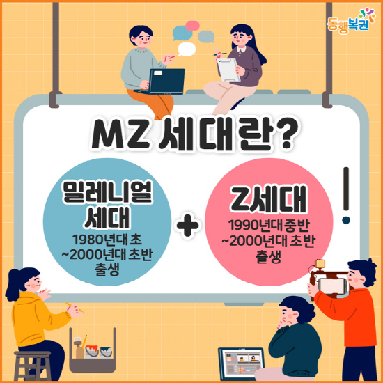
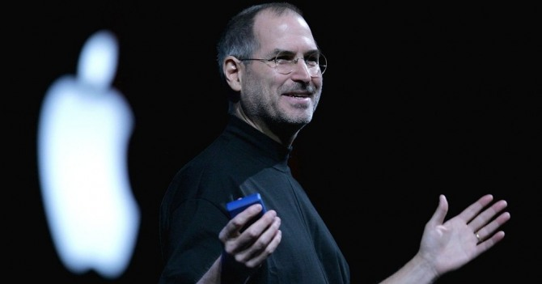
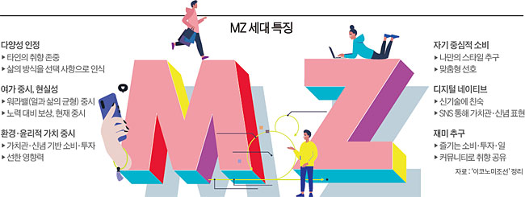

---
categories:
  - life-thoughts/opinions-is-my-own
date: 2021-06-05
description: "Simply put, it means millennials plus Generation Z: people born between 1980 and 2010."
lang: en
last_updated: 2026-11-14
naver_date: 2026-10-06
naver_url: https://blog.naver.com/martin-lee/224432480025
tags:
  - generation-mz
  - millennials
  - generation-z
  - generation-gap
  - blogging
  - personal-thoughts
  - reflections
  - blog
title: My Personal Thoughts on Generation MZ
translation_key: 2021-06-05-thoughts-on-generation-mz
---

※ This post was carried over when I moved my blog. (Originally written: June 5, 2021, 18:30)

What is Generation MZ?

Simply put, it means millennials plus Generation Z: people born between 1980 and 2010.

(Generations born before the 1980s include Generation X and the baby boomers.)

In terms of age, that means people ranging from their late thirties to their teens.

Seen that way, there could actually be quite a severe generation gap between millennials and Gen Z, too.

But I think the gap is relatively small in that both generations are familiar with electronic devices and IT culture.

Then was the development of electronic devices **what caused the gap between Generation MZ and the older generations**?

It's just my personal opinion, but I think so.

I think even people of the same age will see things differently depending on their surroundings.

And I don't view the emergence of generation gaps negatively, either.

[Original image](https://img7.yna.co.kr/etc/inner/KR/2017/05/16/AKR20170516076551033_02_i_P2.jpg)

To give an example,

these days, are more parents reading books to young children, or putting on children's channels on YouTube?

Think how convenient it is for parents. A few taps of a finger stop the baby crying, cost nothing, and save time. Literally the best.

Children growing up in the past probably had a set of biographies of great people at home. Naturally, kids who read those thought scientists, presidents, and doctors were cool, and often dreamed of becoming one themselves.

Now that children learn about the world through YouTube, maybe that's why they want to become YouTube creators, livestreamers, and influencers.

<u>This image is no longer available.</u>

Of course, there must also have been a generation gap between the people who actually lived through war and the baby boomers before them.

For generations who struggled just to put food on the table, went through industrialization and financial crises, and could only make money by sweating it out in factories, indoor white-collar work naturally looked appealing. Lawyers, doctors, and other licensed professions were popular, along with civil service jobs offering steady income and a reasonable workload.

Coming back to Generation MZ, here's how I'd sum it up:

**1\. They are more familiar with videos and photos than with text.**

**2\. They are sensitive to trends and consider recognition from others more important than their personal values.**

**3\. They often don't know where they actually stand.**

I don't understand young people these days using words like YOLO and FLEX. When I listen to people around me who are like that,

I try to hear them out, figuring they must have their own thoughts and circumstances, but it just sounds like excuses to me.

I've heard that Generation MZ could be the first generation to be poorer than its parents.

Whatever happens, it's a natural phenomenon,

but this seems to be how the world is working now.

There may be people who understand these changes, adapt early,

and prepare for them.

That thought is what made me write this post.

#GenerationMZ #Millennials #GenerationZ #GenerationGap #Blogging #PersonalThoughts #Reflections #blog
