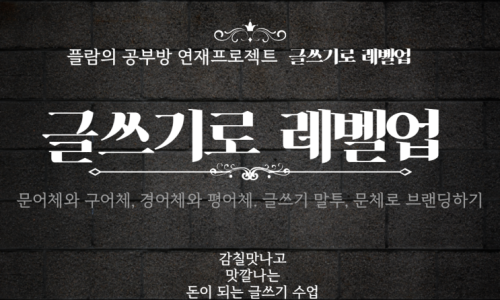

---
categories:
  - opinions-is-my-own
date: 2023-10-03 10:30:00
description: Reflections on consistent writing habits and the attitude behind running a blog
lang: en
layout: post
slug: thoughts2023-10-03
tags:
  - thoughts
  - writing
  - mindset
thumbnail: /assets/img/posts/2023-10-03.png
title: Things to Consider When Writing Blog Posts...
translation_key: "2023-10-03"
---

I stopped blogging for about a month.

~~(Saying I was too busy with work is just an excuse...)~~

Even when I promise myself I will try hard, I always seem to slip back into laziness.

During the Chuseok holiday, I caught up on blog posts I had missed and found myself reflecting a little.

I realized that the blogs I follow tend to meet these conditions.

**Bloggers who post consistently; bloggers who provide quality information**

- Bloggers who post consistently
- Bloggers who provide quality information

Another thing I realized was

**that being good at writing alone could keep you from starving.**

More broadly, this is really about creating content.

Even if you do not make YouTube videos,

knowing how to edit video or create thumbnails certainly cannot hurt.

I think the common qualities of those blogs can be described like this:

**The ability to communicate something,**

**and the ability to communicate it effectively.**

Anyone can create content through writing, photography, video editing, and so on,

so I felt that I needed a distinctive voice of my own.

That led me to look into how to write.

Even on a personal blog, writing should not be taken lightly.

But there is no need to make it overly difficult, either.

**Conversational style vs. written style**

**Polite language vs. informal language**

These are two things to consider when writing.

You need to pay attention to them to maintain a consistent tone and manner.

Mixing the two can make you look like a poor writer.

The blog below explains conversational, written, polite, and informal styles well.

https://m.blog.naver.com/cjd924/222112500878

Until a few months ago, I wrote using polite language.

From now on, I intend to use an informal style,

because I do not want the content I write to feel difficult or intimidating.

My blog still does not get many views, so I have not really been able to take my readership into account.

I do not know my readers' ages, occupations, or interests,

but if you leave feedback in the comments, I will actively incorporate it.

I have also thought it over: rather than blogging as a lone wolf,

endlessly saying only what I want to say or writing purely as a personal record,

communicating with others, pushing each other, and exchanging advice

could provide the motivation to keep blogging consistently.

This time, I looked at the first thing to consider when writing blog posts: **writing style**.

This is not a planned series, but as I continue reading other blogs,

I intend to analyze anything I can learn from and apply it myself.

Let's keep going today, too.
