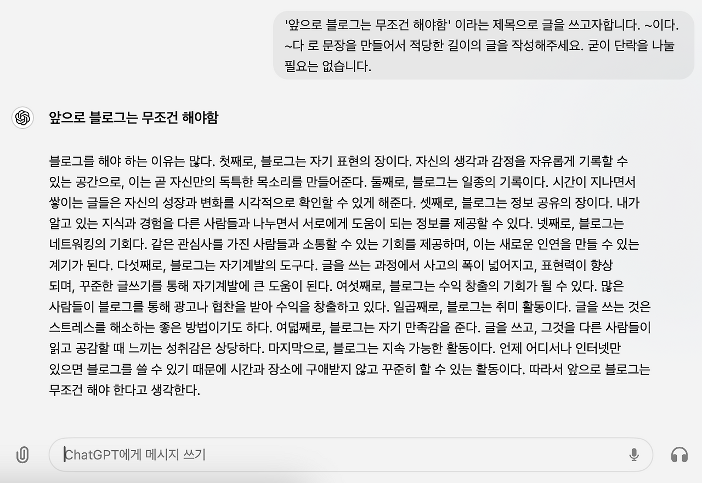
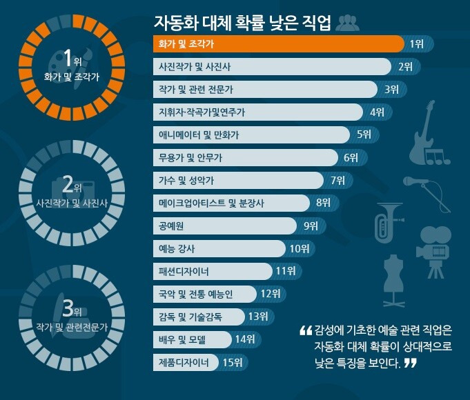
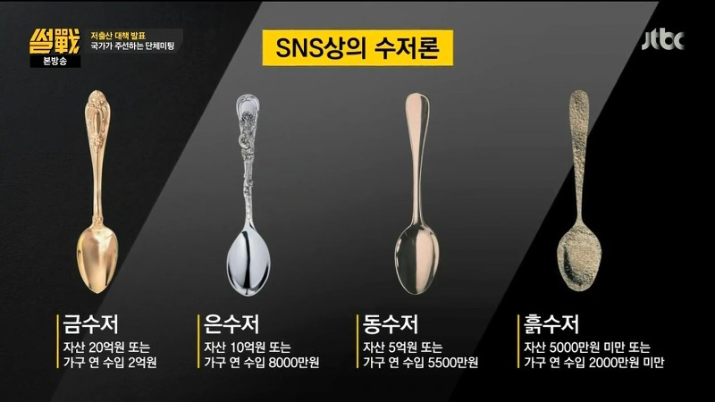

---
categories:
  - life-thoughts/opinions-is-my-own
date: 2024-05-28
description: I think a blog is truly essential in this day and age.
lang: en
last_updated: 2026-11-14
naver_date: 2026-09-26
naver_url: https://blog.naver.com/martin-lee/224422168433
tags:
  - daily-life-and-thoughts
title: If You Weren't Born into Money, You Absolutely Need a Blog
translation_key: 2024-05-28-starting-a-blog
---

※ This post was carried over when I moved my blog. (Originally written: May 28, 2024, 22:16)

I think a blog is truly essential in this day and age.

What kind of age are we living in?

You can throw a rough topic at ChatGPT and ask it to write, and it'll whip up a post in no time.

It translates everything even if you don't speak English, and even lets people who have never coded before write code.

We're living in a time when anyone can start anything as long as they have ChatGPT.

But the important thing here is not to write the same "predictable" posts anyone else could write.

If you're writing by referring to something you found elsewhere, it's easy to see that your writing is predictable.

ChatGPT learns from collections of data gathered from the internet and produces something that sounds roughly plausible.

That's why, going forward, we shouldn't copy posts from the internet, lean on them, or pretend they're our own.

Of course, similarities can happen by coincidence,

but what I really want to say in this post is: "When writing, use your own brain as much as possible instead of relying on a tool."

Using tools is a skill in its own right, but creating is something only humans can do, and I think it will stay that way.

If you look at the top one to three occupations that are hardest to replace in the AI era, most require creativity.

Conversely, the first occupations to be replaced are those involving routine work, and that includes professionals such as lawyers and pharmacists.

But I'm certainly not trying to say, "Write blog posts so machines don't swallow you whole."

Going forward, we need **the ability to create something**, and through that, to find something that carries **our own distinct character**.

In one sentence, I think the idea is that we need to become irreplaceable people.

And I think a blog is one of the easiest ways to present yourself to the internet.

After going around in circles, I ended up starting a blog on Tistory again, but the platform doesn't matter.

These days, even on Naver Blog, it's hard to earn 1 million won a month through AdPost, and people say most earnings come from sponsored advertising.

On Tistory, **you need to write 'well' about things people search for a lot** to get picked up by Google's algorithm.

Though there's been plenty of talk lately about Google's algorithm changing, too...

Unlike before, we should now approach blogging as a way to "build a personal brand and our own value," rather than simply to "make money."

The figures in the image above are from 2020, so it's probably safe to assume the thresholds are higher now.

Working hard may get you from a dirt spoon to a bronze spoon, and even that requires working yourself to the bone.

With polarization getting worse in Korea, reaching silver-spoon or gold-spoon status requires success in at least one of these: business, running a shop, or investing in property, stocks, or crypto.

Even then, you need luck on your side.

But if you have expertise or something that sets you apart, you can bring that luck a little closer.

That's why the poorer your starting point, the more you need a blog that shows your own distinct character.

Most importantly, you have to believe that if you consistently build up a collection of quality posts, one day it will pay off.

Let's all start blogging with the mindset that if we stick it out to the end, we'll win.
