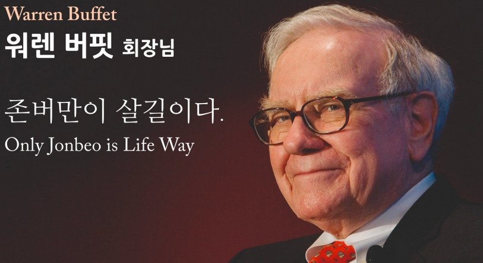

---
categories:
  - life-thoughts/opinions-is-my-own
date: 2024-05-31
description: Life is a continuous series of countless choices and decisions. A life without choices is dull. At a crossroads, we all want to make the best choice, but it is difficult to predict whether our decision will bring the best result. And choosing one means giving up another…
lang: en
last_updated: 2026-11-14
naver_date: 2026-09-26
naver_url: https://blog.naver.com/martin-lee/224422166224
tags:
  - daily-life-and-thoughts
title: Simply Holding On Won't Make Everything Solve Itself
translation_key: 2024-05-31-enduring-and-solving
---

※ This post was carried over when I moved my blog. (Originally written: May 31, 2024, 23:50)

Life is a continuous series of countless choices and decisions. A life without choices is dull. At a crossroads, we all want to make the best choice. But while making a decision, it's difficult to predict whether our choice will bring the best result. And because choosing one thing means giving up another, some regret or lingering attachment to what we didn't choose is inevitable.

We need to learn to enjoy situations that demand a choice rather than fear them. Regret always comes later, so we shouldn't let that feeling overwhelm us and make us afraid to choose. We should try to keep regret at as much of a distance as possible and delay its arrival for as long as we can. If we learn to manage regret, it can serve a better purpose, helping us develop the ability to overcome our current circumstances.

Don't stand by passively when it's time to choose. Whatever choice you make, it will lead you to the best decision.
