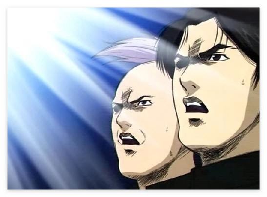

---
categories:
  - life-thoughts/opinions-is-my-own
date: 2024-06-10
description: "Today I realized something important. It’s a kind of unwritten rule that may apply everywhere: if you want to succeed, you have to do something of your own. ChatGPT, selling courses, or putting yourself out there to become an influencer are simply means to an end…"
lang: en
last_updated: 2026-11-14
naver_date: 2026-09-26
naver_url: https://blog.naver.com/martin-lee/224422163399
tags:
  - daily-life-and-thoughts
title: A Realization
translation_key: 2024-06-10-realization
---

※ This post was carried over when I moved my blog. (Originally written: June 10, 2024, 23:31)

Today I realized something important. It's a kind of unwritten rule that may apply everywhere: **if you want to succeed, you have to do something of your own.** Whether you use ChatGPT, sell courses, or put yourself out there aggressively to become an influencer doesn't matter. Those are simply means to an end. As of today, I've firmly decided to do whatever it takes to make things my own and live with a sense of ownership.

Why did I make that decision? Among the posts I briefly skimmed today was one titled '[Sulbing sold for 130 billion won](https://higher-career.com/%EC%84%A4%EB%B9%99-%EB%A7%A4%EA%B0%81-%EA%B1%B4%EC%9C%BC%EB%A1%9C-%EC%95%8C%EC%95%84%EB%B3%B4%EB%8A%94-%EC%82%AC%EB%AA%A8%ED%8E%80%EB%93%9C-%ED%88%AC%EC%9E%90-%EC%BC%80%EC%9D%B4%EC%8A%A4/)'. I'd casually thought of it as just another food franchise, but there was more to it. After a few more searches, I came across things like 'Stylenanda [sold for 600 billion won](https://it.donga.com/27612/)'. I was surprised and fascinated that familiar brand names were selling for hundreds of billions of won, not just a few billion or tens of billions. Wondering how they had achieved that led me to this thought. For a moment I also wondered, "Could that happen to me?", but concluded that as a salaried employee, I couldn't even dream of it.

I cautiously drew a lesson from the patterns behind their success and from what I see around me. Take a startup, for example: the hardest-working person in the company is probably the founder. Why? Because it's their own business. If every employee worked with the same mindset as the founder, that startup could succeed. There's a saying I like: birds of a feather flock together. Even if I rise to the same position as someone else and receive similar treatment, a closer look shows that people who put in the same effort find one another. I must never become complacent just because I'm standing on equal footing with them. And if I can't fit in with them, I need to take time to reflect on where my effort has been lacking. No matter how lucky you are, spend enough time with people and your true abilities will eventually show. Ultimately, this comes back to the importance of metacognition, which I always talk about. And what I realized today is the importance of ownership.

Everyone probably dislikes having things taken from them. Let's think of everything as our own. We need to know what we currently have and keep training ourselves to strengthen and protect it. From that perspective, the thing people neglect most is probably time. Ask yourself, "Am I taking up someone else's time?" At work, finding things you can do to save someone else time is what makes you a good employee. Let's be grateful for everything around us.
