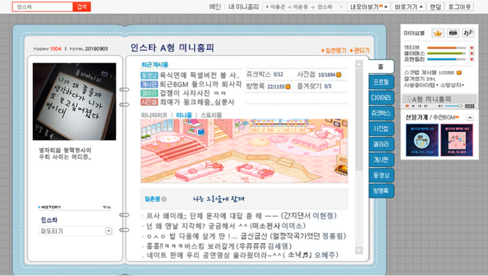

---
categories:
  - life-thoughts/opinions-is-my-own
date: 2024-06-17
description: "Some people will recognize the image above, while others won’t know what it is. Anyone born in the 1990s probably knows it: Cyworld, the Korean social platform that came before Instagram, Facebook, Twitter, and Threads…"
lang: en
last_updated: 2026-11-14
naver_date: 2026-09-26
naver_url: https://blog.naver.com/martin-lee/224422162931
tags:
  - daily-life-and-thoughts
title: Knowing Myself
translation_key: 2024-06-17-knowing-myself
---

※ This post was carried over when I moved my blog. (Originally written: June 17, 2024, 20:02)

Cyworld

Some people will recognize the image above, while others won't know what it is. Anyone born in the 1990s probably knows it: it's Cyworld. It was a Korean social networking platform that existed before today's Instagram, Facebook, Twitter, and Threads. Although the service ended in 2015, it was hugely popular with teenagers at the time. People uploaded selfies to the photo albums on their personal mini-homepages and enjoyed becoming "ilchon"—close online friends—with their real-life friends. Background music, best friends, falling-outs, the ulzzang era of internet-famous faces, "100 Questions, 100 Answers"—there are so many memories.

"100 Questions, 100 Answers" was a way to introduce yourself, and many people filled it out as a standard part of their profile. Actually doing it took quite a while and could be a bit of a chore. But finishing it felt satisfying, almost as though a distinct sense of self had emerged. Now that I'm an adult, there are times when I can't immediately say what I like or dislike. Sometimes I even question whether the hobbies and skills I list on my résumé are things I truly enjoy and do well. That made me wonder: do I really know myself?

I think the act of writing posts while running my Tistory blog helps me understand myself. On the bus today, it occurred to me that I may have simply adopted other people's dislikes from the internet. I hadn't actually experienced those things; it felt as though I'd been living under the influence of what other people said they hated. As I was thinking about what I disliked, someone bumped into me while passing by. At that moment, I felt annoyed: why don't people wear their backpacks on their fronts on packed public transport?

Now, if someone asks what kinds of behavior I dislike, I can answer confidently and explain a situation I actually experienced. I've been putting a lot of effort into understanding myself lately. These days I say more and spend more time online than out in the world, and I feel that a lack of experience weakens the reasoning behind my words. Sometimes I wonder, "What am I even trying to say?" Things we learn without emotion don't last. Whatever we do, we need to remember what we're feeling in the moment and put it into action. That's one way to know ourselves.

If I can define success as the process of getting to know myself, I think I could become a truly happy person.
