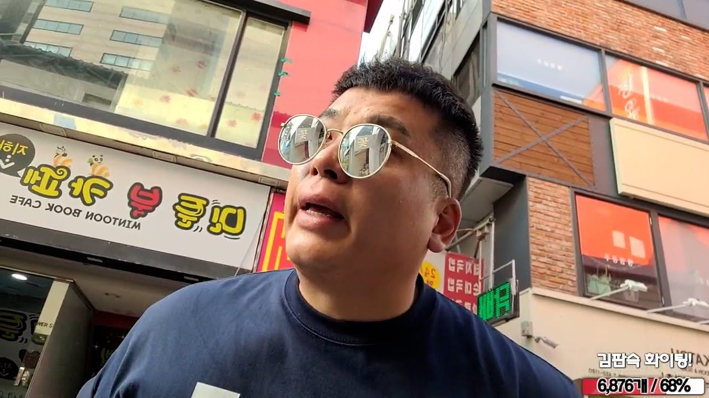

---
categories:
  - life-thoughts/opinions-is-my-own
date: 2024-06-20
description: By “around you,” I mean friends, a spouse, family, and colleagues alike.
lang: en
last_updated: 2026-11-14
naver_date: 2026-09-26
naver_url: https://blog.naver.com/martin-lee/224422162443
tags:
  - daily-life-and-thoughts
title: A Life Without These People Around You Is Already a Success
translation_key: 2024-06-20-people-around-us
---

※ This post was carried over when I moved my blog. (Originally written: June 20, 2024, 23:52)

Excuse me?

An incredibly obvious point.

By "around you," I mean friends, a spouse, family, and colleagues alike.

The first kind of person who really drains you is **someone who meddles in and obsesses over every little detail of your business or other people's business**.

You can tolerate a few small instances and talk to them, but if they spend more time talking about other people than themselves, there's a good chance they're an empty shell.

People wired this way tend to make everything into gossip rather than speak sincerely,

so if you seriously open up about your life, there's a very strong chance they'll talk about you behind your back elsewhere.

The second kind is **someone trapped in their own world**.

[Byun Hee-jae a spy? Taegukgi rally supporters reassess Byun Hee-jae #shorts](https://www.youtube.com/watch?v=Kk4Fxrehaqo)

I had to include this video because it's such a textbook example...

As you can see in the video, you simply cannot have a person-to-person conversation with **someone who is ignorant but full of conviction**.

The last kind is **someone who sees everything negatively**.

Whatever you say, they pretend to be cool-headed and respond with, "To do that, you'd have to...", "Wouldn't you need to do ... first?", or "I think you'd need..."

They've never actually done anything themselves. They're no different from armchair experts who only know how to give unsolicited advice online.

Talking with these people only chips away at your self-esteem and puts you in a bad mood, so don't get involved with them.

It might also be worth reading this and asking whether you fall into one of these categories yourself.

It seems obvious once you've read it, but most people don't realize these are harmful ways of speaking and behaving.

That's why, as the person speaking, you can preserve a relationship by being careful about how you talk in the first place.

Specifically: don't be the first to bring things up.

This is a method I've verified through years of experience.

Generally, it's easier on your peace of mind to be the listener and respond along with the other person.

And finally, here's the most important part.

This applies online, to your parents, and even to your closest friends.

Never be the first to tell someone about your plans.
