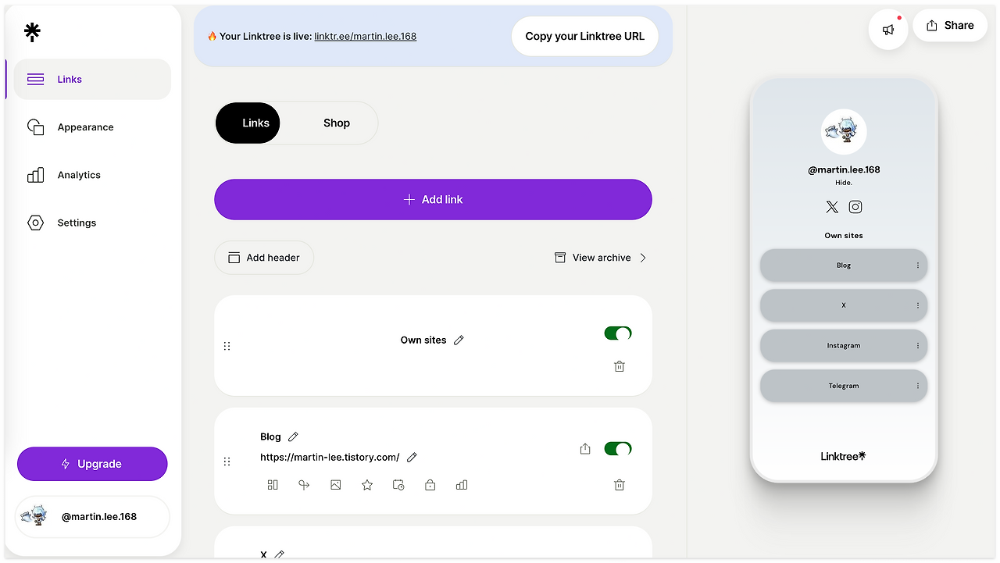

---
categories:
  - life-thoughts/opinions-is-my-own
date: 2024-06-27
description: As we all know, AI technology is developing incredibly fast. Outside certain fields, it is already producing better results than people. Some are earning money with AI, while others are losing their jobs. To survive in this era…
lang: en
last_updated: 2026-11-14
naver_date: 2026-09-26
naver_url: https://blog.naver.com/martin-lee/224422161716
tags:
  - daily-life-and-thoughts
title: An Essential Tool in an Age of Personal Branding
translation_key: 2024-06-27-personal-branding
---

※ This post was carried over when I moved my blog. (Originally written: June 27, 2024, 12:25)

As we all know, AI technology is developing incredibly fast. Outside certain fields, it is already producing better results than people. Some are earning money with AI, while others are losing their jobs. To survive in this era, the most important thing is **personal branding** that increases your individual value.

And a blog is one of the most suitable ways to build a personal brand. What seems to me to be the one real upside of advancing AI technology is that **you can become whatever you want to be in the online world**. You can become a writer by writing, compose music without having studied it, and now even become a model without showing your face. In a way, it's frightening, but giving everyone internet access is almost like giving everyone an equal opportunity. **In other words, we can now create another self in the online world, separate from who we are in real life.** If the past was an era when searching mattered, we have now entered an era of figuring out how to use our thoughts.

The best approach is to make yourself known across different platforms. You should maximize your exposure through blogs, YouTube, Twitter, Instagram, your own page, and other sites. But how should you present all those different sites? That's where [**Linktree**](https://linktr.ee/) comes in.

Its biggest advantage is that anyone can sign up and easily create one **for free**. You can probably put it together in under 15 minutes. Then just add the Linktree address you've created to the bio sections of the profiles you manage, and you're done.
