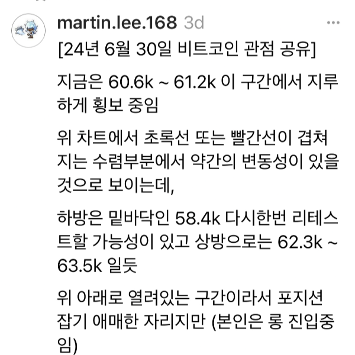
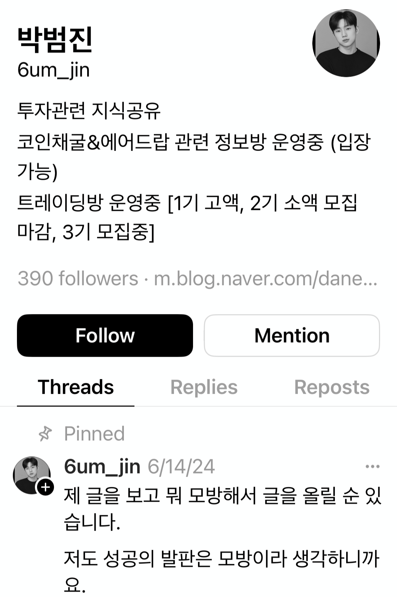
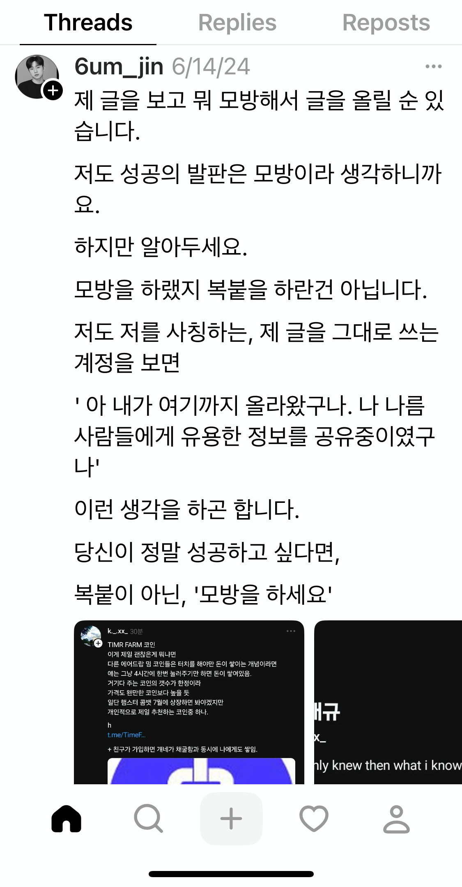
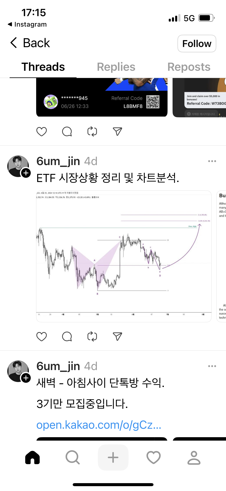
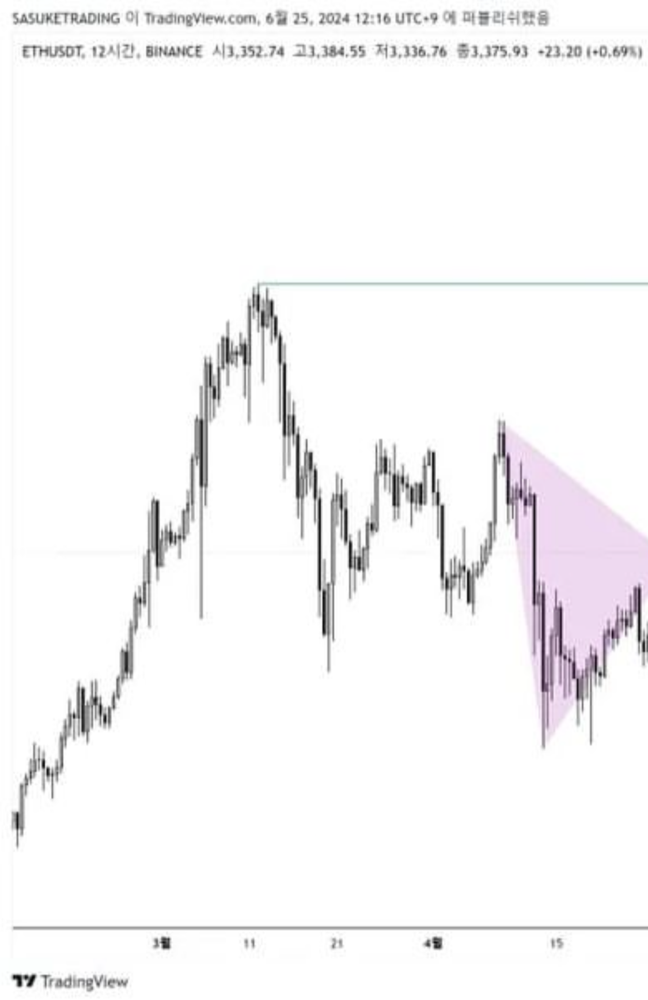
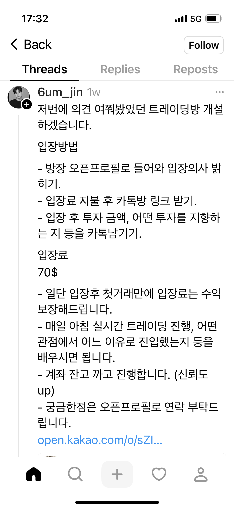

---
categories:
  - life-thoughts/opinions-is-my-own
date: 2024-07-03
description: To survive in an unforgiving Korea, you have to watch out for scams that could happen anytime and anywhere.
lang: en
last_updated: 2026-11-14
naver_date: 2026-09-26
naver_url: https://blog.naver.com/martin-lee/224422160826
pinned: true
tags:
  - daily-life-and-thoughts
title: Beware of Scammers, Anytime and Anywhere
translation_key: beware-of-scammers
---

※ This post was carried over when I moved my blog. (Originally written: July 3, 2024, 17:49)

---

To survive in an unforgiving Korea, you have to watch out for scams that could happen anytime and anywhere.

<figure data-image-caption="true"><figcaption><a rel="noopener noreferrer" href="https://www.newsis.com/view/NISX20240701_0002794401">https://www.newsis.com/view/NISX20240701_0002794401</a></figcaption></figure>

All kinds of incidents happen everywhere, every day,

but I think the issue making headlines lately is jeonse fraud involving large housing deposits.

It's especially heartbreaking because most of the victims are young people just starting their working lives.

Some landlords—the people renting out the homes—even claim it was an accident or disaster, not fraud. I found that pretty absurd.

I think jeonse fraud is a somewhat special case,

and because scammers approach you with a plan from the beginning, you can still fall victim even if you're on guard. Voice phishing is a typical example.

So there are two things worth remembering to protect yourself from scams.

## **1\. Be wary of people who are especially nice to you when you've just met.**

On that subject, I once heard that there's only a paper-thin line between a scammer and a businessperson.

## **2\. If they follow through on what they say, they're a businessperson. If they ultimately fail to keep their word, they're a scammer.**

Recently, I joined the social platform Threads to bring traffic to my blog and began posting summaries of my articles.

I saw lots of people I'd never come across on Twitter or Telegram before,

and just as I was thinking, "There really are a lot of skilled people out there,"

I found an account that seemed like a scammer's.

This industry already has a reputation for being full of scammers,

and I thought accounts like this would only reinforce that impression, so I'm writing this to leave a permanent record on my blog.

They had been posting screenshots boasting of profits on Threads and charging people to enter their open KakaoTalk chatroom.

6/14 — Called out an impersonator and declared, "Imitate, don't copy and paste."

6/25 — Posted an ETF market overview and chart analysis, but the chart had been stolen from a trader named SASUKE.

6/30 — When caught, they blocked the person who confronted them and deleted the post, perhaps out of embarrassment.

This is someone who doesn't know how to keep their own word.

Therefore, they're a scammer.

Even if they aren't a scammer yet, they're well on their way to becoming a textbook example.

If it was a misunderstanding, clear it up. If you did something wrong, say you're sorry.

You only have to say it once, but scammers seem to find that difficult because of their needless pride.

1.  Screenshots proving profits can all be fabricated, so don't be dazzled into trusting them too much.

2.  Even if there are plenty of testimonials from followers, those can all be fabricated too, so don't trust them.

3.  There is absolutely no magical technique that instantly puts you in the fast lane to wealth.
