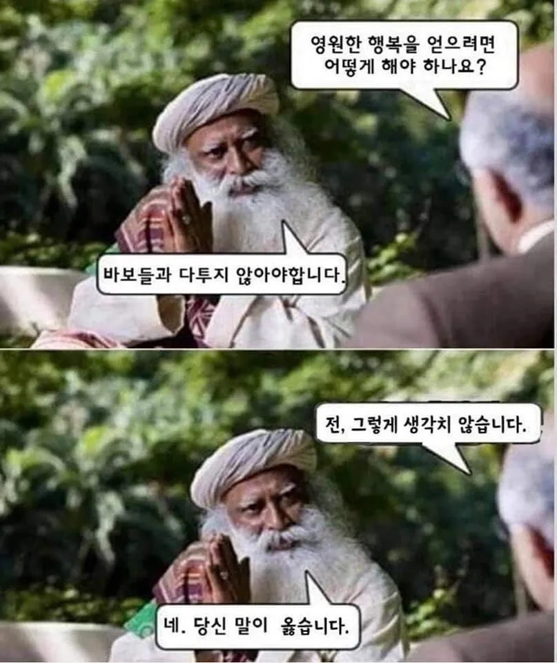
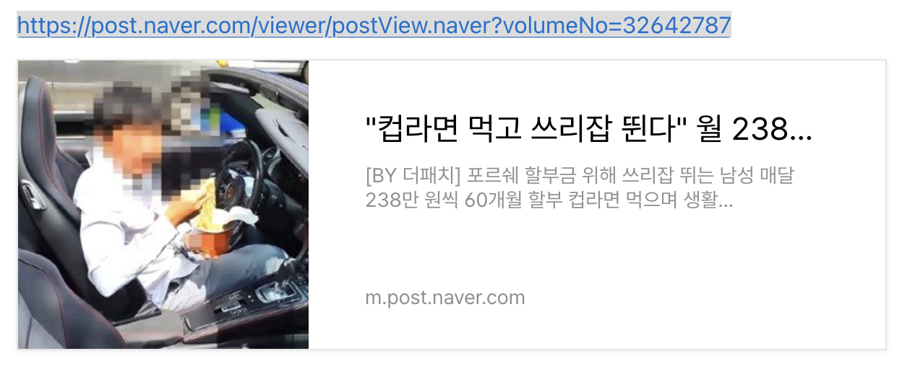

---
categories:
  - life-thoughts/opinions-is-my-own
date: 2024-07-09
description: Money isn’t everything in life. And listening to various wealthy people, it seems that having a lot of it doesn’t necessarily make you happy.
lang: en
last_updated: 2026-11-14
naver_date: 2026-09-26
naver_url: https://blog.naver.com/martin-lee/224422158599
tags:
  - daily-life-and-thoughts
title: When You Shouldn’t Scrimp
translation_key: 2024-07-09-when-to-spend
---

※ This post was carried over when I moved my blog. (Originally written: July 9, 2024, 12:50)

Money isn't everything in life. And listening to various wealthy people, it seems that having a lot of it doesn't necessarily make you happy.

Still, one definite advantage of having money is that it gives you more choices.

We've all probably had the experience of wanting to buy something and thinking, '**Ah... I'd rather buy B than A, but I don't have the money...**'

It feels as though money would solve everything, but because we don't have it right now, we want to use what we do have as efficiently as possible.

Yet there are moments in life when we shouldn't scrimp.

They involve things inseparable from our lives and closely tied to money: what we commonly call **clothing, food, and shelter**.

They're all important, but food is one area people quietly tend to neglect.

Personally, I don't think we should judge what we eat solely by how much we get for our money.

[https://post.naver.com/viewer/postView.naver?volumeNo=32642787](https://post.naver.com/viewer/postView.naver?volumeNo=32642787)

In Korea's entrenched culture of showing off, there are young people who can't afford a home but drive sports cars while eating convenience-store food every day.

I think this is another bad habit created by Instagram.

For starters, I really dislike the culture of showing off. Cars, watches, and things like that are luxuries, and you can live perfectly well without them.

Anyway, saying not to judge food solely by value for money doesn't mean I'm telling you not to visit omakase or Michelin-starred restaurants to take photos.

Places like omakase and Michelin restaurants are expensive partly because of the atmosphere, but also because they operate by reservation and use fresh, high-quality ingredients.

These days, with Coupang Rocket Fresh deliveries working so well and recipes available for anything you search on YouTube, cooking for yourself is the healthiest way to eat—as long as you can be bothered.

People today are said to enjoy eating out because cooking and cleaning up take so much time.

And as inflation pushes restaurant prices higher, people increasingly look for cheap options, including frozen food and inexpensive eateries.

Food goes directly into our bodies, so it is directly connected to our health.

[https://www.mk.co.kr/news/society/11060486](https://www.mk.co.kr/news/society/11060486)

[Suspected food poisoning affects over 1,000 people at 24 schools… Kimchi throws Namwon into turmoil — Maeil Business Newspaper](https://www.mk.co.kr/news/society/11060486)

If you walk into a restaurant and its hygiene looks questionable, I recommend getting out without looking back...

This seems especially, especially important in summer.

**Conclusion: Don't scrimp on what you eat.**
