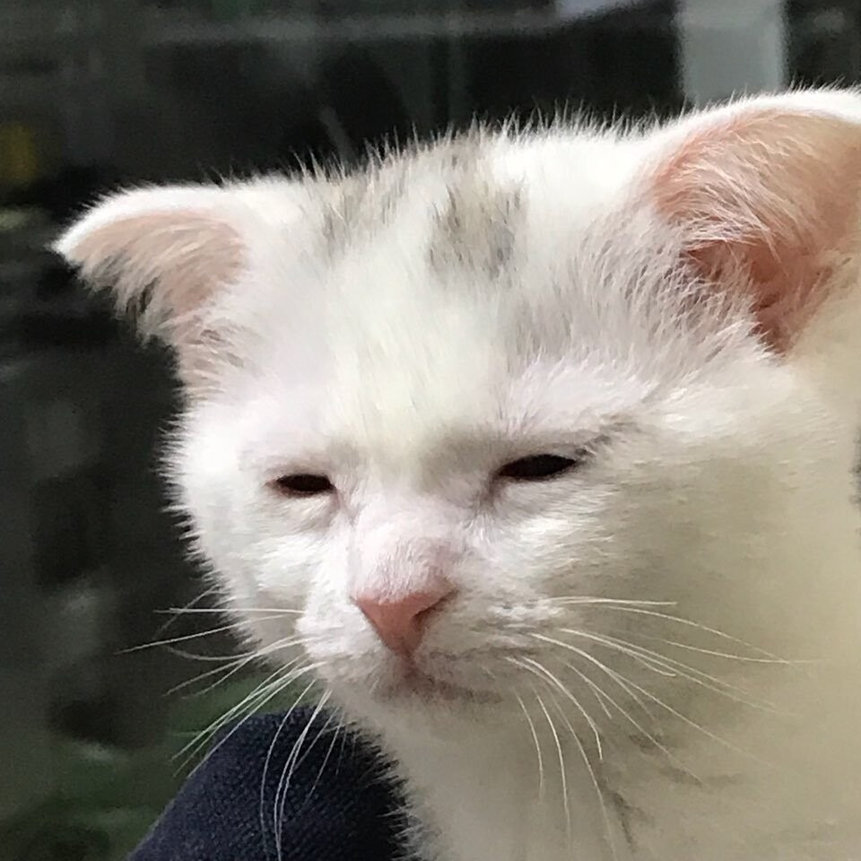

---
categories:
  - life-thoughts/opinions-is-my-own
date: 2024-07-13
description: I bite my nails when I’m anxious. It’s a childhood habit I still haven’t broken—or perhaps haven’t actively tried to break. The saying that a habit learned at three lasts until eighty came to mind, and from this moment on, I want to change my bad habits…
lang: en
last_updated: 2026-11-14
naver_date: 2026-09-26
naver_url: https://blog.naver.com/martin-lee/224422164877
tags:
  - daily-life-and-thoughts
title: Small Things Add Up to Something Big
translation_key: 2024-07-13-small-things-add-up
---

※ This post was carried over when I moved my blog. (Originally written: July 13, 2024, 00:16)

I bite my nails when I'm anxious. It's a habit I've had since childhood, and I still haven't broken it. No—come to think of it, I don't think I've even actively tried. The saying that a habit learned at three lasts until eighty popped into my head, and from the moment I write this, I want to start changing my bad habits.

1\. My actions and thoughts come from who I was in the past. If I stayed up all last night, I'll be tired today. The reason I can't speak English properly now is that I didn't study it ten years ago. This isn't about assigning blame for what I didn't do or can't do. It's simply that I can't do it because I haven't done it.

2\. Biting my nails, crossing my legs when I sit, lying down as soon as I get home, immediately opening social media on public transport—these unconscious behaviors shape me. Why do these bad habits keep staying with me? Because even though I knew they were bad, I didn't make an effort to change them. Without that effort, they became ingrained and remained unconscious habits.

3\. Things we do unconsciously don't consume emotional energy. Emotion will be one of the last uniquely human forms of dignity left in the AI era. That's why we should live with gratitude for being able to feel emotions at all.

4\. We also need to notice the small emotions that come from small actions. Instead of expecting myself to know two things tomorrow because I learned one today, if I thank myself for making it possible to learn that one thing today, I'll unconsciously keep doing something consistently and eventually reach a hundred.

5\. You can't start at a hundred from the beginning.

6\. Small things add up to something big.
