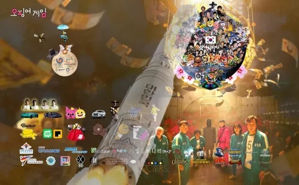
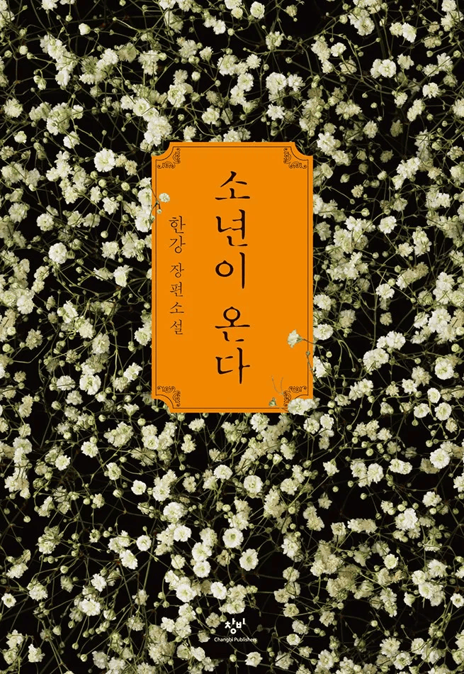
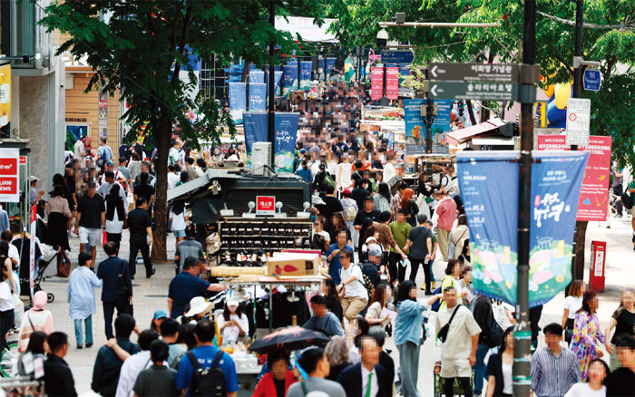
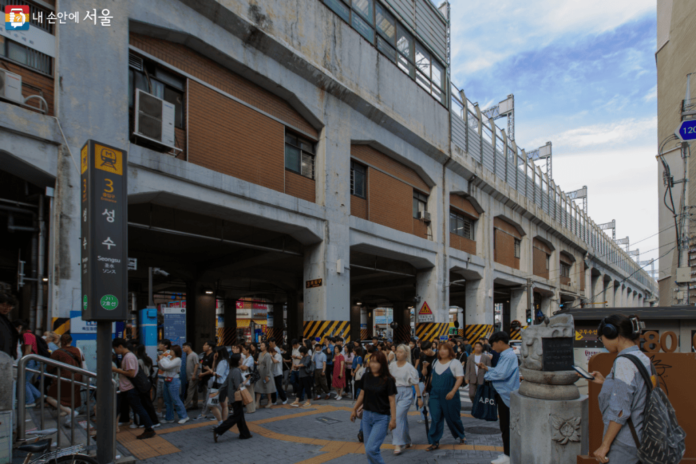
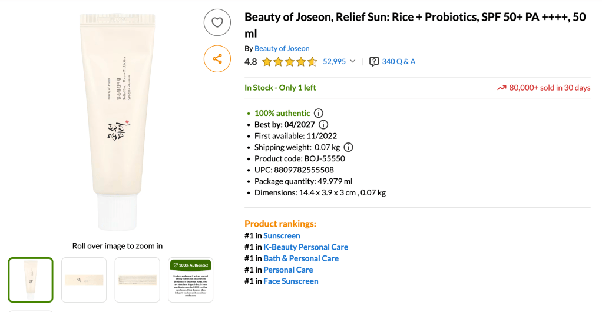
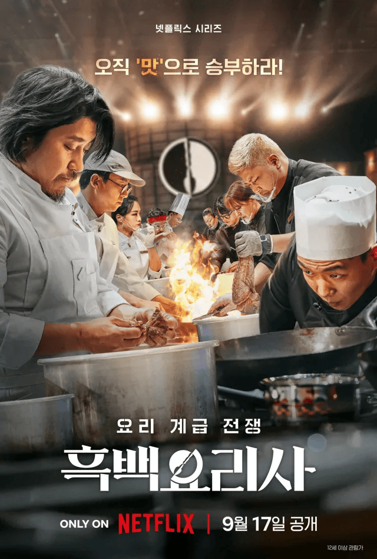
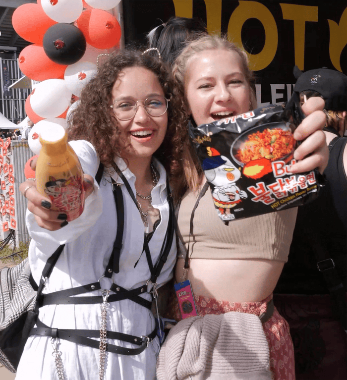

---
categories:
  - life-thoughts/opinions-is-my-own
date: 2024-10-23
description: The image above brings together people and works that have introduced Korea to the world and, as we say, enhanced its national prestige. We often call this the “Do You Know Club,” a meme about figures foreigners recognize when asked “Do you know Korea?”…
lang: en
last_updated: 2026-11-14
naver_date: 2026-10-10
naver_url: https://blog.naver.com/martin-lee/224436714750
tags:
  - daily-life-and-thoughts
title: Do You Know Korea?
translation_key: 2024-10-23-do-you-know-korea
---

※ This post was carried over when I moved my blog. (Originally written: October 23, 2024)

**The Do You Know Club**

The image above brings together people and works that have introduced Korea to the world and, as we say, enhanced its national prestige. We often call this the "Do You Know Club." It began as a meme: people who raised Korea's profile enough for foreigners to recognize it when asked "Do you know Korea?" should be inducted into the **Do You Know Club**. At first, most members were world-famous athletes such as Park Ji-sung and Kim Yuna, but now it includes many idols and artists, including PSY and BTS.

In the past, global events held every four years, such as the Olympics and the World Cup, were the main stages for bringing honor to the country. The state would offer benefits such as prize money to citizens who achieved that. These days, however, there are more ways to raise Korea's standing beyond traditional sports, including esports, television dramas, and music. This has sparked controversy over special military-service treatment. The principles and criteria for enhancing national prestige are ambiguous, and the concept has lost much of its old meaning.

In fact, many Koreans are making Korea known across a wide range of fields, and articles about international recognition for Korea have been appearing frequently. In this post, let's look at some representative examples.

**K-Literature**

Recently, news that Korean author Han Kang had won the Nobel Prize in Literature came as a major surprise to many people. It was especially meaningful as the second Nobel Prize awarded to a Korean, after the Peace Prize, and Korea's first Nobel Prize in Literature. It was also the first award to an Asian in the literature category. Han Kang's Nobel-winning work, "Human Acts," sold out around the world and has attracted great interest among readers both in Korea and abroad.

Yet before she won the Nobel Prize, some people claimed her work contained historical distortions, and the book was even designated harmful reading. Her winning the Nobel Prize despite that surprised many and demonstrated that Korean literature had received recognition overseas.

There have recently been frequent reports about declining reading among Koreans. Against that backdrop, the Nobel news rekindled people's desire to read. Receiving such an award in the month of Hangeul Day, and in autumn—a good season for reading—made it all the more meaningful.

**K-POP**

Two days ago, Rosé released "[APT](https://www.youtube.com/watch?v=ekr2nIex040)," a new collaboration with Bruno Mars. It is Rosé's first solo song since BLACKPINK disbanded, and it has attracted enormous attention, reaching 40 million YouTube views within two days of its release. (At the time of writing, it is approaching 100 million views.) Just three months earlier, Bruno Mars worked with Lady Gaga on "[Die With A Smile](https://www.youtube.com/watch?v=kPa7bsKwL-c)," which is currently at No. 5 on the Billboard chart and receiving a lot of love. Bruno Mars has also produced enduring hits such as "Uptown Funk" and "Nothin' On You," and is popular worldwide as a singer representing South America. I think a singer at that level collaborating with a Korean idol shows just how much the standing of K-pop culture has grown.

I see this as the result of Korean idol culture, which began in the 1990s, being refined over time. People often say we are now in the fourth generation of Korean idols, and today's idols in particular are collaborating with global pop stars. Examples include SEVENTEEN and DJ Khaled, BTS and Coldplay, BLACKPINK and Selena Gomez, and BTS's Jungkook and Charlie Puth. These artists' fandoms extend around the world, and the entertainment industry is making the greatest contribution to promoting Korea.

**K-Beauty**

K-pop and Korean dramas have captured the hearts of many overseas fans, and beauty and fashion have probably benefited the most. You can see this in the destinations foreign tourists frequent. If I had to name the streets most visited by foreigners since COVID-19, I'd choose Myeongdong and Seongsu-dong. Myeongdong, packed with cosmetics stores, and Seongsu-dong, now called the leading fashion district among young people, have become their favorite hot spots.

Also, iHerb, the online store where people can buy supplements and health foods directly from overseas, has a "K-Beauty" category. Sunscreen from the Korean cosmetics brand Beauty of Joseon is a bestseller there. A YouTube search easily turns up videos of foreigners reviewing these products.

Meanwhile, plastic surgery is attracting considerable attention as well. The number of foreigners visiting Korea for cosmetic procedures has risen sharply, and brokers helping arrange surgery trips have reportedly emerged. Korean plastic-surgery techniques have thus become widely known overseas and are helping shape Korea's image.

**K-Food**

"Culinary Class Wars," one of the most popular series on Netflix these days, features a variety of chefs competing in cooking challenges. (Although I haven't watched it yet,) the program presents not just Korean food but a range of dishes reflecting each chef's personality. Chef Jung Ji-sun's baisi, showcased as part of her Chinese cooking, drew great interest even among Chinese viewers. Some tourists reportedly come from overseas to visit restaurants run by chefs who appeared on the show.

Spicy-food challenges have also become popular among young people through social media, and Buldak spicy noodles have been a major hit overseas. There's a strong impression that Koreans handle spicy food well, probably stemming from bright-red kimchi. An indispensable part of the Korean table, kimchi is soul food for Koreans and one of the first Korean foods foreigners think of. "Do you know kimchi?" used to be a common opening when introducing Korea, but perceptions have changed so much that the phrase now feels a little dated.

**Conclusion**

**So far, we've looked at Korea's K-culture. From the examples above alone, it is clear that the world recognizes Koreans. Yet we call our own country "Hell Joseon."** How ironic. Seen through foreigners' eyes, Korea is clearly a very good place to live. But many online communities are full of people saying Korea has no future, casually claiming that "the smarter you are, the sooner you leave Korea," encouraging emigration or international marriage, and busily tearing one another down. When did it become like this? I don't know why, but it isn't a situation where we can simply blame someone.

I remember residents gathering in our apartment complex to cheer during the 2002 World Cup when I was young, and the entire complex erupting in a simultaneous roar whenever a goal was scored. Today, however, people react sensitively even to small noises such as dogs barking or babies walking, and complaints about noise between apartments are frequent. In elementary school, I learned to care for vulnerable people such as older adults, people with disabilities, and pregnant women. Now I feel not only that respect for older people is disappearing, but that attitudes are turning toward dismissing them or treating them with hostility.

Although I haven't lived all that long, comparing Korea now with just twenty years ago shows how rapidly it has changed. Individual dispositions, daily habits, spending patterns, and even culture have all shifted. Whether these changes are positive or negative depends, I think, on each person's interpretation. Many things may change in the future too, but when we don't even know what tomorrow will bring, predicting Korea twenty years from now is incredibly difficult.

Still, if there is one thing that does not change amid this upheaval, it is the fact that we are Korean. Being Korean is an inherent characteristic we naturally acquire at birth and cannot change. From that perspective, I hope we at least hold on to our pride in being Korean. In Korea, being Korean may seem extremely common and ordinary, but broaden your view to a global perspective and Koreans are a minority ethnic group with influence far greater than the size of their small territory.

So I hope we no longer feel ashamed of being Korean. **I hope we refrain from living in Korea while insulting it, which is like lying on your back and spitting upward. At least while reading this post, I hope you felt a surge of national pride.**
