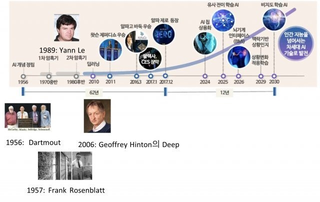

---
categories:
  - life-thoughts/opinions-is-my-own
date: 2024-11-12
description: While browsing the web today, I happened to read an interesting post. Many people have already discussed similar themes, but every new version of ChatGPT brings predictions of jobs being replaced and makes countless workers afraid…
lang: en
last_updated: 2026-11-14
naver_date: 2026-10-10
naver_url: https://blog.naver.com/martin-lee/224436713313
tags:
  - daily-life-and-thoughts
title: No Matter How Far Artificial Intelligence Advances
translation_key: 2024-11-12-even-as-ai-advances
---

※ This post was carried over when I moved my blog. (Originally written: November 12, 2024)

While browsing the web today, I happened to read an [<u>interesting post</u>](https://opensea.kr/%ec%95%84%eb%ac%b4%eb%a6%ac-%ec%9d%b8%ea%b3%b5%ec%a7%80%eb%8a%a5%ec%9d%b4-%eb%b0%9c%ec%a0%84%ed%95%9c%eb%8b%a4%ea%b3%a0-%ed%95%b4%eb%8f%84/). Many people have probably already discussed similar themes over and over. It may feel repetitive, but every new version of ChatGPT brings claims that it will replace many occupations, leaving countless workers afraid. It is an unfortunate reality, but one we have to accept.

[\[AI for Everyone\] Part 1 — The Past and Present of Artificial Intelligence, Now Well Past Sixty (The Dong-A Ilbo)](https://www.donga.com/news/It/article/all/20220608/113851410/1)

The concept and term "artificial intelligence" were established about 68 years ago, but I think the arrival of ChatGPT opened the AI era. We are living through the transition from the information age to the age of artificial intelligence. I don't know what the atmosphere was like during the dot-com bubble or the first arrival of smartphones, but I imagine now might feel similar.

I think AI will naturally become part of our lives, and it is already used in many aspects of everyday life. Recently, I called a bank's customer service center, and an AI agent was handling the work. Even a visit to a café or restaurant shows how common it has become to order through a kiosk rather than a person. To survive in a rapidly changing era, we also need the ability to adapt quickly.

The ultimate goal of every technological advance is to improve human quality of life, and most inventions can be understood as extensions of the human body. AI has begun entering the domain of the brain, where we think, and is trying to reach into the heart as well. In other words, as time passes, machines may be able to replace every physical activity humans can perform. Simple labor and repetitive tasks will be the easiest to replace first. Personally, I think even professions such as doctors, judges, and lawyers could someday be replaced by AI.

Even so, as the title of this post suggests, if there are areas that AI can never reach no matter how far it advances, they are responsibility, ethics, and curiosity. Believing in what we cannot see, imagining it, and creating it are uniquely human abilities.
