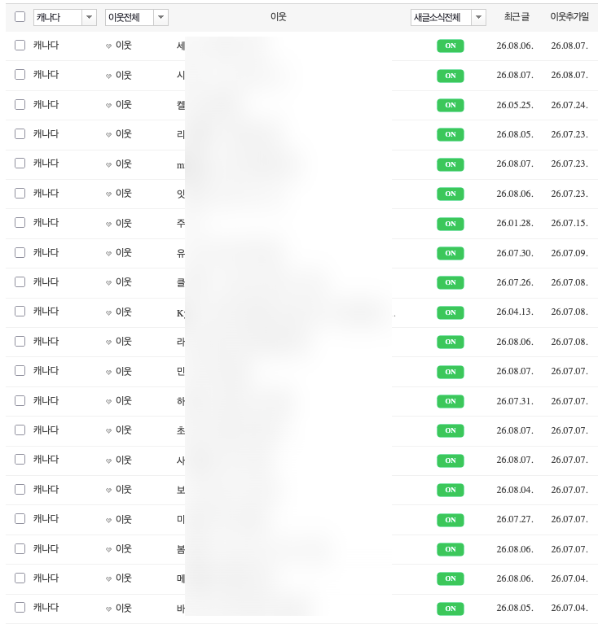

---
categories:
  - life-thoughts/opinions-is-my-own
date: 2026-08-07
description: People say Naver Blog is dead, but more people still use it than you might expect.
lang: en
last_updated: 2026-11-14
naver_date: 2026-08-07
naver_url: https://blog.naver.com/martin-lee/224371056466
tags:
  - daily-life-and-thoughts
title: Is Naver Blog Dead in 2026?
translation_key: 2026-08-07-naver-blog-in-2026
---

**People say Naver Blog is dead, but more people still use it than you might expect.**

With the arrival of AI, Naver bloggers are losing their place.

For most searches, people increasingly prefer ChatGPT over Naver,

and even the people writing posts sometimes publish AI-generated text exactly as it is.

Then what position will Naver Blog move into in the future?

Traditionally, Naver search displayed a mix of ads, blog posts, and posts from its online cafés.

Because results were shown according to Naver's search rankings, advertising posts were mixed in and credibility suffered.

Going forward, I wonder whether Naver's own AI search feature, Naver Mate, will be used to surface more closely relevant information.

At some point, my profile started showing how often my posts had been cited.

I haven't written many posts, so I wonder where on earth they're being cited. The number was surprisingly high.

In other words, AI is evaluating blog posts and deciding which ones to show.

The key point is that this isn't a popularity ranking.

It sounded to me as though my posts could be cited even if I'm not a power blogger.

Nobody is likely to be curious about rambling everyday posts or diary entries like this one.

In the end, all we can do is write thoughtfully about things people want to know and hope AI delivers our posts to them well.

There are several blogs I've been reading lately, and their authors seem to keep writing without particularly thinking about money.

I think doing anything consistently is the hardest part, and in that sense I find those people impressive.

People on working holidays in Canada or living abroad seem to start blogs and YouTube channels quite often, perhaps because they have more free time and breathing room.

It's good for keeping records and building a habit, so I don't see a downside.

In my case, I put them in a group, add them as blog neighbors, and occasionally peek in.

I get to see how people in similar circumstances live, sometimes reflect on myself, and find travel destinations, restaurants, and useful tips.

Most people try to get information only from particular cafés or online communities, but I think Naver Blog is actually more of a treasure trove and often gets news faster.

So my conclusion is: **don't think it's too late to start a Naver blog. I'd encourage you to start right now.**
