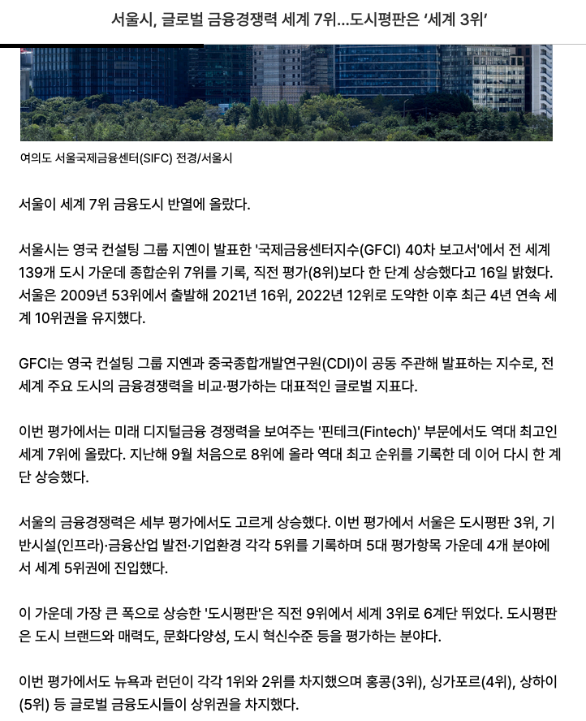

---
categories:
  - life-thoughts/opinions-is-my-own
date: 2026-09-19
description: Living in Vancouver, which has a relatively large Korean population even by Canadian standards…
lang: en
last_updated: 2026-11-14
naver_date: 2026-09-19
naver_url: https://blog.naver.com/martin-lee/224416632195
tags:
  - daily-life-and-thoughts
title: "[Notice] Why Overseas Koreans Complain So Damn Much About Korea"
translation_key: 2026-09-19-korean-diaspora-and-korea
---

[https://faceeast.substack.com/p/5a8?r=4iguvd&utm\_campaign=post-expanded-share&utm\_medium=post%20viewer](https://faceeast.substack.com/p/5a8?r=4iguvd&utm_campaign=post-expanded-share&utm_medium=post%20viewer)

[Why Overseas Koreans Complain So Damn Much About Korea](https://faceeast.substack.com/p/5a8?r=4iguvd&utm_campaign=post-expanded-share&utm_medium=post%20viewer)

---

I wouldn't quite call myself a diaspora Korean, but...

This post really resonates with me.

Living in Vancouver, which has a relatively large Korean population even by Canadian standards,

I hear about Koreans behaving badly, and there's usually at least one Korean wherever I go. In many ways, it isn't that different from Korea.

All my news about Korea comes from stories posted in Korean community groups or on social media.

That's why life seems more peaceful if you stay away from Korean community forums as much as possible.

There's far too much unnecessary gossip.

At least writing your own thoughts on Naver Blog seems like the healthiest option.

Anyway, at a time like this, when Korea's international standing is rising, I think a strange mixture of emotions comes up.

There's the hope that choosing to live abroad was a better decision than staying in Korea. At the same time, I wonder, "Am I here for no reason?" or "Was my choice a mistake?" Some people really are considering moving back.

But we've already spent time here, and the prospect of going back to Korea and starting over is frightening. So I sometimes see people justify their choice by saying, "That's just how Korea is," "Korea is a hard place to live," or "Korea is still an old-fashioned society obsessed with age." Meanwhile, they deliberately look away from Canada's problems.

In Korea, when someone's thinking leans too far in one direction, people say they've become left-wing or right-wing. Looking at this, I sometimes joke that they've become Canada-wing.

I'm not trying to put Korea on a pedestal. Viewed objectively, it is unquestionably a very good country.

[https://www.asiatoday.co.kr/kn/view.php?key=20260916010006087](https://www.asiatoday.co.kr/kn/view.php?key=20260916010006087)

If you disagree, I wonder whether it's because you didn't live in Seoul.

Among people who immigrate to Vancouver, there seem to be far more from outside the Seoul–Gyeonggi area, so perhaps their view makes sense.

Of course, some came because they were exhausted from working endlessly and pushing themselves so hard in Korea, and wanted a more relaxed, family-centered life. Others wanted overseas experience. Whether people immigrated or moved for their own personal circumstances, or even as a form of escape, I think focusing on the present is the right and mature thing to do, whatever the reason.

We weren't dragged here against our will; we chose this country voluntarily. More than anything, it depends on our own mindset. I hope we take responsibility and live happily with a positive outlook. But rather than trying to feel superior by putting someone else down, let's give credit where it's due. If something is wrong, we should say it's wrong.

Many people say they're living much better lives in Canada than they did in Korea. That's wonderful. It's something to congratulate them on. But people whose lives became worse can naturally return to Korea, so of course we don't see as many of them here.

It's difficult to admit that your judgment was wrong.

It seems to get harder as you get older.

That's stubbornness.

Every country has good and bad points, and the choices I've made can change at any time.

Coming to Canada doesn't mean I have to live here forever,

and returning to Korea doesn't mean I've failed.

If you were wrong, you can change course.

What we need more of as we age is principles, not stubbornness.

Keep your thinking flexible and your convictions firm.
