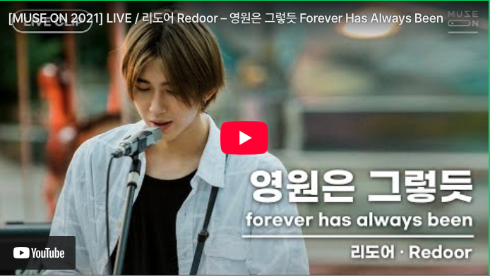

---
categories:
  - life-thoughts/opinions-is-my-own
date: 2026-10-09
description: Let me write down my personal thoughts on AI lately.
lang: en
last_updated: 2026-11-14
naver_date: 2026-10-09
naver_url: https://blog.naver.com/martin-lee/224435902708
tags:
  - daily-life-and-thoughts
title: Why Does It Feel Like This Moment Will Last Forever?
translation_key: 2026-10-09-will-this-moment-last
---

Maybe it will last forever.

[\[MUSE ON 2021\] LIVE / Redoor – Forever Has Always Been](https://youtu.be/JNy_pVfs6yQ?si=KWSnFYls6x1dQoWW)

Let me write down my personal thoughts on AI lately.

What computers do best is repetition. That thought hasn't changed.

The areas where AI is probably used most are writing, video editing, making songs, and vibe coding.

Previously, only people with expertise knew how to create content and use the tools, but AI has broken down that barrier. This means anyone can more easily become a developer, writer, creator, or director—or even try starting a business.

Professional domains such as law, medicine, and the judiciary still exist. I see that as the power of a license, and it shows why universities and qualifying exams matter. Even so, we've reached an era when these, too, could someday be replaced.

There are invisible connections among us, such as professional networks, personal connections, and closeness.

Beyond that, sometimes we look at someone and get an uneasy feeling. We call that intuition or a hunch.

Sight = seeing

Hearing = listening

Smell = smelling

Taste = tasting

Touch = touching

**We now need something beyond the five senses—something we might call a sixth sense.** AI will dominate activities involving sight and hearing. Through creative works that stimulate those senses, it reaches into our brains. Even my tastes are partly the result of algorithms. Lately, I feel put off when I see AI-generated writing and videos. But that isn't true of everything. As a dog owner, I can't easily scroll past a video featuring a cute dog.

For now, smell, taste, and touch still seem to be areas machines cannot replace. I have to experience those three senses myself. That's why I think we're in an era when experience matters more. But if we can someday experience them remotely and physically feel them, I wonder whether every human domain will be taken away.

The release of Meta's Muse and OpenAI's dot made me feel that we're entering a period when the way we use the web is changing. Honestly, AI can now handle most of what we do online. I suspect this latest AI update will bring more layoffs and fewer junior hires. I realized that the frightening thing about large companies is their ability to wipe out many other businesses at once.

Even so, what should we do?

Unless AI stops advancing, all we can do is retire or become liars.

If we don't voluntarily retire, our options are already set: promote things to people who still don't know this field, or prepare for whatever might happen.

As beneficiaries of the AI era, we need to keep following developments and race to become number one in some field that feels like a land grab. The moment something starts doing well, everyone rushes in and copies it. Then the trend changes in an instant. Nothing lasts forever, and we have to move quickly. That's all there is to it.

