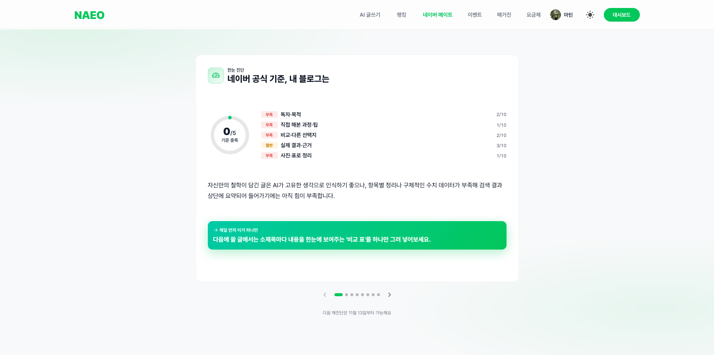
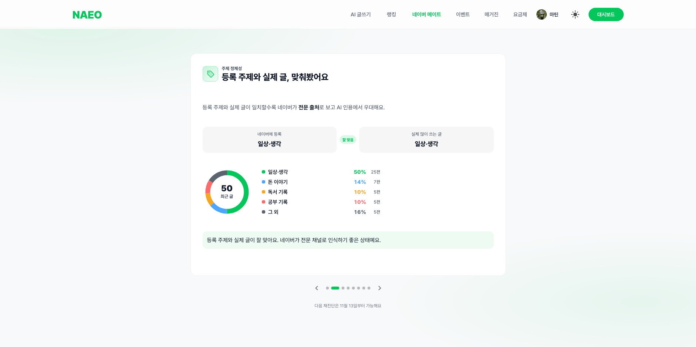
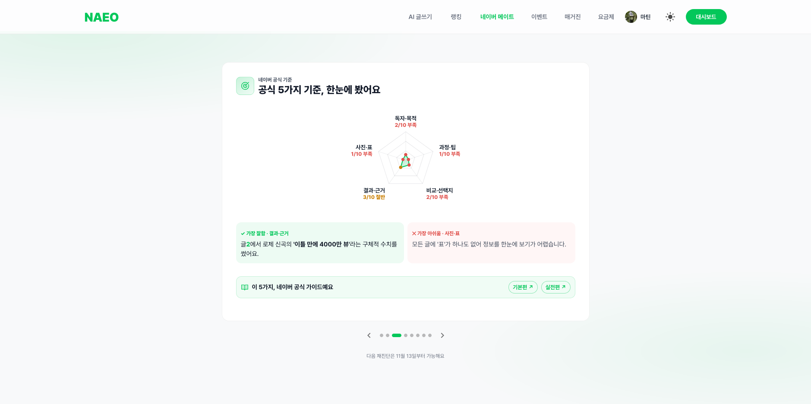
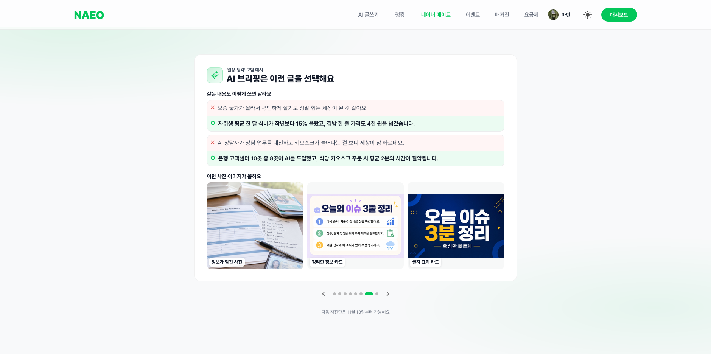

---
categories:
  - life-thoughts/opinions-is-my-own
date: 2026-10-14
description: Lately, I’ve been collecting posts scattered across different places and moving them to this blog. They were on Notion, WordPress, and Tistory. I also have posts on Facebook, but they feel different in nature, so I haven’t moved those…
lang: en
last_updated: 2026-11-14
naver_date: 2026-10-14
naver_url: https://blog.naver.com/martin-lee/224441008532
tags:
  - daily-life-and-thoughts
title: Why I Blog
translation_key: why-i-do-the-blog
---

<figure data-image-caption="true">
  
  <figcaption><a href="https://www.ogq.me/backgrounds/1514325">© CoolPubilcDomains, source: OGQ</a></figcaption>
</figure>

Lately, I've been collecting posts scattered across different places and moving them to this blog. They were on Notion, WordPress, and Tistory. I also have various posts on Facebook, but they feel different in nature, so I haven't moved those. Having used several blogging platforms, I've come to think Naver Blog is a reasonably good all-round option. (I don't know. Ultimately, I think having a blog of my own would be ideal... haha.)

Rereading my old posts as I moved them brought back a lot of feelings. I deleted an account at one point, so plenty of posts must have disappeared, but I probably first started blogging as a side hustle. Back when people said you could earn an extra 1 million won a month on Naver Blog, many bloggers got started for that reason, so most probably began much as I did. There was a period when I blogged diligently, but it didn't last long. I think I drifted through different blogging platforms, repeatedly shelving and reviving that dream of a million won a month.

**I can say with confidence that blogging offers more advantages than disadvantages. For starters, you get free storage.**

A blog is different from social media. Facebook and X have definitely helped me. My online activity led to offline connections, which helped me find work and build my reputation. I call it luck, but looking back, perhaps it wasn't. I can also say it happened because I posted publicly in public spaces and shared quality writing. That's why most of my posts are public, and I usually leave comments publicly too.

If social media is a place to exchange information and communicate, I see blogging as leaning more toward providing information in one direction. All I can do today, too, is hope the algorithm delivers my writing to someone. I don't know whether it's because Naver has become more advertising-focused or because there are more AI-written posts, but Naver Blog is increasingly commercialized and flooded with posts from fake accounts. Since introducing its "AI Briefing" feature, it has even been openly encouraging AI writing.

According to Naver's AI, NAEO, my blog falls below its standards. Apparently I wasn't chosen by Naver's AI... I imagine it gave me a low score because I mainly post personal thoughts rather than informative pieces, and because I focus on text rather than images. Its evaluation criteria include "organizing information with photos/tables" and "comparisons/alternative options," which make me wonder: aren't those things AI does better? What's more, the thumbnail images and tables it recommended are all mass-produced AI content. **It feels as though it's openly pressuring me to use AI to write useful posts, and I don't like that.**

We live in a time when AI even codes for us. Now, opening an IDE and writing code yourself seems old-fashioned and surprises people. Writing code by hand on paper has become something romantic. Perhaps someday writing blog posts yourself will seem old-fashioned too, and picking up a pen to write a diary will remain only as a romantic gesture. Maybe the only way to survive on a blog like this, and keep myself interested, is to use it more like social media. I should communicate more.

My interests are money, technology, and news from Canada.
