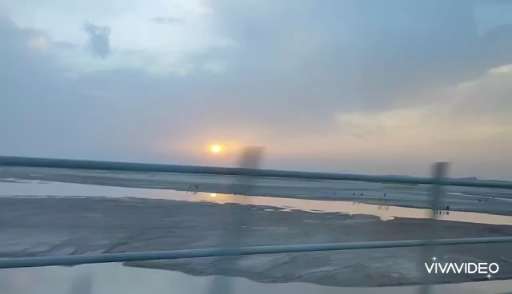

---
categories:
  - life-thoughts/retrospect
date: 2026-01-02
description: Everyone has been writing year-end reflections, so I thought I’d try one too… It’s been a very long time.
lang: en
last_updated: 2026-10-11
tags:
  - "#retrospect"
title: "2025: A Year in Review"
translation_key: 2025-a-year-in-review
---

Everyone has been writing year-end reflections, so I thought I'd try one too.

It's been a very long time since I wrote something like this.

---

## 1. Life Lately

To start with an update: as some of you know, I'm living in Canada now. It's already been nine months since my girlfriend and I came here. As always, I'm doing well.

In 2025, I spent more time overseas—two months in the Philippines and nine in Canada—than in Korea.

Everything was new and unfamiliar. Living with an uncertain immigration status made me anxious, but being exposed to new things and feeling a daily rush of dopamine may be why time passed especially quickly. It was a year full of varied experiences and plenty of opportunities to think.

Honestly, comparing life here with life in Korea, I'm not sure which is better. Looking at Korea from outside, I've come to feel that there are few places as good to live in. But perhaps because I have fewer people to compare myself with, I feel much more at ease mentally.

Personally, I like it here, but I also find myself worrying. I'm now thirty in international age. I still don't know whether interrupting the career I'd built in Korea to come to Canada and do something new was the right choice. What is certain is that this was a period when I made a major decision in my life.

## 2. Concerns

If you've only seen me on social media, my seemingly carefree life may look happy against the backdrop of Korea's unstable political situation. I simply don't express it much; inside, I live with a great many worries.

My career in blockchain ended in June 2024 and has remained on hold ever since. It's been quite a while since I wrote under the nickname I'd used for years, "Yona." In my mind, Yona is already dead. No—I killed that identity myself. Actually, I lost money in the Luna collapse, and perhaps it had already died then. Looking back again, I feel incredibly lucky that someone like me, who had simply been a crypto obsessive, got to enter and work in this industry.

Back then, I enjoyed everything about looking into blockchain, and before AI became as widely used as it is now, I thought blockchain was the future. I used to enjoy browsing overseas Twitter accounts and forums, but now I can just ask ChatGPT to translate or summarize everything, and some of the interest has faded. I'm grateful to live in such an amazing world, but I also have plenty to worry about. I think I've been more anxious and concerned about the future than ever before.

Even so, I'm trying to stay as positive as possible and feel grateful to the many people around me.

## 3. Looking Back

I've always gone through life feeling that I'm very ordinary and very lucky.

After coming to Canada, I reviewed my résumé. Looking over everything from the part-time jobs I'd had as a university student to my last company, I felt proud that I'd worked hard. Maybe that's also why I've adapted well here in Canada.

In particular, I first entered the blockchain industry thanks to Twitter (X), and I think Facebook helped me join my second company. I don't think my writing was especially good, so I'm deeply grateful that people saw it positively. I'm also very sorry that I may not have met their expectations or delivered the performance I should have, considering the time I spent there. As an aside, I don't particularly like social media. But it has brought me many opportunities and benefits, so I wonder whether I should make more effort with it going forward.

I think entering this industry as a researcher was a really good choice. It taught me the pleasure of activities that satisfy intellectual curiosity. If I'd realized that a little sooner, I might have done better at school, which leaves me with some regret.

## 4. Relationships

I have so much fun spending time with my girlfriend. She is my lifelong partner and also my fiancée. Because of that, I feel like I've forgotten what relationships outside of her even are. Honestly, perhaps I don't really feel the need for them.

In 2026, I should at least practice reaching out first to ask the people around me how they're doing.

## <strong>5. Plans for the Future</strong>

Health. It may be a clichéd New Year's goal, but lately I really feel the need to take care of it. In my twenties, my parents would greet me on the phone by asking whether I'd eaten. Since I entered my thirties, they've started urging me to go out and exercise as well. More than anything, health seems to matter most. I hope everyone around me stays healthy.

For me, 2025 marked the beginning of my thirties. When I wrote last year's reflection and looked back on my twenties, I wished, "I hope I keep being a lucky person." Perhaps that's why I was so lucky. I received an enormous amount of help from people around me after coming to Canada. Following my plans and going with the flow, I lived reasonably well. I can't rely on this luck forever, so I hope 2026 will be a year of growth in many different ways.

I wanted to write a clear, well-organized reflection like other people, but after finishing it, I realized it wasn't as easy as I'd expected. Still, I'm leaving this record so I can look back on it in 2027.
