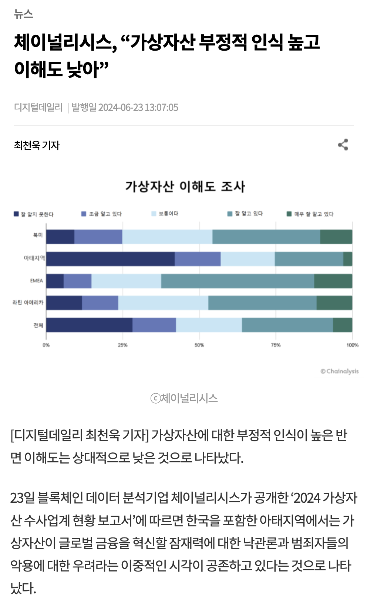

---
categories:
  - money-talk/business
date: 2024-06-28
description: In Korea, the public is probably still more familiar with the word crypto than blockchain. And when people hear crypto, the response is often, 'Isn’t that a scam?' That is both a problem and the reality of this market…
lang: en
last_updated: 2026-11-14
naver_date: 2026-09-25
naver_url: https://blog.naver.com/martin-lee/224422173418
tags:
  - Money Talk
title: What Does Korea Need to Revitalize Its Blockchain Industry?
translation_key: 2024-06-28-blockchain-industry-in-korea
---

In Korea, the public is probably still more familiar with the word crypto than blockchain. And when people hear “crypto,” the response is often, “Isn’t that a scam?” That is both a problem and the reality of this market. I imagine things are similar in other countries, too, although I have never been abroad, so I cannot say for sure.

While recently searching for information on the [Virtual Asset User Protection Act](https://martin-lee.tistory.com/entry/%EA%B0%80%EC%83%81%EC%9E%90%EC%82%B0-%EC%9D%B4%EC%9A%A9%EC%9E%90-%EB%B3%B4%ED%98%B8%EB%B2%95-%EC%82%B4%ED%8E%B4%EB%B3%B4%EA%B8%B0), I came across [articles about struggling exchanges shutting down one after another](https://www.dailian.co.kr/news/view/1377010/). Regulations are also being reviewed and advanced rapidly on several other fronts, including [suspending exchange reviews when major shareholders are under investigation](https://www.hankyung.com/article/2024062482161) and [banning relevant Ministry of Justice employees from holding crypto](https://www.hankyung.com/article/2024062480611). Quite literally, running a blockchain business in Korea has become more difficult. Personally, I see these government interventions as very positive measures that could help prevent events like FTX’s bankruptcy or the Mt. Gox hack.

[Crypto-only exchange closures accelerate… Qubit announces the end of its service](https://www.dailian.co.kr/news/view/1377010/%EC%BD%94%EC%9D%B8%EB%A7%88%EC%BC%93%EA%B1%B0%EB%9E%98%EC%86%8C-%ED%8F%90%EC%97%85-%EA%B0%80%EC%86%8D%ED%99%94%ED%81%90%EB%B9%84%ED%8A%B8-%EC%84%9C%EB%B9%84-2024)

There are various blockchain businesses in Korea today. To look at a few categories, exchanges are represented by the familiar big five: Upbit, Bithumb, Korbit, Coinone, and GOPAX. Exchanges and businesses managing virtual-asset operations are classified as virtual asset service providers and must comply with the revised Virtual Asset User Protection Act. Businesses outside that group, meanwhile, are generally classified under information and communications, specifically software development and supply. Blockchain networks are one example. Names representing Korea include Luna, which has unfortunately already fallen, Klaytn, Wemade, Finschia (formerly LINK), and others such as Orbit Chain and Kroma (WEMIX Canvas). I do not know exactly why, but once a project issues a coin, public perceptions often turn negative. By contrast, infrastructure—nodes—is an area with businesses that have remained relatively solid in Korea, earned global recognition, and continued operating steadily. DSRV, A41, and Cosmostation belong to this category. Marketing and research also seem to have endured. Xangle, DeSpread, Four Pillars, and Coinness come to mind. There were once education providers such as Code States, Like Lion, and Ludium, but they seem to have disappeared now (?). I have listed only the companies that came to mind; there are also companies developing particular dApps and venture investors such as Hashed.

How many of these companies are actually earning money entirely through their businesses? There are probably only a handful generating sustainable revenue without issuing tokens. This is likely a problem shared by 95% of blockchain companies worldwide. Even so, what are people focusing on, and what problems are they solving? The year 2024 is different from the ICO days of 2018, when people were selling dreams. “Decentralization” already sounds like an old slogan, and it seems to resonate with no one anymore.

After so many painful episodes, including the Luna collapse and FTX’s bankruptcy, the scene has been left largely to veterans. Unlike before, newcomers may become KOLs, traders, or people entering the industry to develop their careers. Whatever their reason for entering this market, they often encounter difficult technology and a high barrier to entry. Personally, I feel the way newcomers encounter that barrier has changed. I am not sure why this is, either. Perhaps it is because AI technology has advanced, or perhaps it reflects a problem in a blockchain market that places more importance on marketing than technology.

According to Chainalysis data, [understanding of blockchain is low in Korea, while negative perceptions are high](https://m.ddaily.co.kr/page/view/2024062312193349137).

Many Koreans view blockchain negatively because of past events such as Luna’s collapse, Haru Invest, and WEMIX. Stay in this industry long enough, and you realize that even when something is not a scam, once enough people call it one, that becomes its reality. Unfortunately, we need to accept that reality and work to help the public understand and change their minds. Yet I still do not see much of that effort. Instead, I often feel that projects simply go their own way, assuming everything will be forgotten and resolved with time… On Twitter, people are busy praising one another, but to an outsider it looks like socializing within an exclusive club. Working toward dreams such as reducing information asymmetry and bringing blockchain to the masses is all well and good. Still, shouldn’t we broaden our perspective a little, recognize the industry’s current situation, and define our audience accordingly?

※ This post was moved from my previous blog during a migration. (Originally written: June 28, 2024, 17:57)
