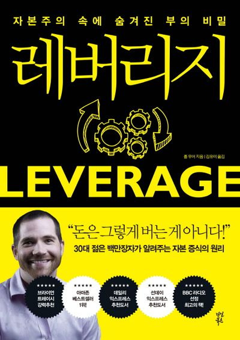
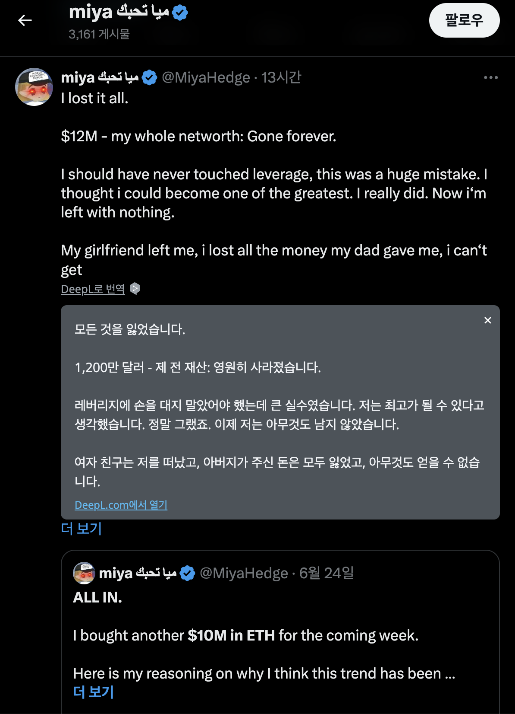

---
categories:
  - money-talk/finance
date: 2024-06-25
description: You have probably heard at least once that the stock market is the flower of capitalism.
lang: en
last_updated: 2026-11-14
naver_date: 2026-09-25
naver_url: https://blog.naver.com/martin-lee/224422172534
tags:
  - Money Talk
title: Thoughts on Leverage
translation_key: 2024-06-25-thoughts-on-leverage
---

[Leverage](https://search.shopping.naver.com/book/product/0y5cqemv%2F2bxYMT37tDLo6cdCCu9su%2BCb2p4aDhdHFk%3D)

Rob Moore, Leverage

You have probably heard at least once that the stock market is the flower of capitalism.

The principle behind stocks is to buy low and sell high.

And one of the tools that helps grow your assets is **leverage**.

Margin trading involves borrowing money from a brokerage to buy assets, so it uses leverage.

Leverage also brings liquidity to futures markets for relatively low-volatility assets such as commodities and financial indexes.

However, leveraged positions may be liquidated depending on their expiry date or price.

That is why **you should never borrow from a bank to trade futures: it compounds your risk.**

In crypto markets, many people use perpetual futures for margin trading.

Because they are not borrowing money from the exchange, they simply lose the money they have put in. With overseas futures, though, you can end up buried in debt…

Some people advise against futures because of liquidation risk, while others recommend them.

Personally, I think you should trade both futures and spot.

There is not really one right answer; **I recommend finding and trading what fits your own criteria.**

When trading futures, you should make the most of leverage.

Rather than small-scale approaches such as a 1x short hedge to collect funding fees or trading the kimchi premium, I want to introduce two things to watch when actively trading.

**The most basic approach is to adjust your leverage.**

100x or 125x really is gambling—something to try only with money you can afford to lose…

No matter how confident you feel, the risk is far too high to make that your strategy.

This varies with each person’s judgment, but I usually trade between 2x and 10x.

**The second important point is strict stop-loss management.**

The reason is to avoid liquidation.

If you sit there desperately praying and the market wipes you out in one move, there is no undoing it.

You need to respect your stop-loss levels more strictly than you would in spot trading.

As long as you survive, you may eventually recover, so do everything you can to avoid going to zero.

Yesterday, news involving Mt. Gox and Bitcoin’s decline caused one person to lose $12 million.

That is roughly KRW 16 billion, lost all at once…

They reportedly went all-in on Ether. Honestly, I suspect they entered with more than 10x leverage.

It is unfortunate, but it seems their own greed brought disastrous consequences.

Put aside the thought that “something like this could never happen to me.”

I recommend gradually building good trading habits while the amounts are still small…

※ This post was moved from my previous blog during a migration. (Originally written: June 25, 2024, 15:54)
