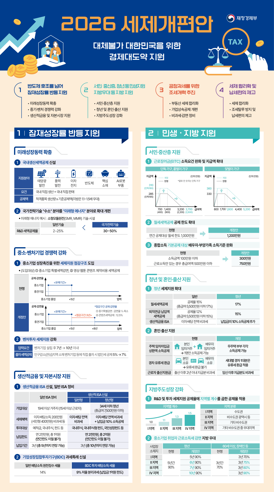
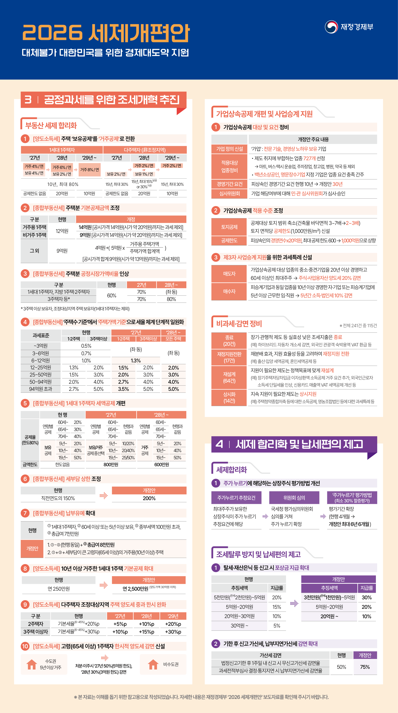
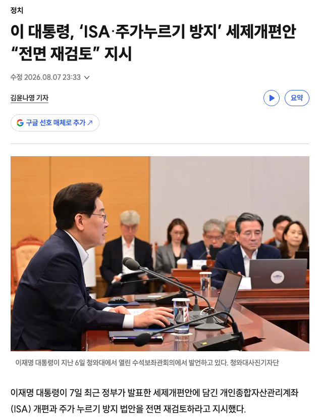

---
categories:
  - money-talk/finance
date: 2026-08-08
description: The Ministry of Finance and Economy (formerly the Ministry of Economy and Finance) announces a tax reform proposal every year.
lang: en
last_updated: 2026-11-14
naver_date: 2026-08-08
naver_url: https://blog.naver.com/martin-lee/224371685317
tags:
  - Money Talk
title: Korea’s 2026 Tax Reform Proposal Announced
translation_key: 2026-08-08-korean-tax-reform-2026
---

The Ministry of Finance and Economy (formerly the Ministry of Economy and Finance) announces a tax reform proposal every year.

This year, it announced the 2026 tax reform proposal on August 3.

[https://www.mofe.go.kr/nw/nes/detailNesDtaView.do?searchBbsId1=MOSFBBS\_000000000028&searchNttId1=MOSF\_000000000078809&menuNo=4010100](https://www.mofe.go.kr/nw/nes/detailNesDtaView.do?searchBbsId1=MOSFBBS_000000000028&searchNttId1=MOSF_000000000078809&menuNo=4010100)

[Ministry of Finance and Economy](https://www.mofe.go.kr/nw/nes/detailNesDtaView.do?searchBbsId1=MOSFBBS_000000000028&searchNttId1=MOSF_000000000078809&menuNo=4010100)

Tax laws do not change as soon as the proposal is announced.

Announcement → Advance legislative notice → Cabinet meeting → Submission of tax amendment bills to the National Assembly → Assembly deliberation and vote → Promulgation → Implementation

Tax amendments are finalized through this process. After the provisions that pass the National Assembly are promulgated into law, they apply from the effective dates specified in each law.

I would like to read the full detailed PDF of the tax reform proposal, but it is 250 pages long.

Below are two government infographics on the 2026 tax reform proposal.

Homeowners should probably focus on the real-estate sections. For ordinary and upper-middle-income people like me who do not own a home, the following seem worth paying attention to.

**1-3. Supporting productive finance and capital markets — ISA reform**

**2-1. Support for ordinary and upper-middle-income households**

**2-2. Support for young people, marriage, and childbirth**

**4-1. Rationalizing the tax system: suppressing share prices??**

Reading through it made me think I should also study the basics of tax law…

The ISA reform includes two elements: **“restructuring the general ISA and introducing a productive-finance ISA.”**

An ISA is an account with tax benefits provided by the government to encourage people to build assets and invest for the long term. For ordinary people, it is one of the few remaining ladders to building wealth—a small ray of hope. **Net income is tax-exempt up to KRW 2 million for the general type and KRW 4 million for the low-income and farmer/fisher type**, with a lower tax rate also applied to amounts above those limits.

**Under the existing ISA rules, you could keep extending the account after completing the minimum three-year holding period.** That meant you could maintain it long-term simply by continuing to renew it. But **the new proposal would change the general ISA to an initial three years plus a maximum two-year extension, allowing only five years in total.** There is also a change to contribution limits: **“unused annual limits cannot be carried forward.”** I wonder whether imposing a time limit is intended to encourage as much use of ISAs as possible…

Another part worth watching is the newly proposed **“productive ISA.”**

The productive ISA comes in two types: general and youth.

With a three-year contribution period extendable to ten years in total, an annual KRW 20 million limit, and full exemption for interest and dividends (plus a deduction of 10% of contributions for the youth type), it offers far more advantages than the existing ISA. However, investments are limited to “domestic” assets such as Korean stocks, domestic equity funds, and the National Growth Fund. This looks like an attempt to boost the Korean stock market specifically.

Since the tax reform proposal was announced, public opinion has been unfavorable because it changes ISA accounts.

[https://www.khan.co.kr/article/202608072329001](https://www.khan.co.kr/article/202608072329001)

Apparently, the government has ordered a review, perhaps realizing that it does not make sense either.

What a relief.
