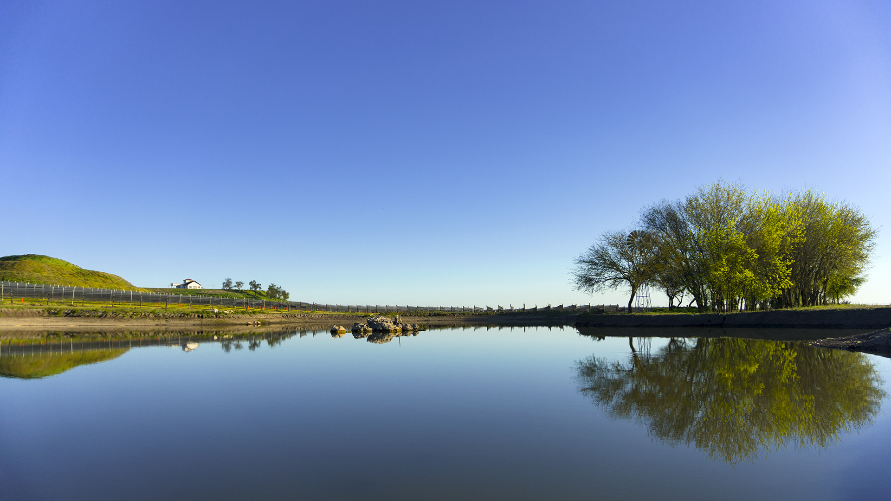
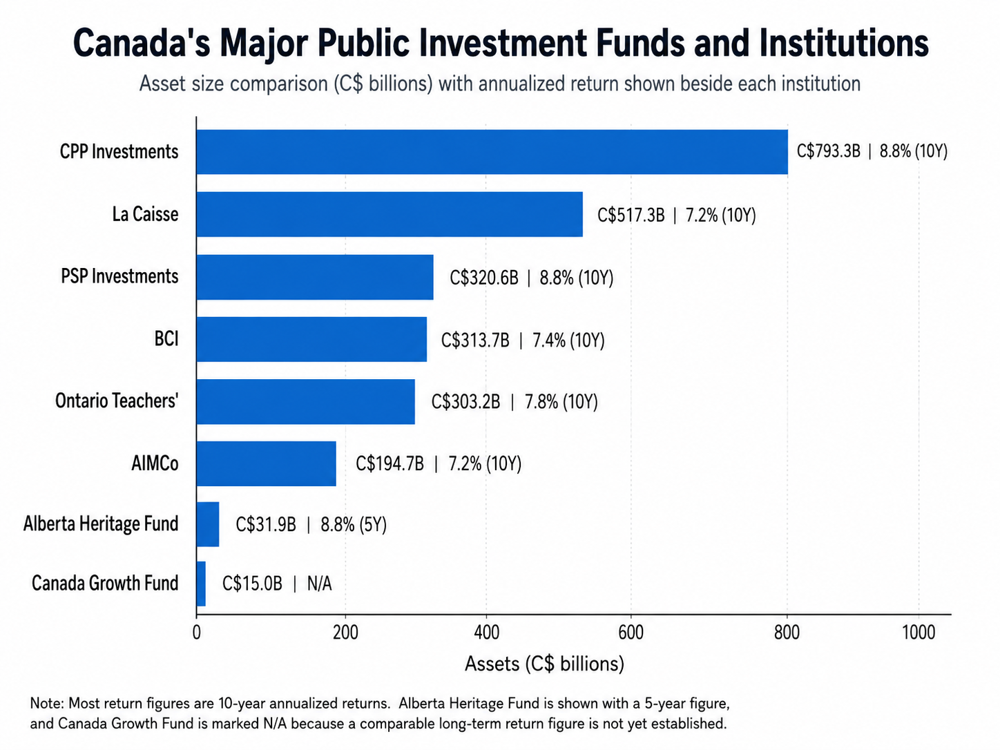
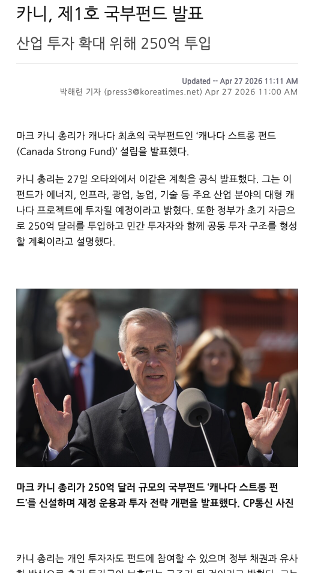

---
categories:
  - money-talk/finance
date: 2026-08-12
description: I suddenly became curious about Canada’s sovereign wealth funds and decided to look into them and make a record.
lang: en
last_updated: 2026-11-14
naver_date: 2026-08-12
naver_url: https://blog.naver.com/martin-lee/224376077768
tags:
  - Canada
  - Canadian Sovereign Wealth Funds
  - CanadaStrongFund
title: Canada’s Sovereign Wealth Funds & the Canada Strong Fund
translation_key: 2026-08-12-canada-strong-fund
---

<figure data-image-caption="true">
  
  <figcaption><a href="https://www.ogq.me/backgrounds/1499856">© CoolPubilcDomains, Source: OGQ</a></figcaption>
</figure>

I suddenly became curious about Canada’s sovereign wealth funds and decided to look into them and make a record.

The underlying reason was that I had recently read about rebalancing Korea’s National Pension Service investments and wanted to know how Canada manages its system. Korea, Canada, and Japan operate similar pension systems, described as **“mandatory, earnings-related public pensions”** or **“social-insurance public pensions.”**

**Korea’s National Pension Service (NPS)**

Salary → National Pension contributions → **NPS** → Investment → National Pension payments

**CPP (Canadian Pension Plan)**

Salary → CPP contributions → **CPP Investments** → Investment → CPP payments

Japan also operates a national pension and an employees’ pension. **When you receive a salary, you must contribute a portion of your income to the public pension, which is managed by the national public pension fund.**

How, then, does this differ from **Norway’s sovereign wealth fund**, which is widely considered well managed?

At first, I thought Canada’s CPP had a structure similar to Norway’s sovereign wealth fund. But after looking into it, I found that **although their investment methods share some similarities, their starting points are entirely different.**

Norway’s sovereign wealth fund began with the idea of “oil → government revenue → investment → assets for future generations.”

Rather than spending all the revenue from selling finite resources such as oil and natural gas today, the country converts it into financial assets to leave to future generations. In other words, Norway’s fund is **a sovereign wealth fund managing money the country earns from resources**, whereas CPP is **a public pension managing contributions paid by workers and employers**. People may think of CPP Investments as Canada’s sovereign wealth fund, but strictly speaking, it is not one.

How big is CPP?

**$793.3B**, or roughly KRW 800 trillion. (Korea’s National Pension is around KRW 1,600 trillion.)

CPP is managed in two separate components: **Base CPP / Additional CPP**.

**\* Base CPP**: Canada’s original basic CPP, which has been operating for years.

**\* Additional CPP**: The enhancement introduced in 2019 to increase the retirement income provided by CPP.

It is easier to think of this as an additional layer of pension coverage on top of the existing CPP, rather than two separate national pensions.

In Korea, “national pension” immediately brings to mind one enormous institution, NPS. In Canada, however, public funds are spread across several very large investment institutions.

**\* CPP Investments = National public pension**

**\* PSP Investments = Federal public-sector pensions (civil servants, military personnel, RCMP, etc.)**

**\* La Caisse = Québec public-institution pensions**

**\* BCI = BC public-sector pensions, including civil servants and teachers**

**\* AIMCo = Alberta public pensions + government funds**

**\* Ontario Teachers’ = Ontario teachers’ pension**

**\* Alberta Heritage Fund = Alberta resource-revenue fund**

**\* Canada Growth Fund = Federal policy investment fund**

To see which stocks CPP Investments buys or sells, you can Google “CPP Investments holdings/portfolios” and check its holdings.

[https://www.koreatimes.net/ArticleViewer/Article/176634](https://www.koreatimes.net/ArticleViewer/Article/176634)

The article above is dated April 27, 2026.

Its main point was that Canadian Prime Minister Mark Carney would establish a new sovereign wealth fund.

**“Canada Strong Fund”**

The details have not yet been released, but it looks worth keeping an eye on.

#Canada

#CanadianSovereignWealthFunds

#CanadaStrongFund
