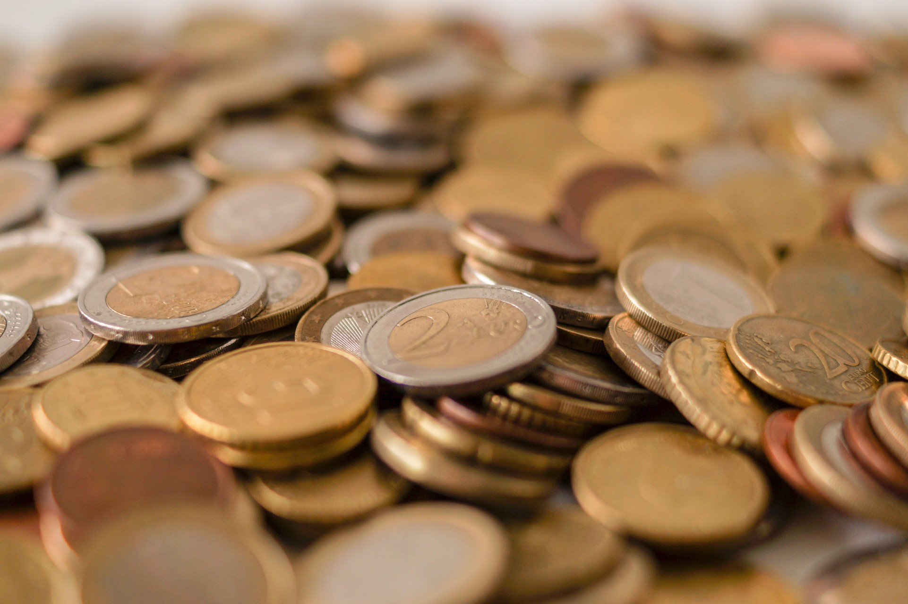
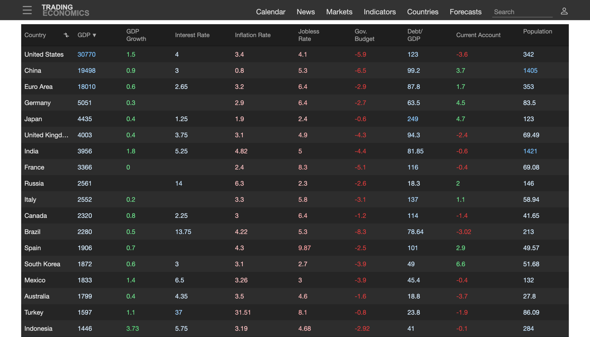
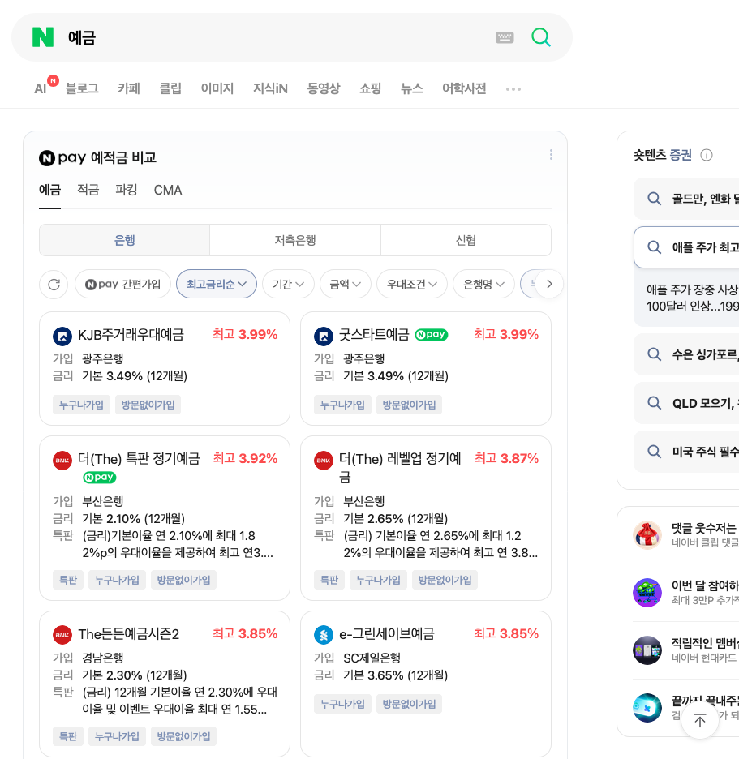
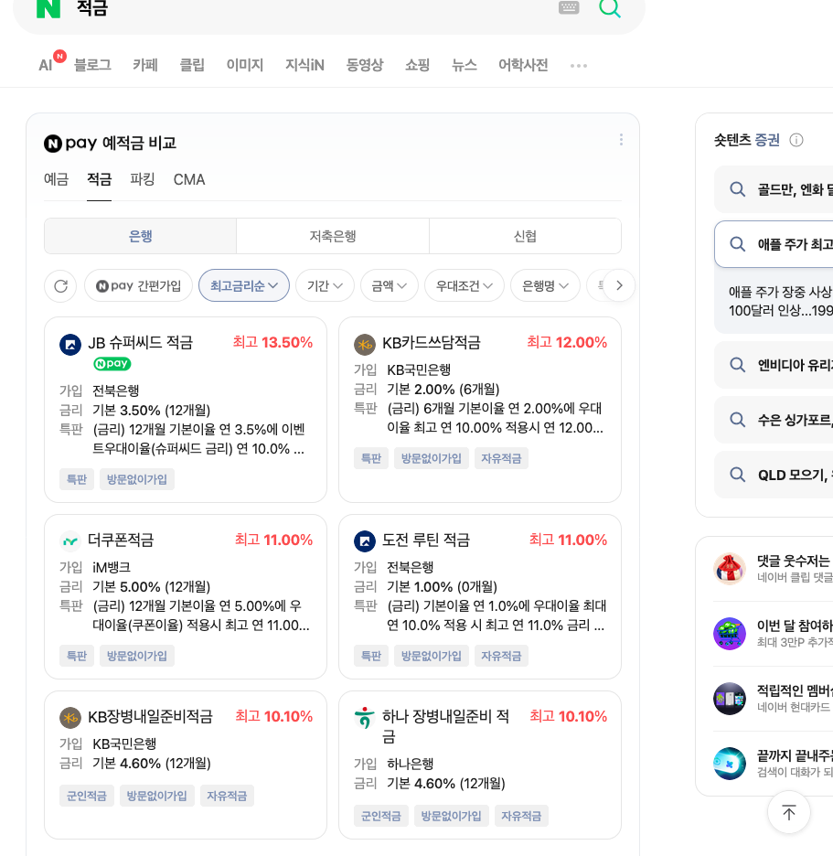

---
categories:
  - money-talk/finance
date: 2026-09-27
description: For example, if you borrow KRW 1 million for one year at 5% per annum, the simple interest rate is 5% and the interest amount is KRW 50,000.
lang: en
last_updated: 2026-11-14
naver_date: 2026-09-27
naver_url: https://blog.naver.com/martin-lee/224422906367
tags:
  - Bonds
  - Stocks
  - Deposits
  - Installment Savings
  - Interest
  - Banks
  - Credit
title: Understanding Interest Rates and Bonds
translation_key: 2026-09-27-interest-rates-and-bonds
---

<figure data-image-caption="true">
  
  <figcaption><a href="https://www.ogq.me/backgrounds/1490017">© CoolPubilcDomains, Source: OGQ</a></figcaption>
</figure>

**“Rate = Interest rate”**

Interest = An amount of money

For example, if you borrow KRW 1 million for one year at 5% per annum, the simple interest rate is 5% and the interest amount is KRW 50,000.

Ways of calculating interest

\* Simple interest = Interest is charged only on the principal.

\* Compound interest = Interest is charged again on the principal plus accumulated interest.

**Interest rates apply both when lending money and when borrowing it.**

When the news reports a rate hike, it usually refers to the central bank’s policy rate.

Why, then, is the central bank’s policy rate important?

**A bank’s basic earnings structure revolves around “raising funds.”**

One of a bank’s main functions is to obtain funds and **lend them to individuals and businesses that need money**. It raises funds through methods such as accepting customer deposits and issuing bonds, then earns the difference between the interest received on loans and the interest paid to obtain those funds. **When the central bank’s policy rate rises, the interest banks pay to obtain money generally rises, too.**

In other words, the chain is **Policy rate rises → Interbank lending rates rise → Banks’ funding costs increase → Customer lending rates rise**. Higher customer lending rates increase the interest burden on households and businesses. If competition to attract customers’ money is intense, banks may also raise deposit rates. As a result, **consumption and investment tend to decline, while asset markets such as real estate and stocks also tend to contract**.

Trading Economics

Let’s look at interest rates by country at the time of writing. The fourth column, “Interest Rate,” shows the rate.

The United States is at 4.0% per year, Japan at 1.25%, and Korea at 3.0%. (Decisions to raise, lower, or hold rates are announced eight times a year, once every six to seven weeks.)

Naver deposit and installment-savings comparison

I was not around in the 1970s and 1980s, so I cannot speak from experience, but older people say interest rates exceeded 20% back then… I do not know how long that lasted. That may be why older people tell us to put money steadily into the bank rather than invest in stocks. In any case, when opening a deposit, installment-savings account, or cash-parking account, choose one with a higher rate. These days, there are plenty of special offers and preferential rates, so I hope you compare them carefully and choose wisely. After all, a well-managed savings ladder can also provide stable returns.

---

Bonds are also closely linked to interest rates.

**“Debt = Money owed”**

**“Claim = The right to receive money”**

**“Creditor = The person entitled to receive money”**

**“Debtor = The person who must repay money”**

“Credit = The extent to which someone can be trusted to repay money”

“Collateral = An asset pledged so it can be taken if the borrower fails to repay”

“Default = Failure to repay principal or interest as promised”

Example: I borrow KRW 100 million from a bank at 5% per year for three years and pledge a car as collateral. (Principal repaid in full at maturity.)

Debtor = Me

Creditor = The bank

Principal = KRW 100 million

Interest rate = 5% per year

Interest = KRW 416,667 × 36 months

Maturity = Three years

Collateral = The car

The example above involves bank lending and credit.

Another area is the **bond market**, where debt and bonds are traded.

Depending on the issuer, bonds include **government bonds / municipal bonds / corporate bonds / financial bonds / agency bonds**.

Bond = Debt made into a security

Face value (Coupon) = The regular interest promised by a bond

Maturity = When the principal is repaid

Yield = The return an investor earns based on the current price

Example: To raise KRW 100 million, the government issues a three-year government bond paying 3% annually.

Debtor = The government

Creditor = The government-bond investor

Principal = KRW 100 million

Coupon rate = 3% per year

Interest = KRW 3 million per year

Maturity = Three years

New government bonds may be issued as existing bonds approach maturity, or because the government actually needs funds. This also means the government continues adding debt. Ultimately, we need to look at who is buying those government bonds.

Understanding interest rates and government bonds is complicated in many ways…

**\* Policy rate ↑ → Existing bond prices ↓ → Bond yields ↑**

**\* Policy rate ↓ → Existing bond prices ↑ → Bond yields ↓**

**\* People sell bonds → Bond prices ↓ → Yield ↑**

**\* People buy bonds → Bond prices ↑ → Yield ↓**

These relationships have been treated almost like formulas in markets to date. Taking this further, one may also see the chain as **“Inflation ↑ → Expectations of rate hikes ↑ → Government bond yields ↑ → Bond prices ↓ → Discount rates ↑ → Pressure on stock valuations.”**

#Bonds

#Stocks

#Deposits

#InstallmentSavings

#Interest

#Banks

#Credit
