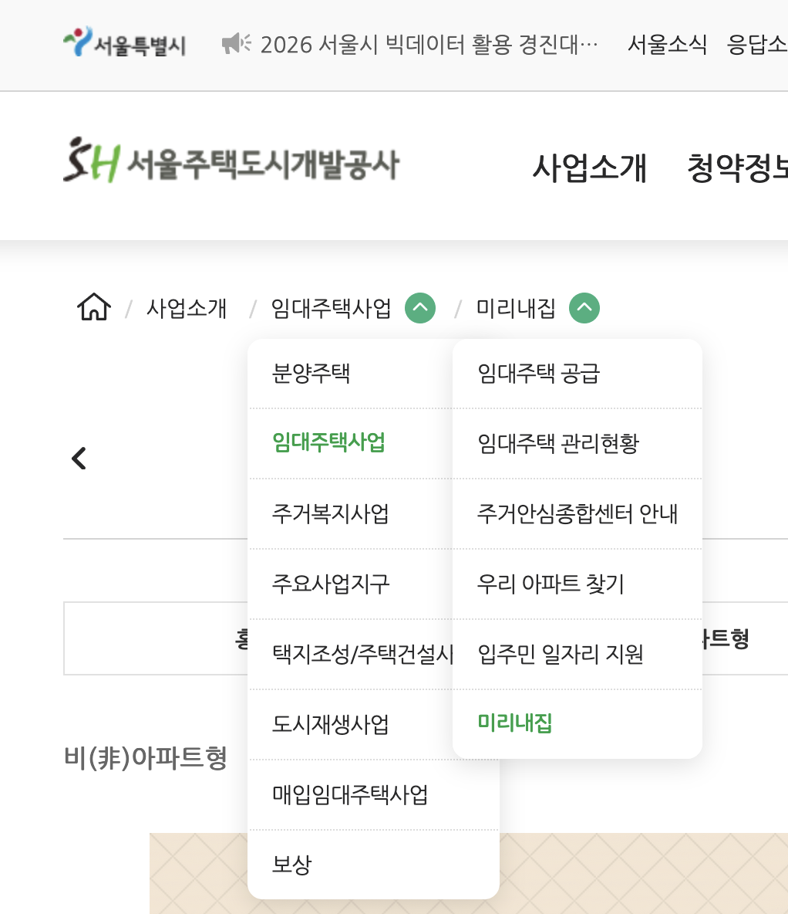
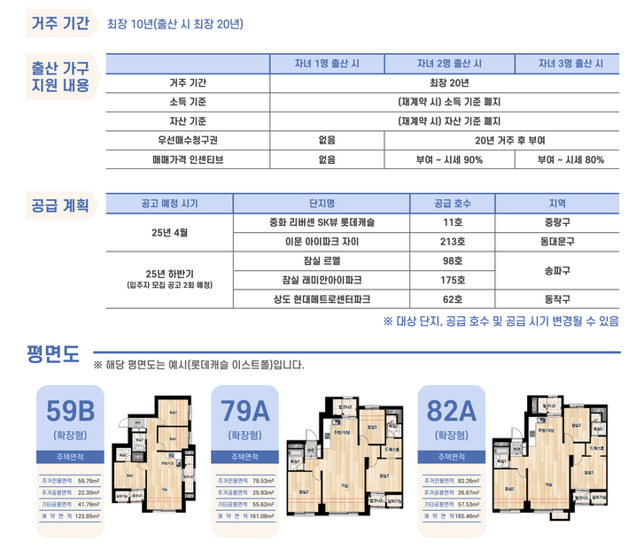
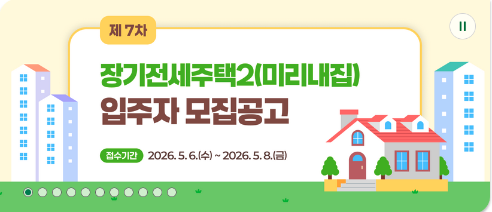
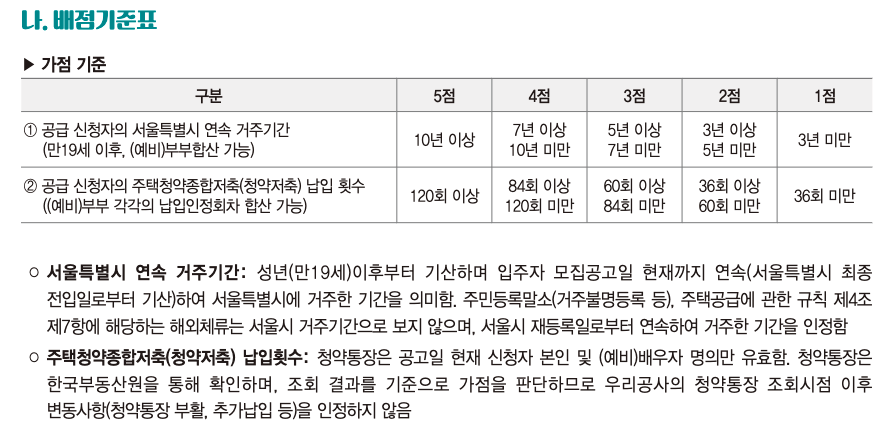
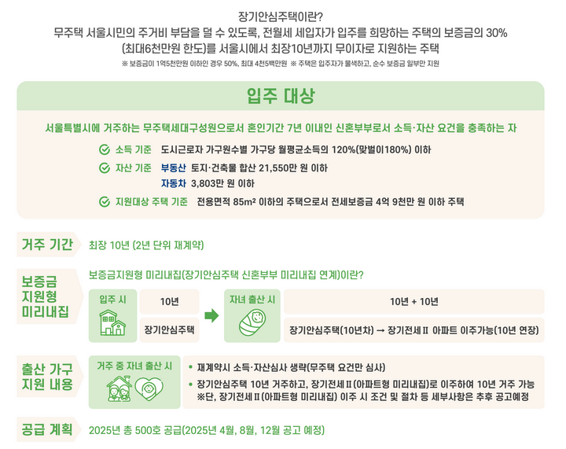
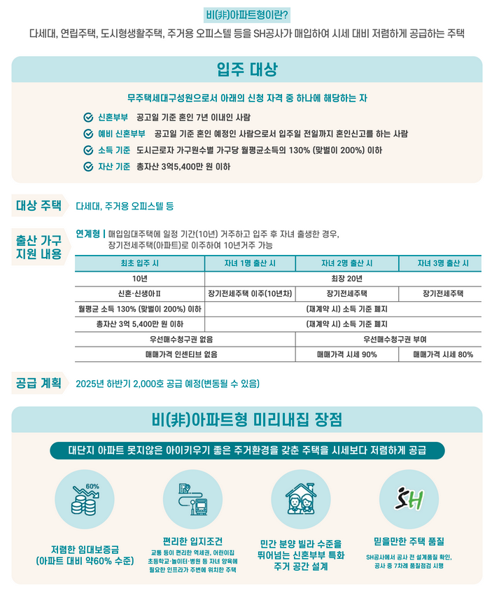

---
categories:
  - money-talk/property
date: 2026-05-01
description: I learned about a rental-housing program called “Mirinaejip” run by SH (Seoul Housing & Communities Corporation).
lang: en
last_updated: 2026-11-14
naver_date: 2026-05-01
naver_url: https://blog.naver.com/martin-lee/224271573222
tags:
  - Money Talk
title: Looking into SH’s Mirinaejip Housing Program
translation_key: 2026-05-01-sh-mirinaejip
---

[https://www.i-sh.co.kr/main/lay2/S1T7312C7332/contents.do](https://www.i-sh.co.kr/main/lay2/S1T7312C7332/contents.do)

I learned about a rental-housing program called **“Mirinaejip”** run by SH (Seoul Housing & Communities Corporation).

Recently, the government has introduced **various policies to reduce housing costs for newly married couples**.

Mirinaejip has:

**1\. Apartment type**

**2\. Deposit-support type**

**3\. Non-apartment type**

Announcements can be divided into these three types.

The common goal is housing stability for newlyweds and families having children, long-term residence, and an opportunity to own a home. **The most noteworthy point is that after 20 years, residents can buy the home they have lived in at 80%–90% of its price.** The apartment type includes major branded apartment complexes, which has attracted a lot of attention. Naturally, applicants must not own a home. They must also meet the income and asset requirements in the relevant announcement.

**1\. Apartment type**

Eligibility

Within seven years of registering the marriage as of the tenant recruitment announcement date.

Able to prove a legal marriage within six months of the announcement date (engaged couples may also apply).

Must not have owned a home during the five years specified by the recruitment criteria (non-homeowners).

Income requirements

Exclusive-use floor area of 60 m² or less: At or below 120% of average monthly income (180% for dual-income households).

Exclusive-use floor area over 60 m²: At or below 150% of average monthly income (200% for dual-income households).

(\* These vary by household size, so be sure to check the recruitment announcement.)

Total assets = Real estate + Vehicles + General assets + Financial assets - Liabilities

One child: KRW 704,000,000

Two children: KRW 768,000,000

Neither of the above: KRW 648,000,000

Imun I’Park Xi in April 2025,

and Jamsil Le El and Jamsil Raemian I’Park in the second half of 2025 are expected to be the most popular.

Let’s look at the latest announcement, posted on April 24, 2026.

Mirinaejip, 7th special allocation

Recruitment details (new units)

**Hillstate Dongjak Signature**

45 m² (66 units): KRW 469,560,560

50 m² (6 units): KRW 521,820,000

59 m² (19 units): KRW 593,580,000

**Elif Mia Station**

49 m² (5 units): KRW 380,640,000

59 m² (9 units): KRW 493,740,000

74 m² (2 units): KRW 541,320,000

84 m² (1 unit): KRW 606,060,000

**Boramae Station Precent**

44 m² (16 units): KRW 364,260,000

Total units available: 441 households

124 new units / 317 reoffered units

(The reoffered properties have only a small number of units per complex, so competition will probably be high. Banpo Xi is included.)

**Applications: May 6–8, 2026**

Successful applicants announced: September 18, 2026

Contracts signed: October 19, 2026 (varies by complex)

(\*\*Under the deposit installment plan, you can pay 70% upfront and spread the remaining 30% over the period until moving out. Annual interest of 2.73% applies to that 30%.)

**Selection criteria**

[https://www.i-sh.co.kr/main/lay2/program/S1T294C295/www/brd/m\_241/view.do?seq=303480](https://www.i-sh.co.kr/main/lay2/program/S1T294C295/www/brd/m_241/view.do?seq=303480)

[SH Seoul Housing & Communities Corporation](https://www.i-sh.co.kr/main/lay2/program/S1T294C295/www/brd/m_241/view.do?seq=303480)

Be sure to read the application announcement.

**2\. Deposit-support type**

This program lends 30% of a home’s deposit, up to KRW 60 million, interest-free.

Residents must find the home themselves and receive support for the deposit. A jeonse deposit of KRW 150 million in Seoul would probably cover a small studio or two-room unit. If your plan is to start small and move up to a larger home, this announcement may be appealing. One benefit is that if you have a child while living there, you can move into a long-term jeonse apartment.

**3\. Non-apartment type**

Unlike the apartment type, this involves moving into a building purchased by SH. Like the deposit-support type, if you have a child while living there, you can move to long-term jeonse housing and live there for ten years.

---

In many ways, this is an era in which saving a salary alone is not enough to buy a home in Seoul. Using a support program like this and making a plan to hold on for 20 years before buying the home could be a practical alternative. I should keep paying attention to it.
