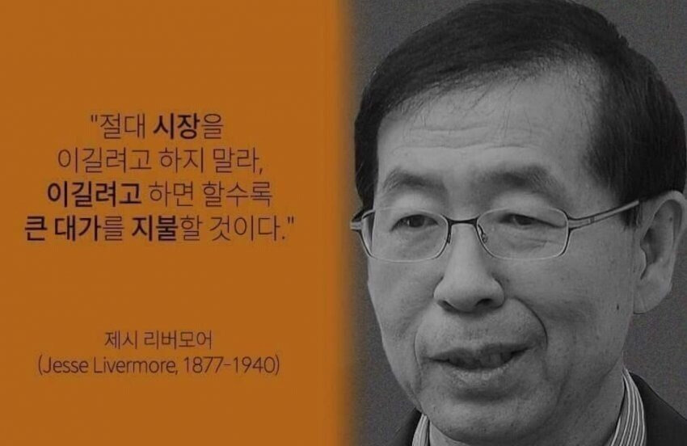

---
categories:
  - money-talk/stock
date: 2024-06-02
description: Since ChatGPT 4o was unveiled, many people seem to be wondering whether they will lose their jobs. Job seekers are even more frightened. I feel that way, too. I wrote this to organize my thoughts on preparing for the age of AI…
lang: en
last_updated: 2026-11-14
naver_date: 2026-09-26
naver_url: https://blog.naver.com/martin-lee/224422165269
tags:
  - Money Talk
title: Never Try to Beat the Market
translation_key: 2024-06-02-beating-the-market
---

※ This post was moved from my previous blog during a migration. (Originally written: June 2, 2024, 00:17)

Since ChatGPT 4o was unveiled, many people seem to be wondering whether they will lose their jobs. Job seekers are even more frightened. I feel that way, too. I wrote this to organize my thoughts on preparing for the coming age of artificial intelligence.

1\. The term artificial intelligence was introduced in the 1950s as “making machines behave as they would with knowledge of human behavior.” The 1950s were not long after computers appeared, and the internet did not yet exist.

2\. Let’s look at the chronology of industrial revolutions so far. (The following was written with help from ChatGPT.)

The First Industrial Revolution used the invention of the steam engine to replace human- or animal-powered production with machine power.

The Second Industrial Revolution dramatically improved industrial and manufacturing productivity through electricity, oil, and the introduction of large-scale production lines.

The Third Industrial Revolution brought digitalization through computers and the internet, fundamentally changing how information was produced, stored, transmitted, and processed.

The Fourth Industrial Revolution is merging the digital and physical worlds through advanced technologies such as artificial intelligence, big data, and the Internet of Things, driving innovation across all industries.

3\. The Third Industrial Revolution began with computers, but I think the **internet** was what allowed it to blossom. With the internet as its foundation, the **smartphone**, which made internet access possible anywhere, was able to open a new era. Among the world’s ten largest companies by market capitalization today, all except Saudi Aramco and Berkshire Hathaway are in businesses related to the **internet** or **computers**. These are the companies commonly called Big Tech.

4\. Similarly, I think the Fourth Industrial Revolution began with big data and the cloud, and **artificial intelligence** may be what sets it alight. There must then be something that can be built on AI, but I do not yet have a clear sense of what that will be.

5\. Looking at past industrial revolutions, progress has made life more convenient by addressing things that were difficult, expensive, or inefficient. That progress has also inevitably involved some people losing their jobs. It is an unfortunate reality, but it seems unavoidable.

6\. I feel that this reality is now approaching us. This industrial revolution involves technology that replaces people, and its ability to use big data and knowledge is particularly threatening to high-paying jobs.

7\. Unless a profession allows people to demonstrate creativity, survival may be difficult. What should we do to become irreplaceable workers? No matter how much I think about it, we may eventually have no choice but to give up our place.

8\. Then what can we do? All we can do is accept it. A reality we cannot change through resistance is approaching. It is also true that this is a once-in-a-lifetime opportunity. The AI era will create opportunities for some people. So I recommend learning as much AI technology as possible in advance, starting now.

9\. Never try to beat the market.
