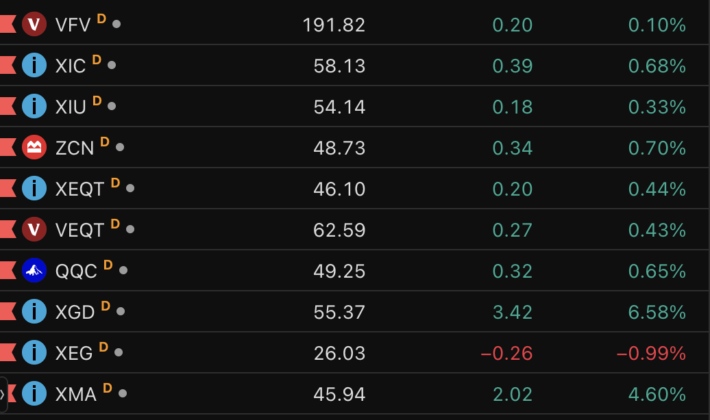
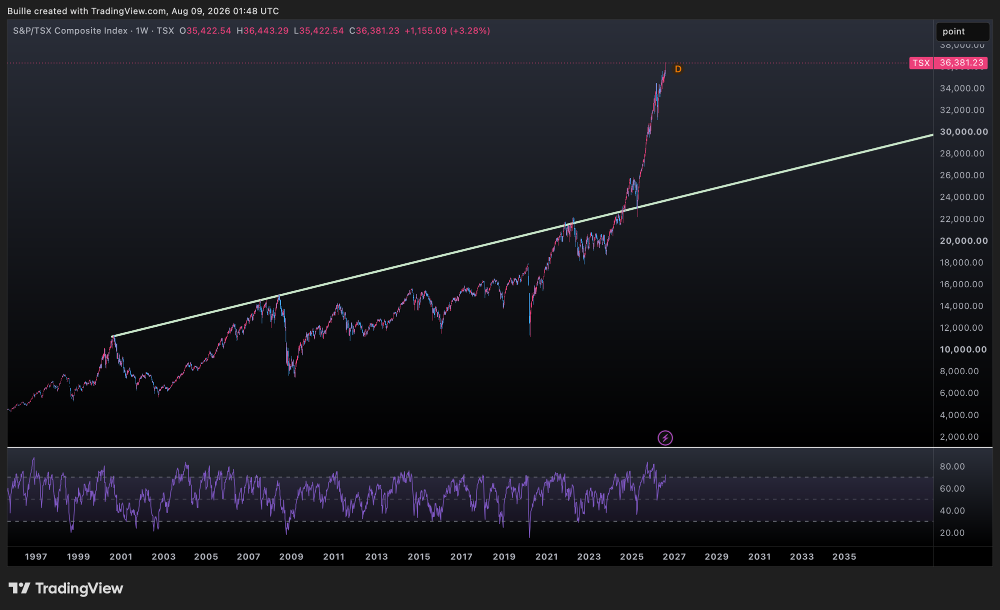

---
categories:
  - money-talk/stock
date: 2026-08-09
description: "There is a famous investing saying: “Don’t put all your eggs in one basket.”"
lang: en
last_updated: 2026-11-14
naver_date: 2026-08-09
naver_url: https://blog.naver.com/martin-lee/224372793980
tags:
  - Canadian Stocks
  - Canadian ETFs
  - XIU
  - VEQT
  - XGD
  - XEG
  - XMA
title: "[Canadian Stocks] Shortlisting ETFs"
translation_key: 2026-08-09-canadian-etf-shortlist
---

<figure data-image-caption="true">
  
  <figcaption><a href="https://www.ogq.me/backgrounds/1481518">© CoolPubilcDomains, Source: OGQ</a></figcaption>
</figure>

There is a famous investing saying: “Don’t put all your eggs in one basket.”

It is another way of saying not to go all-in on a single stock.

Of course, some stocks, such as Coca-Cola, may keep trending upward.

But if you had bought Nike instead, the result would have been disastrous.

That is why this saying often comes up when discussing diversification to reduce investment risk.

Increasing the number of stocks you own is one way to diversify.

Buying an ETF is another form of diversification.

ETF = Exchange-Traded Fund.

It is a fund that holds a collection of assets.

One of the best-known ETFs is QQQ, which invests in 100 U.S. technology stocks.

It holds stocks such as Nvidia / Apple / Microsoft / Amazon / Micron … at different weights.

Large asset managers such as BlackRock (iShares), Vanguard, and Invesco create and manage ETFs.

An ETF’s advantage is that it offers a convenient and safer way to invest in several companies at once. However, since it invests in an entire market or a particular sector, its price falls when that market falls, and returns may be lower than those from individual stocks. Buying several ETFs can also result in overlapping holdings.

Let’s look at which ETFs people tend to prefer in Canada.

[https://www.reddit.com/r/CanadaInvesting/](https://www.reddit.com/r/CanadaInvesting/)

[r/CanadaInvesting](https://www.reddit.com/r/CanadaInvesting/)

There does not seem to be an equivalent to the individual-stock discussion boards on Toss or Naver yet. Reddit seems to be the most active option.

Preferences may change over time, but from what I have recently seen on Reddit, people seem especially fond of **VFV, XEQT, and QQC**.

To list a few more:

**VFV =** U.S. S&P 500 ($34B)

**XIC =** Canadian total market ($32.9B)

**XIU = Canada’s 60 large companies ($24.6B)**

**XEQT =** Global equities ($21.5B)

**ZCN =** Canadian total market ($18.1B)

**VCN =** Canadian total market ($16.9B)

**VEQT = Global equities ($16.2B)**

**ZAG =** Canadian bonds ($13.1B)

**VDY =** Canadian high-dividend stocks ($9.2B)

**ZEB =** Canadian banks ($7.3B)

**XGRO =** 80% stocks + 20% bonds ($5.2B)

**XUU =** U.S. total market ($4.7B)

**XGD = Global gold miners ($4.0B)**

**QQC** = Nasdaq 100 ($3.7B)

**XEG = Canadian energy ($2.2B)**

**XRE** = Canadian REITs ($1.1B)

**CGL.C** = Physical gold (0.77B)

**XMA = Canadian mining, metals, and fertilizers ($0.71B)**

If I build a portfolio and plan to add ETFs, I should consider the ones highlighted in green: XIU, VEQT, XGD, XEG, and XMA. (**This is simply because I personally expect Canada to do well. These are absolutely not stock recommendations.**)

(I do not particularly like drawing chart lines on indexes, so I have included only the prices.)

They have climbed steadily so far, and I do not know when to get in.

ETFs seem heavily influenced by the market or sector.

So let’s buy regularly in installments.

TSX weekly chart

Canadian stocks have an upward-trending chart much like the Nasdaq.

They keep reaching all-time highs, yet things remain quiet.

It feels as though prices are simply rising, rather than rising because of some particular achievement—perhaps because they follow the United States, or because there is so much old money. That makes it even more unsettling and frightening. It feels as though it will burst someday.

#CanadianStocks

#CanadianETFs

#XIU

#VEQT

#XGD

#XEG

#XMA
