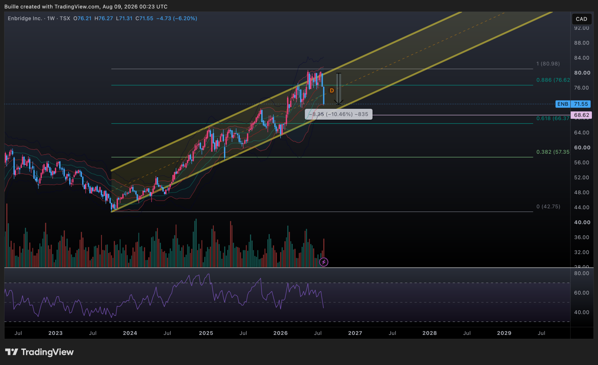
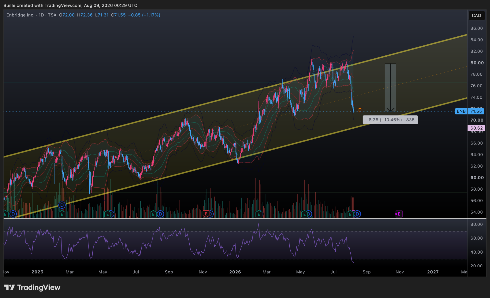

---
categories:
  - money-talk/stock
date: 2026-08-09
description: Enbridge closed the week down 6.2%. It has fallen 10% over two weeks.
lang: en
last_updated: 2026-11-14
naver_date: 2026-08-09
naver_url: https://blog.naver.com/martin-lee/224372753700
tags:
  - Enbridge
  - ENB
  - EnbridgeInc
title: "[Canadian Stocks] Enbridge — ENB, Enbridge Inc."
translation_key: 2026-08-09-enbridge-stock-notes
---

**※ Please note that this post is not a stock recommendation.**

Weekly chart

Enbridge closed the week down 6.2%. It has fallen 10% over two weeks.

With its attractive dividend yield and payment schedule, Enbridge is one of the top-tier dividend stocks.

Daily chart

On the daily chart, it has done nothing but fall. It is in oversold territory, so I do not know whether the decline will continue next week. But if it keeps moving sideways or downward, it looks as though it could fall to the $68–$70 range (about 3% below the current price).

As a dividend stock, it probably will not be extremely volatile, but looking at the chart, this is certainly a reasonable area to buy.

The upcoming dividend schedule is not bad, either.

Expected ex-dividend date: August 14, 2026

Dividend payment date: September 1, 2026

Dividend per share: Approximately CAD $0.97 (a dividend yield of around 5%–5.4%)

Since it is a dividend stock, steadily accumulating shares whenever a buying opportunity appears seems best.

#Enbridge

#ENB

#EnbridgeInc.
