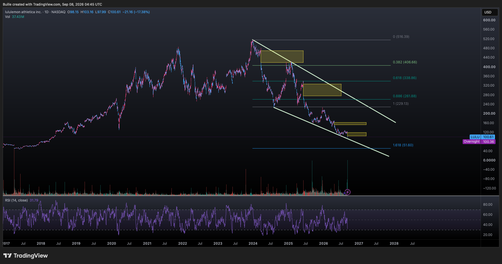

---
categories:
  - money-talk/stock
date: 2026-09-08
description: Not long after Lululemon’s new CEO took office, the stock immediately fell 17%…
lang: en
last_updated: 2026-11-14
naver_date: 2026-09-08
naver_url: https://blog.naver.com/martin-lee/224404756274
tags:
  - Nike Stock
  - Nike
  - Lululemon Stock
  - Lululemon
title: Can “Burry’s Pick” Lululemon Recover?
translation_key: 2026-09-08-lululemon-and-burry
---

Lululemon daily chart

[https://www.newspim.com/news/view/20260908000747](https://www.newspim.com/news/view/20260908000747)

[\[U.S. Stocks in Focus\] Lululemon cuts annual outlook again… A rough road even before the new CEO takes office](https://www.newspim.com/news/view/20260908000747)

Not long after Lululemon’s new CEO took office, the stock immediately fell 17%…

That puts it 80% below its pre-pandemic peak…

[https://www.mk.co.kr/news/stock/12145453](https://www.mk.co.kr/news/stock/12145453)

[Lululemon shares hit an eight-year low… Even Burry, who kept averaging down, is “suffering” — Maeil Business Newspaper](https://www.mk.co.kr/news/stock/12145453)

For reference, Michael Burry’s average purchase price is reportedly around $288.

I wonder whether a recovery is really possible.

Lululemon was once a trend—and judging by how many people still wear it on the street, it seems to remain one. It was considered a consumer-staples stock, in one of the sectors known for holding up well.

But since COVID, the apparel and sports industries seem to have been declining overall.

I really do not know how things came to fall apart like this.

It seems to be a combination of factors, including U.S.–China tensions, changing consumption patterns, and the emergence of weight-loss drugs.

[https://www.joongang.co.kr/article/25459969](https://www.joongang.co.kr/article/25459969)

[Leaving the S&P 100 after 18 years… What happened to once-thriving Nike? | JoongAng Ilbo](https://www.joongang.co.kr/article/25459969)

Apparently, even Nike is being dropped from the S&P 100…

As someone who owns Nike shares, this is really bad news…

#NikeStock

#Nike

#LululemonStock

#Lululemon
