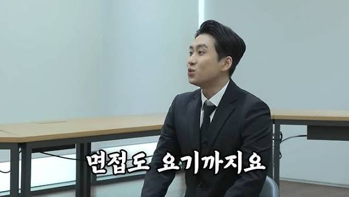

---
categories:
  - study-log/career
date: 2024-11-13
description: It has been almost six months since I stopped working. Looking back on that time, I have rested well and learned a great deal through various experiences. Of course, I am still learning. Since graduating from high school, going to university, serving in the military, and finding work…
lang: en
last_updated: 2026-11-14
naver_date: 2026-10-10
naver_url: https://blog.naver.com/martin-lee/224436718979
tags:
  - Everyday Life and Thoughts
title: Hiring Is Like a Blind Date
translation_key: 2024-11-13-hiring-and-blind-dates
---

※ This post was moved from my previous blog during a migration. (Originally written: November 13, 2024)

It has been almost six months since I stopped working. Looking back on what I have done, I have rested well and learned a great deal through various experiences. Of course, I am still learning. Across the years since high school graduation, university, military service, and employment, I have never had a break this long. I think I was lucky. Perhaps I was able to keep moving from one stage to the next because I was constantly prepared.

**From a career perspective, taking time off is a career interruption.** That is why it can be seen as a blemish on a résumé or something to fear. I do not consider this period a loss at all, and I doubt I will regret it later. The biggest change during this break has been in how I think. **Today, it suddenly occurred to me that the hiring process is very much like a blind date.**

You have probably heard that “an interview is also an opportunity for you to choose the company,” or that “an interview is like a blind date.” In fact, I have only been on one blind date in my life, but luckily, I met my current girlfriend on that first date. My experience is limited, but having tried it, I recommend going on blind dates or dating if you have the opportunity. It is unfortunate when young people do not get to date or experience relationships.

A blind date usually has a matchmaker. Job platforms such as Saramin and LinkedIn play that role in hiring.

A blind date may start with someone asking, “Would you like to meet so-and-so?” The job market is not quite that kind. Still, there are similarities. Being asked that question by a matchmaker generally happens in two situations: when you are trying to date but things are not working out, or when you have stirred someone’s sympathy. Similarly, if you want a job, it is important to let people around you know you are looking. That is why I see activities such as blogging and using LinkedIn positively. If you do nothing, nothing happens.

You have probably seen people around you who go on blind dates often. Why is that? Why has no one ever asked you, “Would you like to go on a blind date?” If you know the answer, that is good; if you do not, take a moment to reflect. Most problems come down to you, and often to a lack of preparation. The same applies in the job market. If you were prepared to be the person companies wanted, you would have many more employment opportunities.

Fortunately, I think hiring is somewhat easier than blind dating. Before meeting someone on a blind date, you have no idea what they like or how they think. In hiring, on the other hand, companies tell you in their job postings what kind of person and what skills they need, so there is much more information you can use to prepare.

Just as there are lines that tend to work and qualities people seek on a blind date, companies have their own preferred candidates and requirements. So instead of seeing a posting and mindlessly submitting your résumé with a click, take a close look at whether the company suits you, tailor your résumé, and then apply. That is also a matter of basic courtesy.

An interview is the first meeting with the other party. Before a blind date, we think about what to wear, where to go, and what to talk about, and prepare our responses. In the same way, we prepare answers to anticipated interview questions. When we fail an interview, it is probably because we did not meet the interviewers’ expectations.

Both blind dating and hiring are fiercely competitive. There are frequent reports lately about how difficult the job market is, but finding a job seems to have always been hard. It might actually have been more concerning if employment were easy to find. Whether it is a job or a blind date, the difficulty naturally calls for a corresponding level of effort.

It is not easy to find a relationship from a single blind date. Likewise, do not be too discouraged if you do not receive a final job offer. One way to improve your chances of finding a relationship is to go on more blind dates, and hiring is similar. Submit as many résumés as you can, keep reflecting on your experiences, and work toward finding a company that fits you.

**In one sentence: Become the person the other side is looking for.**
