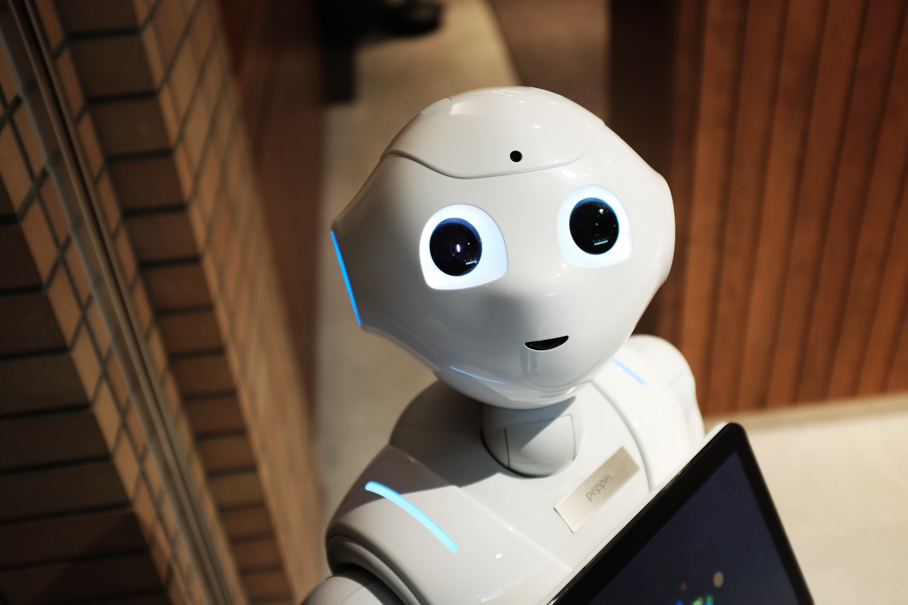

---
categories:
  - study-log/dev
date: 2026-04-11
description: “Will developers really disappear in the age of AI?” “If so, what should I do with my life?”
lang: en
last_updated: 2026-11-14
naver_date: 2026-04-11
naver_url: https://blog.naver.com/martin-lee/224249014056
tags:
  - Everyday Life and Thoughts
title: Taking HarvardX CS50x Online in the Age of AI
translation_key: 2026-04-11-cs50-in-the-ai-era
---

<figure data-image-caption="true">
  
  <figcaption><a href="https://www.ogq.me/backgrounds/1476739">© CoolPubilcDomains, Source: OGQ</a></figcaption>
</figure>

“Will developers really disappear in the age of AI?” “If so, what should I do with my life?”

These are among the thoughts I return to most often these days.

As AI keeps advancing, it is replacing more and more human work. Of course, this is not unique to AI. It has happened repeatedly throughout the history of industrial development. The difference now is that the scope and scale of what AI replaces are much greater.

As time passes, much of the work humans have traditionally done will eventually be replaced. That also means AI will be able to take over even areas based on the abilities we have considered uniquely human, such as our five senses. So we now need to think about something beyond those senses. Lately, I have been calling this “the realm we need to transcend into”: invisible things such as inspiration and intuition, often called a sixth sense, or what people commonly call “taste.”

I also use AI a great deal at work. It has clearly increased my productivity and enabled me to do things I could not do before. My learning curve feels much steeper, too. On the other hand, there are times when I am not sure whether the results I achieve this way are truly mine. That is why I think I must be even more careful not to become conceited. That is a principle I hold for myself.

With so-called vibe coding, you can put something together almost instantly. It is easy to feel pleased with yourself when you see the result. I watch out for that feeling, too. We are receiving help from AI right now, but we cannot be sure that help will always be available as a matter of course. For example, if ChatGPT or Claude goes down, we run out of tokens, or costs keep rising, we could find ourselves in a difficult situation. I think we need to prepare for those possibilities as well.

That is why I started taking Harvard University’s CS50 course. I expect fewer students to enroll in university in the future and more schools to close. The population is declining, degrees matter less than they used to, and there are fewer and fewer reasons why education must happen in person.

Even so, some things never change. I call them “the essentials.” The essence of being a developer is not simply writing code to build something. Ultimately, a developer is someone who solves problems in a structured way. Of course, AI makes identifying and solving problems much faster. But the more I use it, the more I sometimes find myself feeling helpless in proportion to my reliance on it. That is another reason I do not want to depend on AI excessively. So I plan to finish the course and strengthen my computational thinking, even a little.

To develop a more flexible and creative way of thinking.
