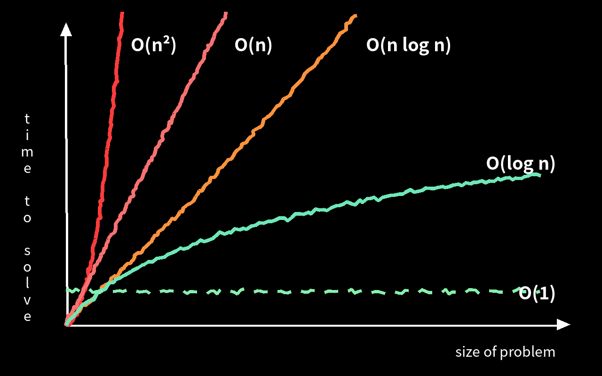

---
categories:
  - study-log/dev
date: 2026-09-22
description: C is a language in which managing memory—allocating and freeing it—is incredibly annoying.
lang: en
last_updated: 2026-11-14
naver_date: 2026-09-22
naver_url: https://blog.naver.com/martin-lee/224419464839
tags:
  - Study Notes
title: "[CS50] Review #2"
translation_key: 2026-09-22-cs50-review-2
---

**C is a language in which managing memory—allocating and freeing it—is incredibly annoying.**

Arrays are inefficient.

To allocate memory only when needed and create more dynamic data structures,

linked lists appeared, using only pointers.

The first two-dimensional data structure is trees.

```javascript
dypedef struct node
{
  int number;
  struct node *left;
  struct node *right;
}
```



O(n^2)

O(n log n)

O(n)

O(log n)

O(1)

**Hashing / Hash function**

**Hash tables =** "Key-Value"

**Tries**

---

I don’t understand this…

This is hard…
