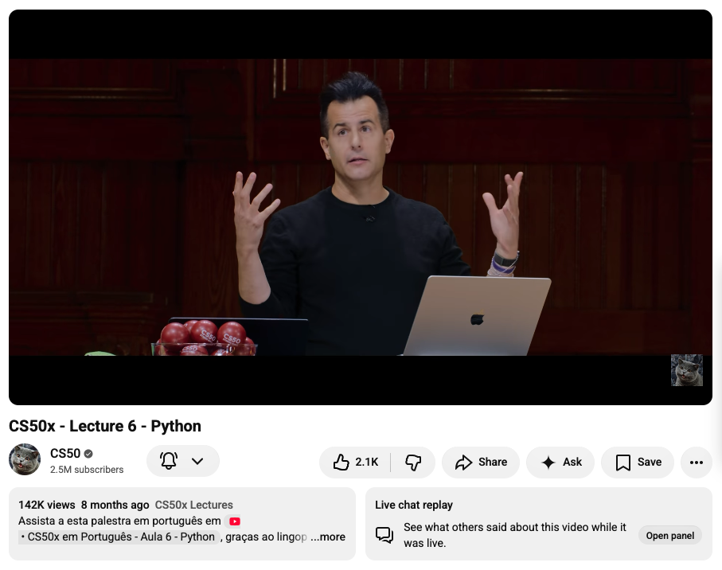

---
categories:
  - study-log/dev
date: 2026-09-23
description: We have invested more resources to make computers do more work.
lang: en
last_updated: 2026-11-14
naver_date: 2026-09-23
naver_url: https://blog.naver.com/martin-lee/224420584596
tags:
  - Study Notes
title: "[CS50] Review #3"
translation_key: 2026-09-23-cs50-review-3
---



We have invested more resources to make computers do more work.

As a result, we do not need to be as meticulous about syntax or write as much code.

```javascript
python hello.py
```

Python is not only a programming language; it is also a program in its own right.

Compared with C, the code becomes much more concise.

```javascript
// No ; (semicolon), no % operator, no need for #include <studio.h>, a main function, or types
answer = input("What's your name?");
print(f"hello, {answer}")
```

```javascript
// Pass named parameters by explicitly specifying their names
greet((greeting = "Hello"), (name = "Martin"));
```

**Conditionals are expressed with if, elif, and else.**

```javascript
if x < y:
  print("x is less than y");
elif x > y
  print("x is greater than y")
else:
  print("x is equal to y")
```

**Container type**

**\- range / list / tuple / dict / set ...**

```javascript
s = input("Do you agree? ").lower()

if s in ["y", "yes"]:
  print("Agreed")
else:
  print("Not agreed")
```

```javascript
before = input("Before: ")
after = before.upper()
print(f"After: {after}")
```

```javascript
// list
// scores = [72, 73, 33]
for i in range(3):
  score = int(input("Score: "))
  scores.append(score)

average = sum(scores) / len(scores)
print(f"Average: {average}")
```

```javascript
// dict
people = {
    "Kelly": "+1-617-495-1000",
    "David": "+1-617-495-1000",
    "John": "+1-123-465-1000"
}

name = input("Name: ")

if name in people:
    number = people[name]
    print(f"Found {number}")
else:
    print("Not Found")
```

**Object-Oriented Programming; OOP**

Strings are objects, and those objects have methods.

**Loops**

```javascript
for i in range(3):
  print("meow")
```

Python does not have do while.

```javascript
while True:
  n = int(input("Height: ")
  if n > 0:
      break

for i in range(n):
  print("#")
```

**Exceptions**

```javascript
try:
  n = int(input("Integer: "))
  print("Integer")
except ValueError:
  print("Not integer")
```
