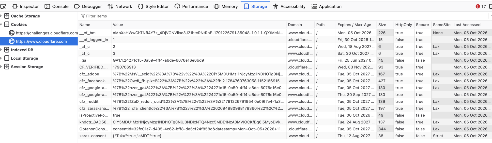

---
categories:
  - study-log/dev
date: 2026-10-06
description: While browsing websites, we often click “Accept” without thinking when asked, “Do you consent to cookies?” Yet we may not know what cookies actually are. Today, I want to learn about them.
lang: en
last_updated: 2026-11-14
naver_date: 2026-10-06
naver_url: https://blog.naver.com/martin-lee/224432543358
tags:
  - Study Notes
title: Cookies
translation_key: 2026-10-06-web-cookies
---

<figure data-image-caption="true">
  
  <figcaption><a href="https://www.ogq.me/backgrounds/1487600">© CoolPubilcDomains, Source: OGQ</a></figcaption>
</figure>

While browsing websites, we often click “Accept” without thinking when asked, “Do you consent to cookies?” Yet we may not know what cookies actually are. Today, I want to learn about them.

The name cookie comes from “[magic cookie](<http://catb.org/jargon/html/M/magic-cookie.html)%EC%9D%B4%ED%9B%84>).”

A cookie is **a small text file that a website stores in a user’s browser**.

Cookies are **used for user identification, keeping users logged in, personalization settings, shopping-cart functions, and storing browsing history and behavioral tracking information**. Simply put, cookies help ensure an efficient and secure web experience.

To view cookies in a browser, go to Developer Tools > Storage > Cookies. You can also enter document.cookie in Developer Tools > Console. Developer Tools > Network lets you inspect the flow of cookies, too. The actual cookies can be found in database form within the browser’s installation directory.

[https://support.mozilla.org/en-US/kb/about-your-important-data-and-their-files?utm\_source=chatgpt.com](https://support.mozilla.org/en-US/kb/about-your-important-data-and-their-files?utm_source=chatgpt.com)

[About your important data and their files | Firefox Help](https://support.mozilla.org/en-US/kb/about-your-important-data-and-their-files?utm_source=chatgpt.com)

As the screenshot above shows, cookies have attributes including **Name, Value, Domain, Path, Expires/Max-Age, HttpOnly, Secure, and SameSite**. Among these, **HttpOnly** prevents JavaScript from directly reading or modifying authentication cookies. **Secure** restricts transmission to HTTPS connections and is practically essential. **SameSite** limits cookies being attached to requests initiated from other sites, reducing CSRF risk. SameSite=Lax is common. Strict is more restrictive but can affect login flows when arriving via external links.

The most commonly used cookies are probably \_ga (GA4) and \_cf\_bm (Cloudflare). Cookies also remember settings such as dark mode and language. For these, HttpOnly should not be applied, and Domain should be limited to the necessary scope.

There are different types of cookies, too.

Session cookie: A cookie without Expires/Max-Age. It is normally deleted when the browser session ends, though it may return when the session is restored.

Persistent cookie: A cookie with an expiration condition that may remain after the browser closes.

Authentication cookie: Used to authenticate a logged-in user.

Tracking cookie: Used to track or analyze visits and behavior.

First-party cookie: Used in the same-site context as the site currently being visited.

Third-party cookie: A cookie belonging to a site other than the one currently being visited, used for advertising, embedded services, and similar purposes.

Zombie cookie: A cookie that is recreated after deletion using information left in other storage locations.

Cookies can be categorized by how long they last, their purpose, and their relationship to the site. A single cookie that keeps someone logged in may simultaneously be a persistent cookie, an authentication cookie, and a first-party cookie.

[https://www.cloudflare.com/ko-kr/learning/privacy/what-are-cookies/](https://www.cloudflare.com/ko-kr/learning/privacy/what-are-cookies/)

[What are cookies? | Cookie definition](https://www.cloudflare.com/ko-kr/learning/privacy/what-are-cookies/)

Let’s use an example to make this easier to understand.

Imagine the frontend as a restaurant’s dining room, where customers are welcomed, and the backend as the kitchen, where orders are handled.

The restaurant needs to remember each customer’s order and requests. As more customers arrive, it becomes harder to distinguish who ordered what, so each customer receives a numbered ticket. When a customer places an additional order, they show the ticket, and the restaurant finds the order record for that number and continues processing it. Session management using cookies is similar. The session ID cookie kept in the browser is the customer’s ticket, while the session data stored on the server is the restaurant’s order record. A cookie may contain only a number, or it may directly contain simple settings such as dark mode or language.

The example above might make cookies sound like something used for marketing. It is true that cookies are used for marketing today. But the original purpose of web cookies was to maintain state—such as a shopping cart—between otherwise independent HTTP requests. Over time, Memcached and Redis came to be used to store server-side session data and let several servers access the same records. In restaurant terms, this is an order-management system that several kitchens can consult together. Wherever the records are stored, however, the restaurant still needs to identify which customer a request belongs to. Cookies and these storage systems can therefore be used together.

Cookie-consent laws differ by country, so services must inform users about cookie use and obtain any required consent according to the laws that apply and the purposes for which the cookies are used.
