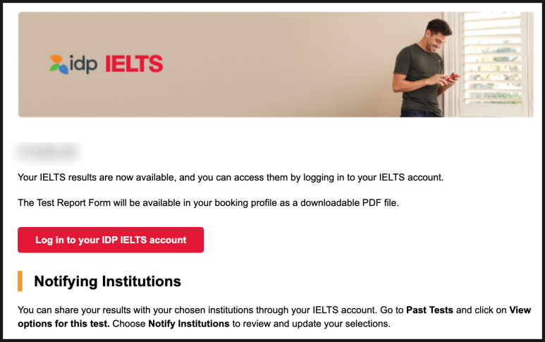
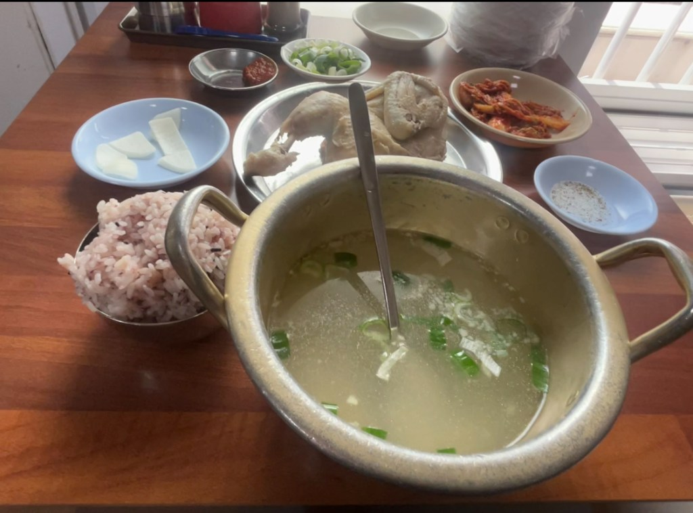
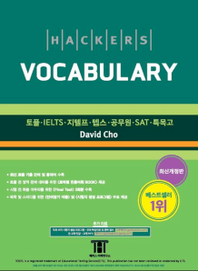
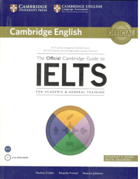
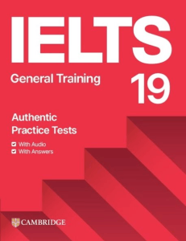

---
categories:
  - study-log/english
date: 2024-10-26
description: I took IELTS on Saturday, October 12, and received my results by email around 9 p.m. on Sunday the 13th. I was surprised by how quickly they arrived. Although I did not reach my target score, I am satisfied with the result of my first English test. Above all, I learned a lot while preparing…
lang: en
last_updated: 2026-11-14
naver_date: 2026-10-10
naver_url: https://blog.naver.com/martin-lee/224436717451
tags:
  - Useful Information
title: My IELTS Test Experience
translation_key: 2024-10-26-ielts-test-review
---

※ This post was moved from my previous blog during a migration. (Originally written: October 26, 2024)

I took IELTS on Saturday, October 12, and received my results by email around 9 p.m. on Sunday the 13th. I was surprised by how quickly they arrived. Although I did not reach my target score, I am satisfied with the result of my first English test. Above all, I picked up a lot of information while preparing, and I am writing this belated reflection to record it.

(Addendum: After finishing, I realized this feels more like a review than a reflection. Next time, I should try to write a proper reflection.)

---

**What is IELTS?**

IELTS (International English Language Testing System) is an internationally recognized test of English proficiency. It consists of four sections: **Listening / Reading / Writing / Speaking**. Listening (40 minutes), Reading (one hour), and Writing (one hour) run consecutively without a break for a total of two hours and 40 minutes. Speaking is held separately and takes about 12–14 minutes. You can choose between **General Training / Academic**, and between computer-based and paper-based testing.

**Choosing the test type, format, and venue**

Unlike TOEIC, IELTS is not limited to a fixed regular schedule; you can take it whenever a place is available. Check availability and register on the official IDP website. I recommend booking at least a week in advance. Registration requires passport details, so obtain a passport beforehand. I chose General Training on computer and booked an afternoon session at IDP’s Gangbuk location in Nambuk Square.

Some people struggle to choose the test type and format. For the type, choose according to your purpose—for example, Academic for graduate school or General Training for immigration. The format is simply a matter of preference. I chose computer-based testing because I am comfortable typing, and I felt each format had its own pros and cons. It also seems best to study in conditions as close to the actual test environment as possible.

Unfortunately, it did not feel appropriate to take photos at the venue, so I did not. It was not far from the station and was easy to reach by public transit. The test center was on the building’s 20th floor and felt like a rented section of the building. It was rather small—about 20 people would fill it—but the facilities were clean.

As this was my first IELTS test, I had no other venue to compare it with, but I experienced no particular inconvenience. I have, however, read other reviews mentioning noise during the test.

If you have lunch nearby, I recommend the chicken set meal at “Sarangbang Kalguksu,” close to the test center. With good prices, good food, and seating for solo diners, it should be very satisfying.

**The test experience**

**Speaking**

The speaking test lasts about 12–14 minutes and has three parts. Part 1 is a basic conversation. In Part 2, you receive a prompt, have one minute to prepare, and then speak in English on your own. Part 3 is a more in-depth conversation based on what you discussed in Part 2.

When preparing, I found speaking difficult to study because I had no one to talk to. I used italki, a platform for one-on-one online English lessons, but the cost can be a burden. While looking for study methods, I found a free option I recommend: [joining the IELTS Prep Discord](https://discord.com/invite/ielts-prep-868524158743633981). It is a channel with IELTS candidates from around the world, where you can find a speaking partner and practice in real time. It is free, and speaking with people from other countries feels somewhat like talking to an actual examiner, which is great.

My test was at 11:40, and these were the questions I actually received.

**Part 1**

Q: Do you live in a city or a town? (What is the difference between the two…?)

Q: What are the advantages of where you live? Why?

Q: Is there somewhere near where you live that you would recommend? Why?

Q: Do you like taking photos? Why?

**Part 2 & Part 3**

Q: Talk about an experience when you helped family or friends.

What happened?

Who did you help, and what did you do?

What was I doing at that moment?

Why did you do it?

The very first question in Part 1 threw me off a little. I wondered whether “city” and “town” were different, but felt I had to answer, so I responded quickly. After that, I think things went smoothly. When I received the Part 2 prompt, it was fascinating to see what I had watched in YouTube videos happening right in front of me. I do not remember the Part 3 questions very well. I may have given some unexpected answers, but I do not think I got stuck on any of the examiner’s questions.

It was my first time ever speaking face-to-face with a foreigner, so I was very nervous. The test took place in a very relaxed atmosphere, and I never felt interrupted or treated rudely.

**Listening, Reading, Writing**

The test proceeds in the order Listening, Reading, Writing. Be sure to remember that there are no breaks between them. The total test time is almost three hours, so it is more tiring than expected, and concentrating for that long is not easy. When preparing, it may help to get into the habit of completing the sections consecutively.

I prepared using only The Official Cambridge Guide to IELTS, Cambridge IELTS books 15–19, and a Hackers vocabulary book. I chose them because they are the best known and are used by most academies. Having taken the test, I think they were definitely helpful. You can find good explanations of the question types in each IELTS section on YouTube. Working through many questions to get a feel for them matters, but it also helps to know the formats beforehand, so set aside time to familiarize yourself with the question types. Knowing plenty of vocabulary is certainly useful, and knowing many synonyms is especially helpful when answering questions.

For reference, the Cambridge books are essentially practice-test books containing past exam questions, and they are expensive at KRW 34,000. You can buy them cheaply secondhand or easily find PDFs through an internet search.

---

**Conclusion**

Preparing for IELTS reduced some of my fear of English, which I had always assumed would be difficult. I think this test is more practical than other English certification exams. During preparation, I gradually learned how to study English and changed my surroundings to make it easier to encounter the language. As you study, you notice that English is used in many parts of daily life. I also think our level of education has risen enough that we can communicate with foreigners without much difficulty. Still, the English we commonly use is only at a fairly basic level. To learn a language, you need plenty of exposure and familiarity. I do not know whether I will take IELTS again, but I think steady effort will lead to better results.
