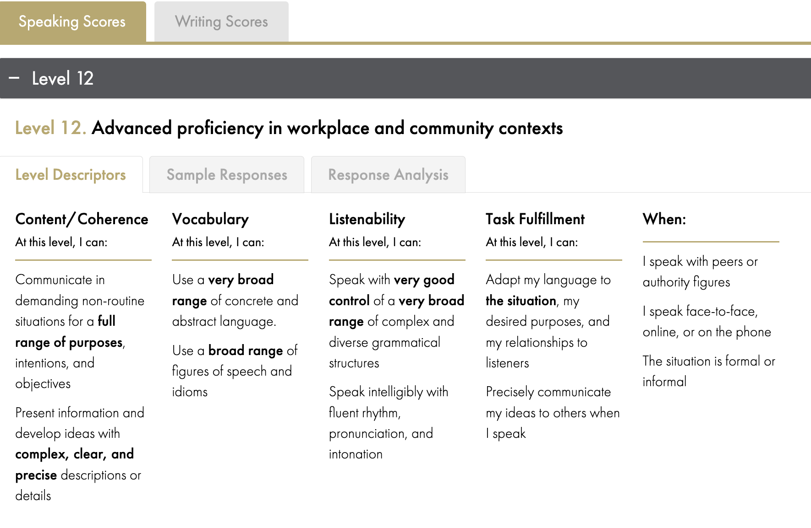

---
categories:
  - study-log/english
date: 2025-11-16
description: I would confidently say that people studying for CELPIP are aiming to obtain permanent residence in Canada. I think I recently saw that Australia also accepts CELPIP scores for immigration, but that is a very recent policy, and for now it is mainly Canadian permanent-residence applicants taking the test…
lang: en
last_updated: 2026-11-14
naver_date: 2025-11-16
naver_url: https://blog.naver.com/martin-lee/224077467213
tags:
  - Study Notes
title: Read This Before Studying for CELPIP
translation_key: "2025-11-16-before-studying-for-celpip"
---

**English is essential.**

I would confidently say that people studying for CELPIP are aiming to obtain permanent residence in Canada. I think I recently saw that Australia also accepts CELPIP scores during immigration assessment, but that is a very recent policy, and for now it is mainly people applying for Canadian permanent residence who take the test.

Some people also need English scores for academic purposes, such as university, graduate school, or college admission, but they seem to mainly take IELTS Academic or the Duolingo test.

For permanent residence, **Duolingo is not yet accepted, and CELPIP is easier than IELTS General, costs less, and provides results faster**, so people tend to prefer CELPIP. In fact, that is the whole reason to study for CELPIP.

**CELPIP = A test for Canadian immigration**

We need to remember that we are taking this test because we need an English score, not to become good at English. Of course, everyone has a different study style, but if the goal is a high score, we should focus our preparation on that and finish once we achieve it. Canada’s Express Entry permanent-residence program is points-based, so a higher English score puts you in a better position.

First, we need to understand CELPIP properly.

(This post is a personal set of notes using the official CELPIP website and ChatGPT to gain a deeper understanding of CELPIP. Please note that it is not a post sharing or recommending study methods.)

**1\. Official CELPIP website**

[https://www.celpip.ca/](https://www.celpip.ca/)

[Home - CELPIP](https://www.celpip.ca/)

\- The test costs $290 + tax.

\- The sections are taken in the order L > R > W > S.

\- Total time is about two hours and 50 minutes.

\- After registering for an account, you can take two practice tests. It seems useful to sign up, assess your current level, and familiarize yourself with the overall test first. Additional paid practice-test sets are also sold separately.

**2\. Official CELPIP YouTube channel**

[**https://www.youtube.com/@CELPIPOfficial/videos**](https://www.youtube.com/@CELPIPOfficial/videos)

[CELPIP Test](https://www.youtube.com/@CELPIPOfficial/videos)

The channel uploads videos analyzing the task types in each section and explaining how to prepare. They might be good to listen to on the commute to and from work.

**3\. Task types by section**

<table><tbody><tr><td></td><td>
Part - Task type
</td><td>
Questions / Time
</td><td>
Content
</td></tr><tr><td rowspan="6">
Listening

(38 questions total / Approximately 47–55 minutes)
</td><td>
Part 1 - Problme Solving
</td><td>
8 questions / 11–13 minutes
</td><td>
A conversation between two people solving an everyday problem (reservations, schedules, purchases, breakdowns). Select the necessary information.
</td></tr><tr><td>
Part 2 - Daily Life Conversation
</td><td>
5 questions
</td><td>
Everyday conversation among friends, family, or colleagues. Identify feelings, intentions, and details.
</td></tr><tr><td>
Part 3 - Listening for Information
</td><td>
6 questions
</td><td>
One person explains a place, rules, or a procedure. Information-matching questions.
</td></tr><tr><td>
Part 4 - News Item
</td><td>
5 questions
</td><td>
Listen to a news item and identify key facts, numbers, and the sequence of events.
</td></tr><tr><td>
Part 5 - Discussion
</td><td>
8 questions
</td><td>
Several people discuss a topic. Distinguish their different opinions and arguments.
</td></tr><tr><td>
Part 6 - Viewpoints
</td><td>
6 questions
</td><td>
One person gives an extended opinion. Identify attitude, feelings, and supporting reasons.
</td></tr><tr><td rowspan="4">
Reading

(38 questions total / 55–60 minutes)
</td><td>
Part 1 - Correspondence
</td><td>
11 questions / 9–13 minutes
</td><td>
Read an email or message and identify the sender’s intentions, feelings, and the content of a response.
</td></tr><tr><td>
Part 2 - Apply a Diagram
</td><td>
8 questions / 9–13 minutes
</td><td>
Use a notice, table, or diagram to find the option that meets the conditions.
</td></tr><tr><td>
Part 3 - Reading for Information
</td><td>
9 questions / 10–15 minutes
</td><td>
A longer informational text, such as a notice or explanation. Identify facts and details.
</td></tr><tr><td>
Part 4 - Reading for Viewpoints
</td><td>
10 questions / 13–18 minutes
</td><td>
An opinion or argument piece. Questions about the writer’s attitude, supporting reasons, and comparisons.
</td></tr><tr><td rowspan="2">
Writing

(2 tasks total / 53 minutes)
</td><td>
Part 1 - Writing an Email
</td><td>
1 task / 27 minutes
</td><td>
Write an email with a clear purpose: explain a situation, make a request, suggest a solution, and so on.
</td></tr><tr><td>
Part 2 - Responding to Survey Questions
</td><td>
1 task / 26 minutes
</td><td>
Choose one of two options → Give at least three reasons with specific explanations.
</td></tr><tr><td rowspan="8">
Speaking

(8 tasks total / Approximately 15–20 minutes)
</td><td>
Part 1 - Giving Advice
</td><td>
30 seconds to prepare / 90 seconds to respond
</td><td>
A friend has a concern → Offer two or three pieces of advice.
</td></tr><tr><td>
Part 2 - Personal Experience
</td><td>
30 seconds to prepare / 90 seconds to respond
</td><td>
Describe an actual personal experience naturally.
</td></tr><tr><td>
Part 3 - Describing a Scene
</td><td>
30 seconds to prepare / 90 seconds to respond
</td><td>
Describe what is visible in a photo or picture, focusing on people, actions, and the situation.
</td></tr><tr><td>
Part 4 - Making Predictions
</td><td>
30 seconds to prepare / 90 seconds to respond
</td><td>
Look at a scene and predict what will happen next.
</td></tr><tr><td>
Part 5 - Comparing &amp; Persuading
</td><td>
60 seconds to prepare / 90 seconds to respond
</td><td>
Compare two options → Persuade the other person.
</td></tr><tr><td>
Part 6 - Difficult Situation
</td><td>
60 seconds to prepare / 90 seconds to respond
</td><td>
Propose a solution to an awkward situation. Polite requests and explanations are important.
</td></tr><tr><td>
Part 7 - Expressing Opinions
</td><td>
30 seconds to prepare / 90 seconds to respond
</td><td>
Give an opinion on a topic with two or three reasons.
</td></tr><tr><td>
Part 8 - Unusual Situation
</td><td>
30 seconds to prepare / 90 seconds to respond
</td><td>
Describe an “unusual situation” (for example, a strange scene). Creativity is needed.
</td></tr></tbody></table>

**4\. CELPIP Score Comparison Chart**

[**https://www.celpip.ca/prepare-for-celpip/score-comparison-chart-2/**](https://www.celpip.ca/prepare-for-celpip/score-comparison-chart-2/)

[Score Comparison Chart - CELPIP](https://www.celpip.ca/prepare-for-celpip/score-comparison-chart-2/)

This test does not assign different point values to different questions. In other words, you just need to get as many questions right as possible. Minimize mistakes and make sure to get every question you can answer right. Since the test lasts almost three hours, concentration is essential.

If you have taken a recognized English test such as IELTS, TOEIC, or TOEFL before, this probably will not feel much different.

If you have to take CELPIP anyway, I hope you prepare well and get the score you need in one attempt. In terms of money and time, simply spending a long time on this test does not necessarily improve your result, and it does not seem worth that much prolonged effort.
