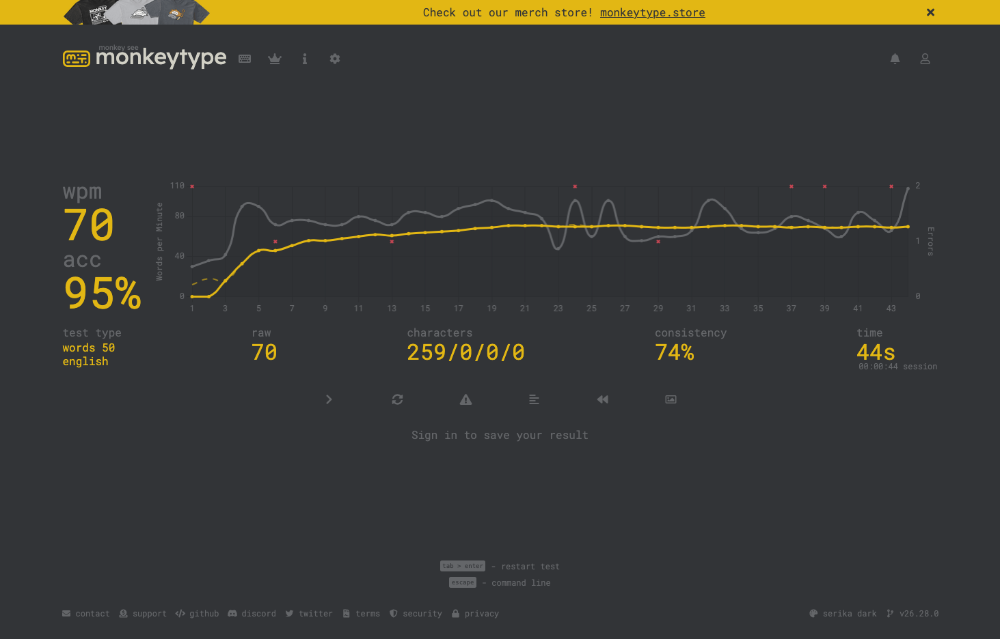
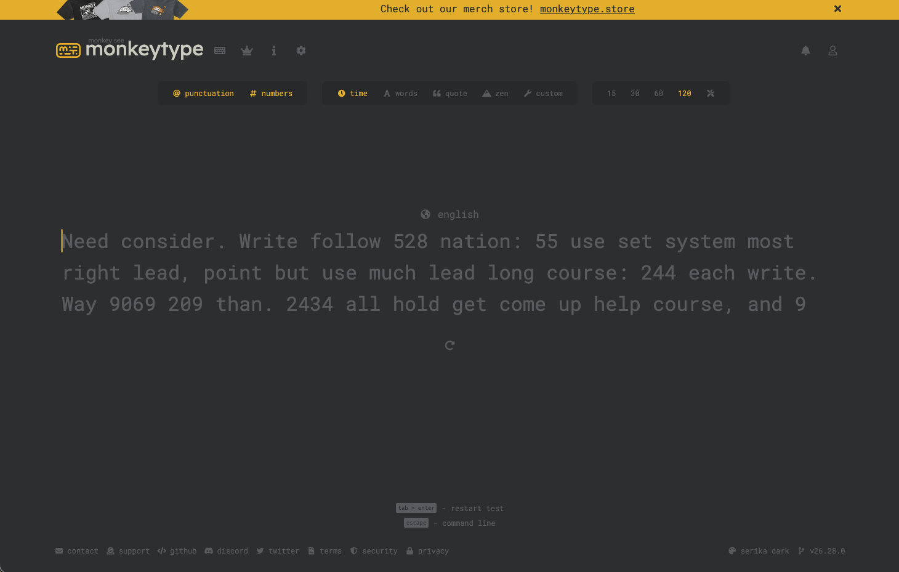

---
categories:
  - study-log/english
date: 2026-07-23
description: I was not used to typing in English, so I started looking for a site where I could practice.
lang: en
last_updated: 2026-11-14
naver_date: 2026-07-23
naver_url: https://blog.naver.com/martin-lee/224354982503
tags:
  - English Typing Practice
  - monkeytype
  - Monkeytype
  - English Typing
title: Practicing English Typing — monkeytype.com
translation_key: "2026-07-23-typing-with-monkeytype"
---

[https://monkeytype.com/](https://monkeytype.com/)

I was not used to typing in English, so while looking for a site where I could practice,

[https://monkeytype.com/](https://monkeytype.com/)

[Monkeytype | A minimalistic, customizable typing test](https://monkeytype.com/)

I discovered monkeytype.com.

You can see the rankings, too. People are really fast…

When typing in Korean, I can hold my own anywhere.

Switching to English makes it much harder.

Practice will do it.

Let’s get used to it.

When I was young, we had computer classes…

Our practical assignments were to exceed 300 or 500 keystrokes per minute in Hancom Typing.

I wonder whether they still do that these days…

#EnglishTypingPractice

#monkeytype

#Monkeytype

#EnglishTyping
