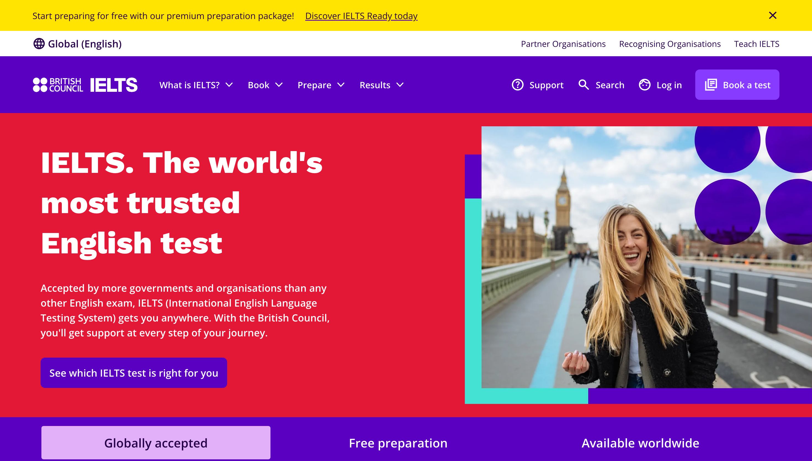
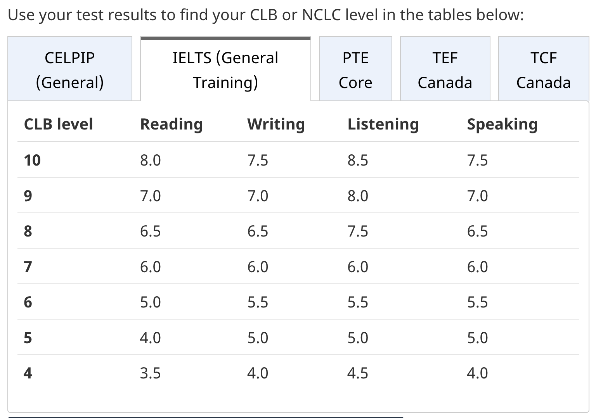

---
categories:
  - study-log/english
date: 2026-11-11
description: Notes written while preparing for the IELTS test
lang: en
last_updated: 2026-11-12
tags:
  - ielts
  - english
title: Preparing for IELTS (edX Courses, Anki, Engnovate, IELTS Bro, Podcasts…)
translation_key: "ielts-preparation"
---

I have taken IELTS before. I attended an academy for a month? Two months? But I remember the result being terrible… (An email recently reminding me that my score would soon expire brought it back to mind.) When deciding to study for an English test again, I debated CELPIP versus IELTS and eventually came full circle and decided to prepare for IELTS once more.

These are my personal reasons for choosing IELTS over CELPIP:

1. CELPIP does not have many study materials.

2. I have often heard that if you want to study English properly, you should master IELTS.

Aside from those two points, many reviews say that getting a good score on CELPIP is easier and that it is cheaper. I think it is best to choose whichever approach suits you and start studying quickly.

---

## **IELTS**

IELTS is **an internationally recognized English proficiency test widely used for university and graduate-school admission, employment, and immigration in English-speaking countries**.

IELTS is jointly operated by the British Council in the UK, IDP Education in Australia, and Cambridge University Press & Assessment. Registration is mainly handled through the British Council or IDP, and both organizations use the same test difficulty and scoring criteria. You can therefore choose by comparing venue locations, dates, fees, and available study materials.

Depending on your purpose, the test is divided into **IELTS Academic** and **IELTS General Training**. **Both assess Listening, Reading, Writing, and Speaking. Listening and Speaking use the same tests, but Reading and Writing differ in content.** Generally, choose Academic when preparing for university or graduate-school admission, and General Training when applying for Canadian permanent residence. The fee is approximately KRW 340,000 in Korea and CAD $362–389 in Vancouver, depending on the venue and test format. Results are generally valid for two years from the test date.

## IELTS Structure and Question Types by Section

### **Listening**

**Test duration**

- Approximately 30 minutes

- Paper-based: 10 minutes to transfer answers

- Computer-delivered: 2 minutes to review answers

**Test structure: 4 Parts (40 Questions)**

- Social Conversation — Two speakers

- Social Monologue — One speaker

- Academic Discussion — Two to four speakers

- Academic Lecture — One speaker

**Question types: 7 Question tpyes**

- Form / notes / flowchart

- Multiple-choice

- Short answer

- Sentence completion

- Labelling diagram / map

- Classification

- Matching

### Speaking

**One-on-one format, 3 parts, 11–14 minutes**

- Part 1 — Introduction & Interview (4–5 min)  
  Identity check, questions about familiar topics (home, work, studies, hobbies).

- Part 2 — Individual Long Turn (3–4 min)  
  Task card with a topic and prompts, 1 minute to prepare and make notes, 1–2 minutes to speak, possible follow-up questions

- Part 3 — Discussion (4–5 min)  
  More abstract questions related to Part 2, including opinions, comparisons, and explanations.

**Assessment criteria**

- **Fluency and coherence**

- **Lexical resource**

- Grammatical range and accuracy

- Pronunciation

### **Reading**

### **Writing**

## **Aiming for Canadian Permanent Residence?**

To reach CLB 10, the level that earns the maximum language points for permanent residence, you need <strong><em><u>Reading 8, Writing 7.5, Listening 8.5, and Speaking 7.5</u></em></strong>. This is roughly an overall band of 8.0—a score you could describe as allowing only two or three mistakes in each section… Let’s try to achieve as high a score as possible…

---

## **Study Materials**

- [https://takeielts.britishcouncil.org/](https://takeielts.britishcouncil.org/)

- [https://ielts.idp.com/](https://ielts.idp.com/)

- [https://www.edx.org/learn/test-prep/the-university-of-queensland-ielts-academic-test-preparation](https://www.edx.org/learn/test-prep/the-university-of-queensland-ielts-academic-test-preparation)

- [https://ankiweb.net/](https://ankiweb.net/)

- [https://engnovate.com/ielts-tests/](https://engnovate.com/ielts-tests/)

- [https://ieltsbro.com/](https://ieltsbro.com/)

- [https://www.youtube.com/@EnglishProTips](https://www.youtube.com/@EnglishProTips)

- [https://open.spotify.com/show/5ISJgLQXgXRzeumkV4eR40](https://open.spotify.com/show/5ISJgLQXgXRzeumkV4eR40)
