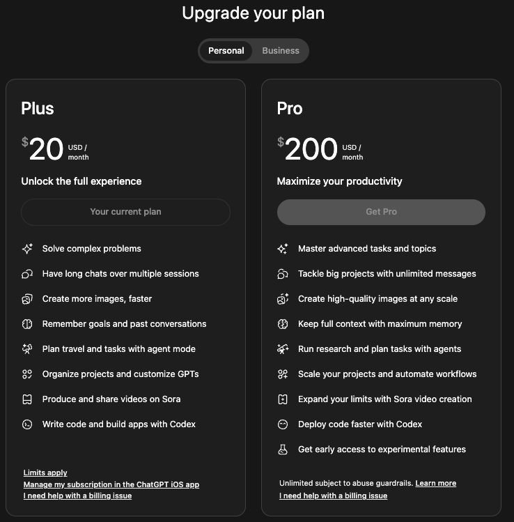
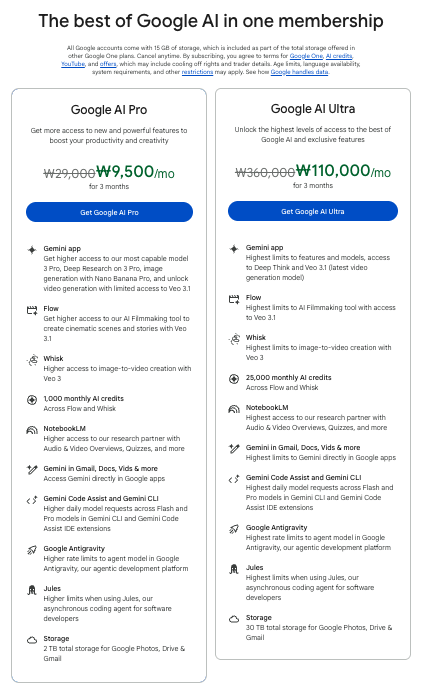
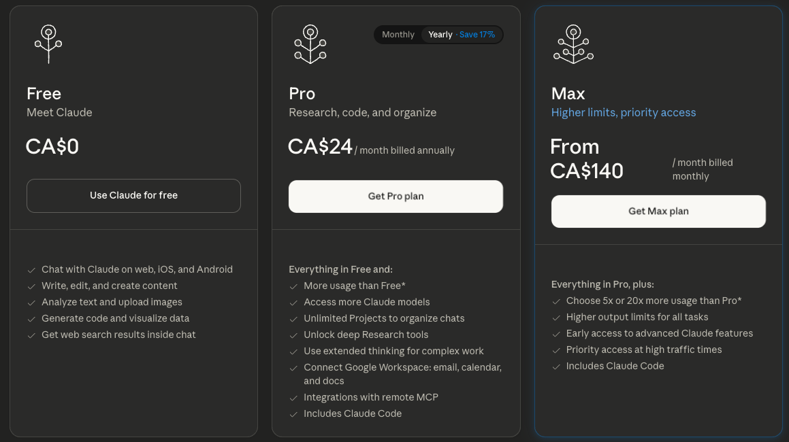
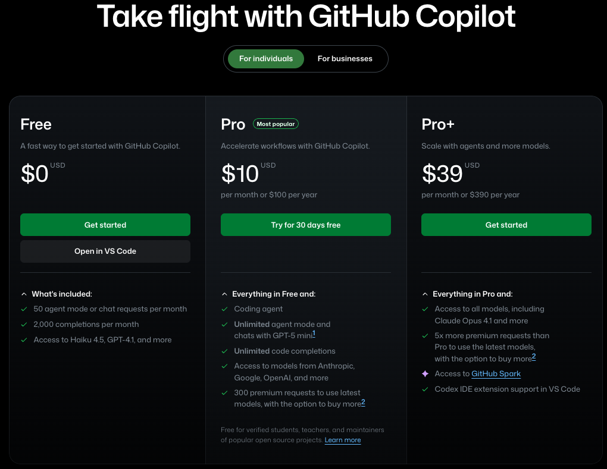
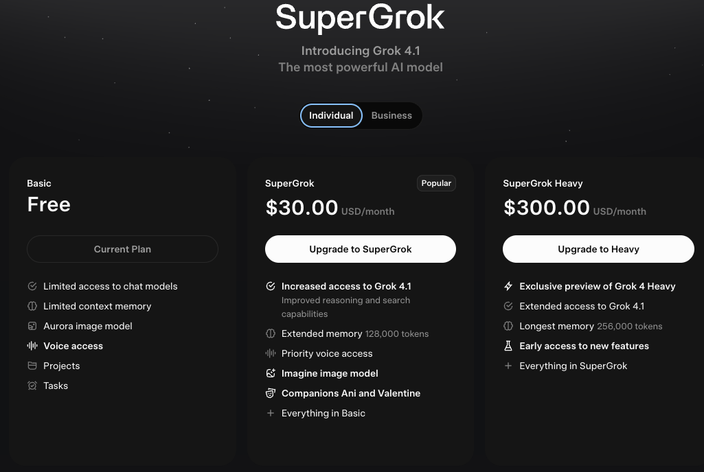
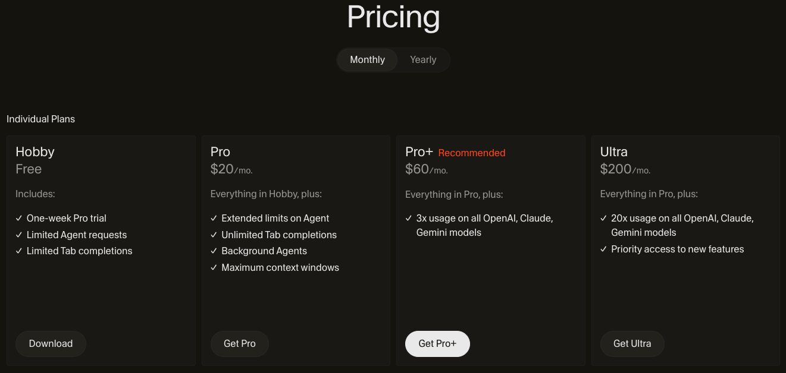

---
categories:
  - useful-tips/general
date: 2026-01-08
description: Perhaps because vibe coding has become so popular, even non-developers can now code easily. Sometimes they build things better than developers do. That may be why so many people seem to be starting their own projects or websites as a side hustle.
lang: en
last_updated: 2026-11-14
naver_date: 2026-01-08
naver_url: https://blog.naver.com/martin-lee/224138665001
tags:
  - Sharing information
title: Which AI Tools Should I Use?
translation_key: 2026-01-08-choosing-ai-tools
---

<figure data-image-caption="true">
  
  <figcaption><a href="https://www.ogq.me/backgrounds/1515200">© CoolPubilcDomains, Source: OGQ</a></figcaption>
</figure>

Perhaps because vibe coding has become so popular, even non-developers can now code easily. Sometimes they build things better than developers do. That may be why so many people seem to be starting their own projects or websites as a side hustle.

For some, it is a hobby, and things may vary by industry. But at least for people whose jobs involve using a computer, an AI subscription has become a necessity rather than an option.

Since this is the age of AI, I also tried to replace everything with AI platforms so I could keep up. My usual combination was ChatGPT + Cursor + Comet + Figma, with only ChatGPT on a paid subscription. After reading that the Comet browser was not secure, I stopped using it. When I heard that Cursor's Solidity extension had security vulnerabilities, I immediately went back to VSCode, too.

Fortunately, I could use the features available in Cursor in VSCode as well. The trouble was that the free credit allowance was far too small. Maybe I had already become too used to working with AI. I could not resist and paid for Copilot. I am quite happy with it. As many people had predicted, I could really feel the equation taking shape: money = credits = access to powerful AI tools = time saved.

Once this equation has been fully proven, I thought, it might become difficult to use AI as cheaply as we do now. Reality feels like a game. AI companies encourage us to spend, and in games, it is hard to beat paying players.

Unless you are aiming to become a top-ranked player, it is best to get the most enjoyment from a reasonable amount of spending. So let me compare and organize the AI tools to get as much value as possible. Fortunately, there are not that many AI companies, so there was not too much to agonize over.

**<AI>**

**OpenAI ChatGPT,**

**Google Gemini,**

**Anthropic Claude Code,**

**Github Copilot,**

**Meta MetaAI(Llama),**

\- Coming soon

**xAI Glok,**

**Deepseek**

**<IDE>**

**Microsoft VSCode**

**Google Antigravity**

**Cursor**

**<Browser>**

**Perplexity Comet**

**OpenAI Atlas**

**<Note>**

**Google NotebookLM**

**<Design>**

**Midjourney**

**Figma**

These may be all we need to keep an eye on. For now, at least.

Whenever a company announces a new model, people benchmark it and compare its performance. Honestly, keeping up every time is exhausting. Let us put aside who will win and first find the tools that suit us.

New AI companies are appearing, but my conservative nature makes me cheer for the established players, Microsoft and Google, rather than readily embrace something new. I think that is a bad habit.

[https://medium.com/hashed-kr/vibe-founders-64f178fe5497](https://medium.com/hashed-kr/vibe-founders-64f178fe5497)

While writing this, I came across an article by Simon Seojoon Kim, CEO of HASHED. Once again, I feel that AI really is the paradigm of our time. And an opportunity has arrived in front of us.

The era of succeeding on thoughts and ideas alone is over. From now on, it is about execution and persistence.
