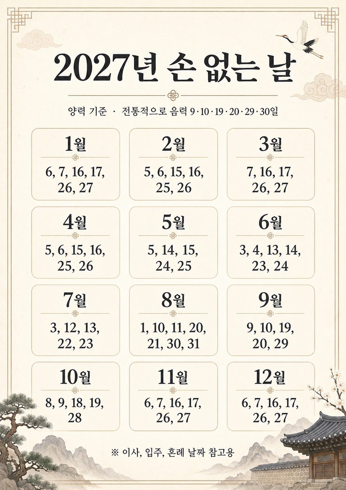
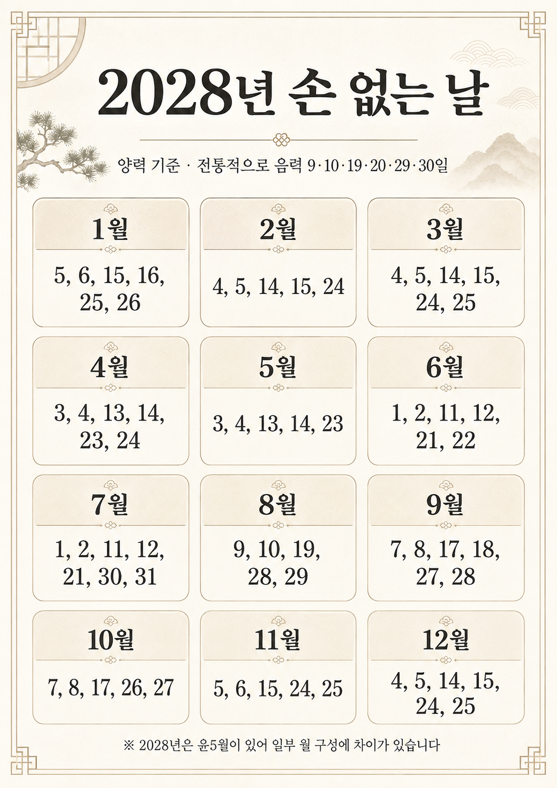
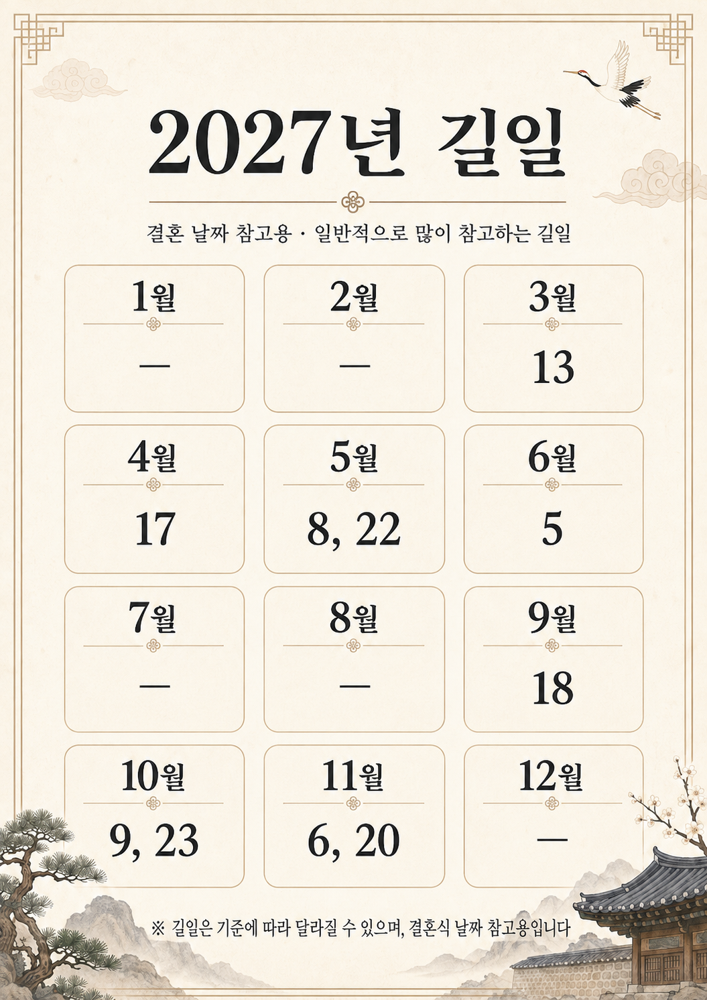
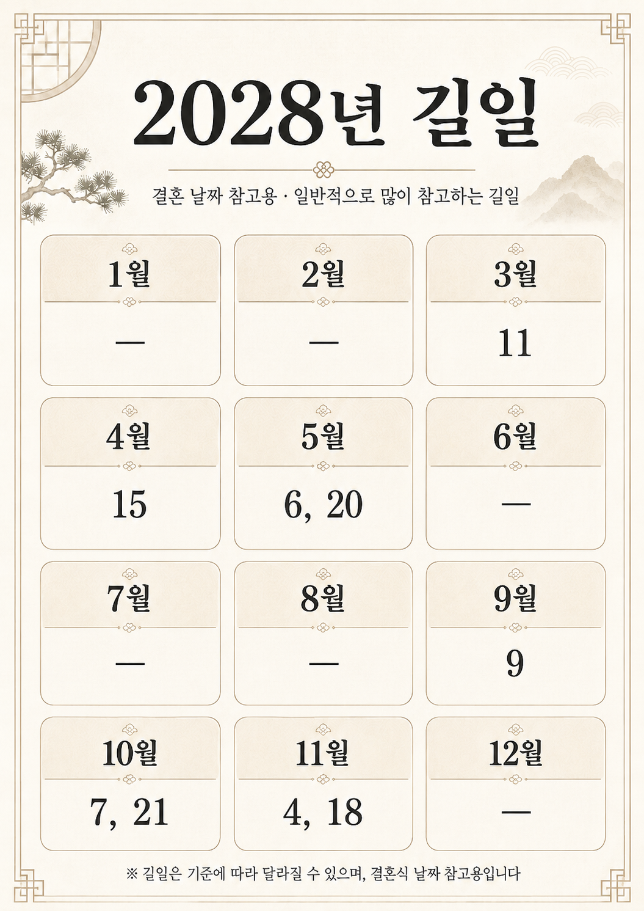

---
categories:
  - useful-tips/general
date: 2026-08-27
description: What you need to do is choose your wedding date.
lang: en
last_updated: 2026-11-14
naver_date: 2026-08-27
naver_url: https://blog.naver.com/martin-lee/224391813548
tags:
  - wedding
  - marriage
  - wedding-date
  - auspicious-days-2027
  - auspicious-days-2028
  - days-without-son
title: "[Marriage] Choosing a Wedding Date: Auspicious Days in 2027, Peak and Off-Peak Seasons, and Holidays"
translation_key: 2026-08-27-choosing-a-wedding-date
---

If you have decided to get married,

and need to start preparing for the wedding,

the thing to do is **choose your wedding date**.

Although there is no scientific basis for it, many people still

choose a moving date on a day without “son,”

select a wedding date using auspicious days and traditional date selection,

or consider both auspicious days and days without “son” when choosing a business opening date.

\* A day without “son” = a day believed to be free of the misfortune-bringing spirit called “son”

\* Auspicious day = any day traditionally considered good for undertaking something

\* Inauspicious day = a day on which important activities are best avoided

\* Date selection = choosing an actual date after weighing various conditions

(A day without “son” != an auspicious day)

There are fewer auspicious days than days without “son.”

There are also different kinds of auspicious days:

<table><tbody><tr><td>
<b>Type</b>
</td><td>
<b>Meaning / Concept</b>
</td><td>
<b>Main Uses</b>
</td><td>
<b>Characteristics</b>
</td></tr><tr><td>
<b>Hwangdo auspicious day</b>
</td><td>
A favorable day based on celestial movements and traditional astrological influences
</td><td>
Weddings, moving, and business openings in general
</td><td>
The most widely recognized concept of an auspicious day
</td></tr><tr><td>
<b>Cheondeok day (天德日)</b>
</td><td>
A day imbued with heaven's virtue
</td><td>
Weddings, contracts, and new beginnings
</td><td>
Believed to bring blessings and reduce misfortune
</td></tr><tr><td>
<b>Woldeok day (月德日)</b>
</td><td>
A day with the virtue of the moon
</td><td>
Weddings, business openings, and moving
</td><td>
Considered favorable, much like a Cheondeok day
</td></tr><tr><td>
<b>Cheoneun day (天恩日)</b>
</td><td>
A day believed to receive heaven's grace
</td><td>
Wedding ceremonies, celebrations, and initiation ceremonies
</td><td>
Often mentioned in connection with happy occasions
</td></tr><tr><td>
<b>Daean auspicious day (大安吉日)</b>
</td><td>
A day signifying peace without major trouble
</td><td>
Weddings, moving, and business openings
</td><td>
Often regarded as a reliably favorable, stable day
</td></tr><tr><td>
<b>Eumyang Buljang / Eumyang Bujang auspicious day</b>
</td><td>
A day when yin and yang are in harmony and misfortune is limited
</td><td>
Selecting wedding dates
</td><td>
One of the criteria often used for marriage dates
</td></tr><tr><td>
<b>Sipjeon Daegil day</b>
</td><td>
An exceptionally auspicious day
</td><td>
Major events, weddings, and business openings
</td><td>
As the name suggests, considered a “very good day”
</td></tr><tr><td>
<b>Saenggi / Saenggap day</b>
</td><td>
A day believed to be full of vitality and energy
</td><td>
Business openings, departures, and starting a business
</td><td>
Considered favorable for new beginnings
</td></tr><tr><td>
<b>Ordinary auspicious day</b>
</td><td>
A generally favorable, uneventful day
</td><td>
Important everyday appointments
</td><td>
Not an especially remarkable auspicious day, but often consulted
</td></tr></tbody></table>

2027

**March 13 (Sat): Daean auspicious day**

**April 17 (Sat): Cheondeok day**

**May 8 (Sat): Cheoneun day**

**May 22 (Sat): Woldeok day**

June 5 (Sat): Daean auspicious day

**September 18 (Sat): Cheondeok day**

**October 9 (Sat): Daean auspicious day**

**October 23 (Sat): Woldeok day**

**November 6 (Sat): Cheondeok day**

November 20 (Sat): Daean auspicious day

2028

**March 11 (Sat): Daean auspicious day**

**April 15 (Sat): Cheondeok day**

**May 6 (Sat): Cheoneun day**

**May 20 (Sat): Woldeok day**

**September 9 (Sat): Daean auspicious day**

**October 7 (Sat): Cheondeok day**

**October 21 (Sat): Daean auspicious day**

**November 4 (Sat): Cheondeok day**

November 18 (Sat): Woldeok day

Those are the dates.

The second thing to consider is **wedding season**.

**Peak wedding season**

Spring: March–May

Fall: September–November

April–May and September–October are especially popular.

**Off-peak wedding season**

Winter: January–February and December

Summer: July–August

Keep in mind that prices can vary enormously depending on the season.

Dates that combine an auspicious day, a day without “son,” and peak season are usually popular and difficult to book.

Another thing to consider is **holiday periods**.

People travel during holidays, so your guests may resent you...

Office workers often attach vacation days to a holiday period, so that is worth remembering...

Flights for the honeymoon might be expensive, too...?

2027

May 1 (Sat)–May 3 (Mon): Labour Day + substitute holiday

**September 14 (Tue)–September 16 (Thu): Chuseok**

October 2 (Sat)–October 4 (Mon): National Foundation Day + substitute holiday

October 9 (Sat)–October 11 (Mon): Hangeul Day + substitute holiday

2028

April 29 (Sat)–May 2 (Tue): Weekend + Labour Day + Buddha's Birthday

May 5 (Fri)–May 7 (Sun): Children's Day + weekend

September 30 (Sat)–October 5 (Thu): Weekend + Chuseok + substitute holiday for National Foundation Day

October 7 (Sat)–October 9 (Mon): Hangeul Day

I hope everyone chooses a good wedding date, has a ceremony that goes smoothly,

and enjoys nothing but happiness in the years ahead.

#wedding

#marriage

#weddingdate

#auspiciousdays2027

#auspiciousdays2028

#dayswithoutson
