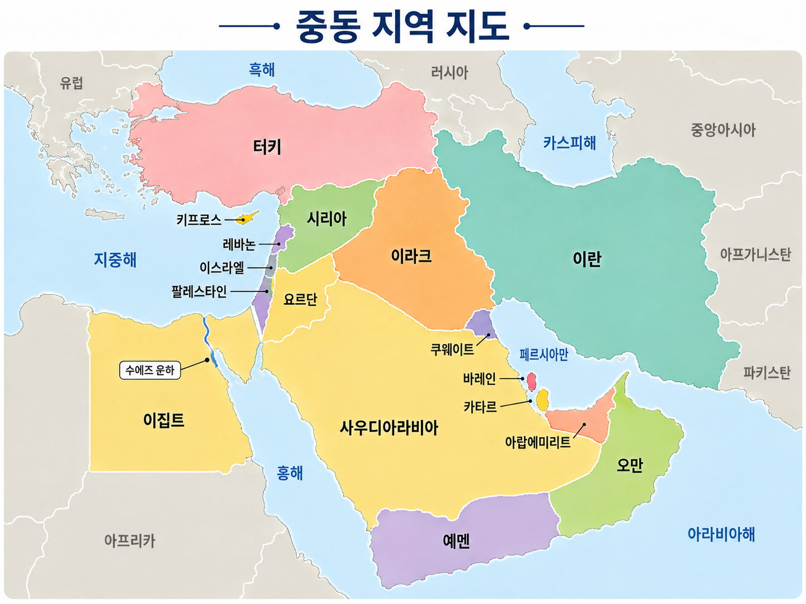

---
categories:
  - useful-tips/general
date: 2026-09-02
description: Where is the Middle East?
lang: en
last_updated: 2026-11-14
naver_date: 2026-09-02
naver_url: https://blog.naver.com/martin-lee/224398026298
tags:
  - Study notes
title: What Exactly Is the Middle East?
translation_key: 2026-09-02-defining-the-middle-east
---

Where is the Middle East?

When we hear “the Middle East,” places that produce oil readily come to mind.

Usually, Western Asia and the area around Egypt are grouped together as the Middle East. The countries and territories include:

Saudi Arabia

UAE

Qatar

Kuwait

Bahrain

Oman

Yemen

Iraq

Iran

Israel

Jordan

Lebanon

Syria

The Palestinian territories

Turkey

Egypt

These are grouped together as the Middle East.

If the scope is broadened to include North Africa, Libya, Tunisia, Algeria, and Morocco are sometimes also considered part of the Middle East.

---

**Why the Middle East Matters**

1\. Resources

2\. Geographic location

3\. Canals

4\. Political, religious, and security issues

Judaism, Christianity, and Islam all originated in this region or have major holy sites here.

Israel–Palestine,

Iran–Saudi Arabia,

Sunni–Shia,

and the interests of the United States, Russia, and China all overlap. It is a strategic crossroads where many complex factors coexist.
