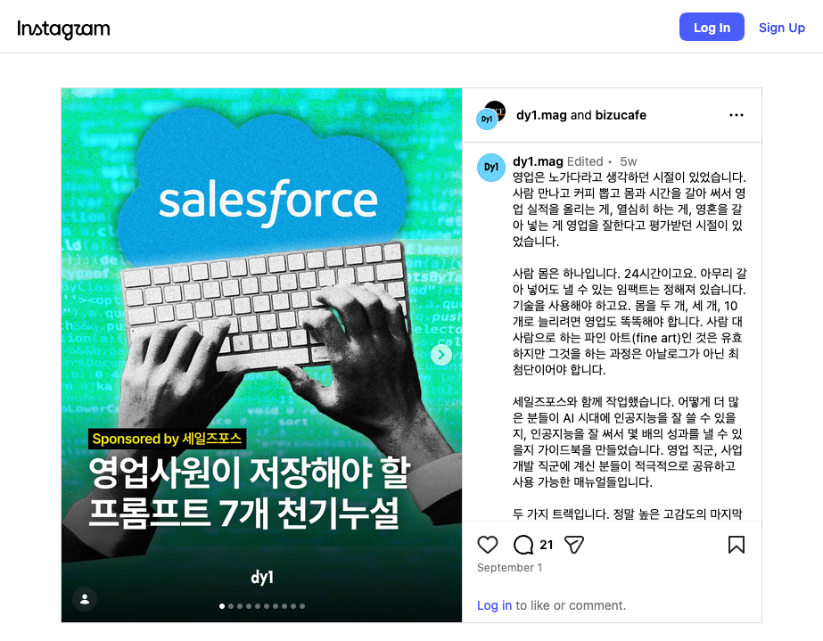

---
categories:
  - useful-tips/general
date: 2026-09-03
description: 2. Practice handling rejection, ten minutes before a meeting.
lang: en
last_updated: 2026-11-14
naver_date: 2026-09-03
naver_url: https://blog.naver.com/martin-lee/224399141758
tags:
  - prompts
title: Prompting Tips
translation_key: 2026-09-03-prompting-tips
---

[https://www.instagram.com/p/DcxGkfgmUD\_/?utm\_source=ig\_web\_copy\_link&igsi=NTc4MTIwNjQ2YQ==](https://www.instagram.com/p/DcxGkfgmUD_/?utm_source=ig_web_copy_link&igsi=NTc4MTIwNjQ2YQ==)

---

Research the day before a meeting

> I have a meeting with \[company name\] tomorrow. Research the following and brief me.
>
> News, investment, and hiring updates about this company from the past three months
>
> Three problems this company may currently be facing, with supporting evidence
>
> Two topics I can bring up to break the ice at the meeting
>
> Points of connection with our product, \[product name\]
>
> Finish by listing “three questions I should ask in this meeting.”

2\. Practice handling rejection, ten minutes before a meeting

> You are the \[job title\] at \[company name\]. You are considering adopting our product, but you are skeptical. I am the salesperson. Let's have a conversation.
>
> Raise the following objections in order: “It is too expensive,” “What we currently use is enough,” and “We need to review this internally.” After the conversation, give me feedback on the weaknesses in my answers.

3\. A follow-up email, right after the meeting

> Below is a summary of the meeting that just ended.
>
> \[Paste meeting summary\] Draft a follow-up email based on this.
>
> \- Summarize the key points discussed today in two lines.
>
> \- Separate what we will do before the next meeting from what the client will confirm.
>
> \- Finish by proposing a date for the next meeting.
>
> \- Keep it polite but concise, within five sentences.

4\. An initial cold email

> Write an initial email to the \[job title\] at \[company name\].
>
> \- Mention one recent piece of news about the company in the opening sentence; look it up.
>
> \- Explain the problem our product, \[product name\], solves in one sentence.
>
> \- Do not list features or boast.
>
> \- End only by asking whether they are available for a 30-minute call.
>
> \- Keep the entire email within six sentences.

5\. Weekly report

> Below are this week's meeting notes and emails.
>
> \[Paste here\] Organize these into a weekly report.
>
> \- One line on the status of each ongoing project
>
> \- New inquiries received this week and their handling status
>
> \- Three things to do next week
>
> \- Make it short enough for my team lead to read in one minute.

6\. When inquiries pile up: whom to contact first

> Here is a list of inquiries.
>
> \[Paste the list\] Prioritize whom to contact using the following criteria.
>
> Money: Do they appear to have a budget?
>
> Person: Are they a decision-maker?
>
> Timing: When do they intend to adopt the product?
>
> Pick only the top three, with your reasons.

#prompts
