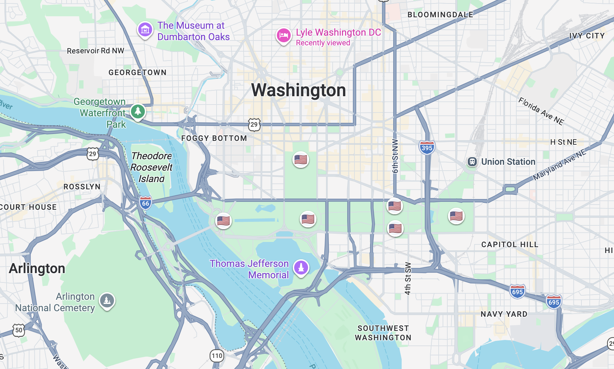

---
categories:
  - useful-tips/general
date: 2026-10-06
description: AI is really, really helpful when planning a trip.
lang: en
last_updated: 2026-11-14
naver_date: 2026-10-06
naver_url: https://blog.naver.com/martin-lee/224432997876
tags:
  - Travel notes
title: "[U.S. Travel] Planning a Two-Day, One-Night Trip to Washington, DC"
translation_key: 2026-10-06-washington-dc-itinerary
---

The world has become so convenient.

AI is really, really helpful when planning a trip.

---

On a first visit to Washington, DC, the must-see sights are fairly well established.

Most attractions are clustered together, making it ideal for a day trip or a two-day, one-night itinerary.

It seems many people stop in Washington as part of a trip to New York.

You can take an Amtrak train from New York to Washington.

Union Station is probably the best reference point when choosing accommodation.

Public transportation in Washington is safer and well organized, so you can use the subway and buses. Uber is also convenient for short distances.

If the weather is good, bicycle tours seem popular, too.

Something like this...

The leftmost pin on the map above is the Lincoln Memorial, and the rightmost is the United States Capitol. Google Maps gives a walking time of 56 minutes. As you walk through this park-like area, you pass the World War II Memorial, Washington Monument, Smithsonian National Museum of Natural History, Smithsonian's National Air and Space Museum, and more. The White House is to the north.

Even people who were not interested in museums or exhibitions in Korea say there are so many fun, astonishing, beautiful, and impressive things here that their eyes widen. There is a lot of walking, so comfortable shoes are a must. Another important point is that admission is free or inexpensive. **However, reservations are essential.**

Day 1 (west): Arrive in Washington -> unpack at the hotel -> White House -> lunch -> National Museum of African American History and Culture or Natural History Museum -> Washington Monument -> World War II Memorial -> Vietnam Veterans/Korean War Veterans memorials -> Lincoln Memorial -> dinner -> hotel

Day 2 (east): Breakfast -> National Gallery of Art or Air and Space Museum -> Library of Congress -> Capitol -> **Union Station**

0\. White House (apply 7–90 days before your visit; free)

[https://www.whitehouse.gov/visit/](https://www.whitehouse.gov/visit/)

[Visit The White House](https://www.whitehouse.gov/visit/)

1\. National Museum of African American History and Culture (reservations available from 30 days before your visit; free)

[https://nmaahc.si.edu/](https://nmaahc.si.edu/)

[A People’s Journey, A Nation’s Story | National Museum of African American History and Culture](https://nmaahc.si.edu/)

2\. History museum

[https://tickets.si.edu/nmaahc/events](https://tickets.si.edu/nmaahc/events)

3\. Natural History Museum (no advance reservation needed; free)

[https://naturalhistory.si.edu/visit](https://naturalhistory.si.edu/visit)

4\. Washington Monument (reservations open at 3 p.m. one day before your visit; $1)

[https://www.recreation.gov/ticket/facility/234635?tab=tours](https://www.recreation.gov/ticket/facility/234635?tab=tours)

[Washington Monument, National Mall and Memorial Parks - Recreation.gov](https://www.recreation.gov/ticket/facility/234635?tab=tours)

4\. Lincoln Memorial Undercroft exhibition space ($1)

[https://www.nps.gov/linc/planyourvisit/index.htm](https://www.nps.gov/linc/planyourvisit/index.htm)

[Plan Your Visit - Lincoln Memorial (U.S. National Park Service)](https://www.nps.gov/linc/planyourvisit/index.htm)

5\. Air and Space Museum (reservations available from 30 days before your visit; free)

[https://airandspace.si.edu/](https://airandspace.si.edu/)

[Smithsonian’s National Air and Space Museum](https://airandspace.si.edu/)

6\. Library of Congress (reservations available from 30 days before your visit; free)

[https://www.loc.gov/visit/](https://www.loc.gov/visit/)

[Visiting the Library | Library of Congress](https://www.loc.gov/visit/)

7\. U.S. CAPITOL (free)

[https://www.visitthecapitol.gov/visit/book-a-tour](https://www.visitthecapitol.gov/visit/book-a-tour)

[Book a Tour | U.S. Capitol - Visitor Center](https://www.visitthecapitol.gov/visit/book-a-tour)

---

**Washington restaurant candidates**

Old Ebbitt Grill ([https://maps.app.goo.gl/BNkfTrMAW1j1xTM37](https://maps.app.goo.gl/BNkfTrMAW1j1xTM37))

Founding Farmers DC ([https://maps.app.goo.gl/WFrFRDwspF1Jk8D68](https://maps.app.goo.gl/WFrFRDwspF1Jk8D68))

Le Diplomate ([https://maps.app.goo.gl/LayiTLGVwvJNUpso6](https://maps.app.goo.gl/LayiTLGVwvJNUpso6))

Unconventional Diner ([https://maps.app.goo.gl/gNtG5R6ibM4sxKcb9](https://maps.app.goo.gl/gNtG5R6ibM4sxKcb9))

**Final itinerary**

**Day 1**

**07:35–10:30 Arrive in Washington, DC, at Union Station**

**10:30–11:30 Travel to accommodation: Lyle Hotel**

**11:30–12:30 Drop off luggage and head to lunch at Old Ebbitt Grill — reservation confirmed for 12:30**

**13:30–14:30 After lunch, visit the White House**

**15:00–18:00**

**National Museum of African American History and Culture — reservation confirmed for 15:00**

**Washington Monument**

**World War II Memorial**

**(18:08–18:10: sunset in late October)**

**18:00–19:30 Lincoln Memorial — reservation confirmed for 19:15**

**19:30–20:00 Head to dinner at Le Diplomate · Dining Room — reservation confirmed for 20:30**

**22:00– Return to accommodation**

**Day 2**

**08:00–11:00 Breakfast + check out + leave luggage**

**12:00–15:00 Air and Space Museum — reservation confirmed for 12:00**

**15:00–16:00 Capitol — reservation confirmed for 15:00**

**16:00–17:00 Library — reservation confirmed for 16:00**

**17:00–17:30 Photos in front of the Supreme Court**

**Have a quick bite, then head to Union Station to catch the bus — reservation confirmed for 18:55**

(If there is time, visit the Natural History Museum on Day 2.)
