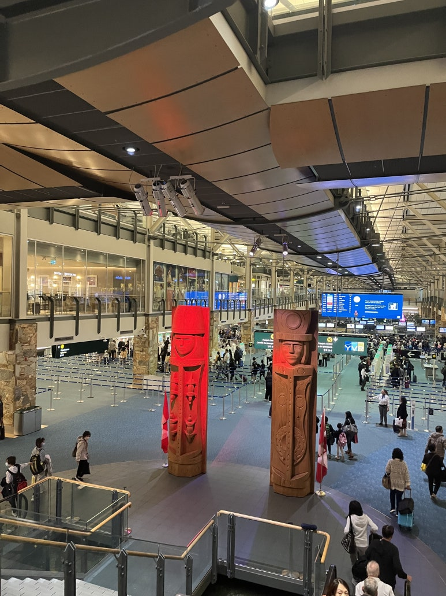
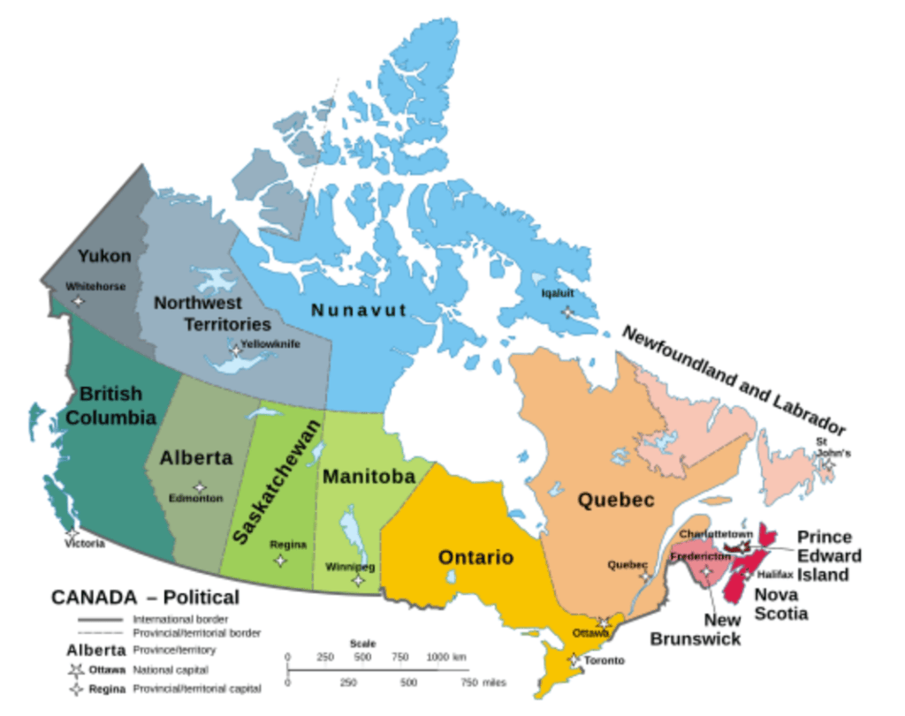
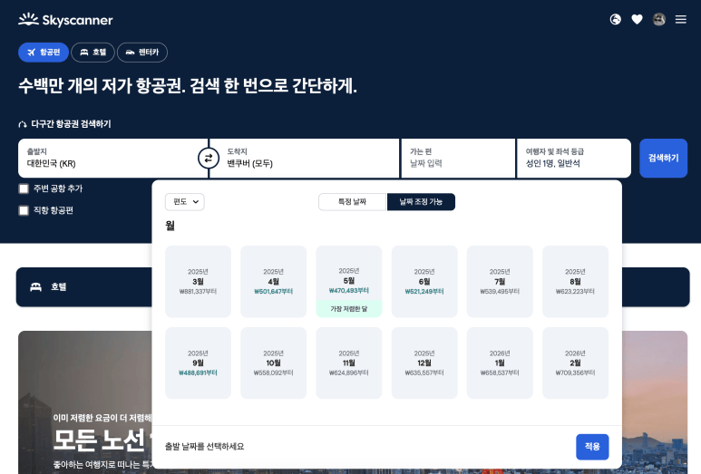
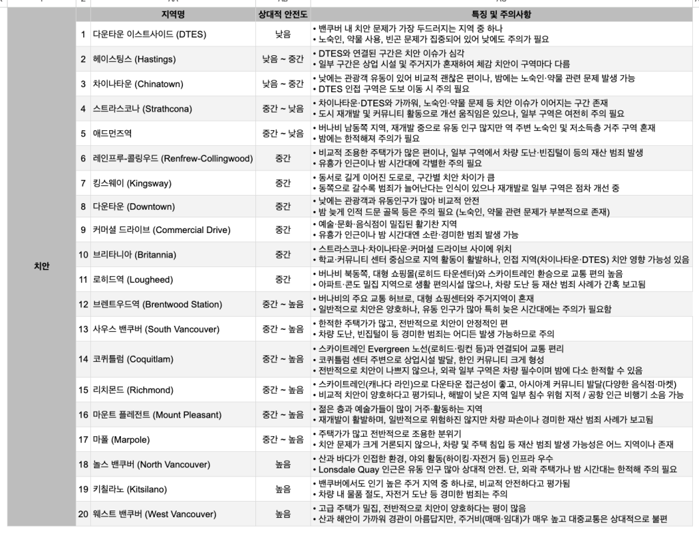
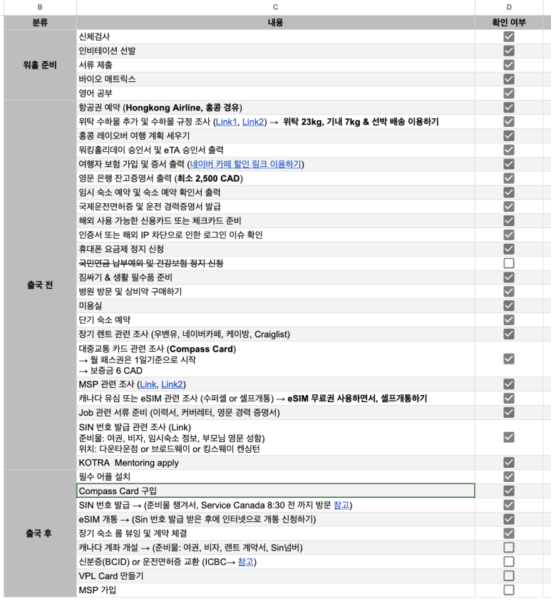

---
categories:
  - useful-tips/in-canada
date: 2025-04-12
description: I am currently in Canada on a working holiday.
lang: en
last_updated: 2026-11-14
naver_date: 2026-10-10
naver_url: https://blog.naver.com/martin-lee/224436725035
tags:
  - "1"
  - "2"
  - "3"
  - "4"
  - "5"
  - "6"
  - "7"
  - "8"
  - "9"
title: "A Complete Guide to a Working Holiday in Vancouver, Canada: Location, Flights, eSIM, Insurance, Temporary Accommodation, Documents, and Packing"
translation_key: 2025-04-12-vancouver-working-holiday
---

※ This post was brought over from my previous blog during a move. (Originally written: April 12, 2025)

I am currently in Canada on a working holiday.

I decided to go on a working holiday because I had wanted to become good at English for a long time. Before coming, I completed two months of English language study in the Philippines. Now I have to put it into practice in Canada...

There was a lot to prepare to get here, and I thought it would be useful to keep a record on my blog, so I am writing this post.

---

**#1. Working Holiday — Canada**

A working holiday gives you a work visa rather than a tourist visa, allowing you to stay for about one to two years. You can work, learn English, travel, and pursue various other goals. Popular destinations include Japan, Australia, Canada, and New Zealand. From 2024, Canada raised its age limit from 30 to 35 and changed the permitted stay to two years. I chose Canada because it is an immigrant-friendly, English-speaking country. Application requirements and procedures differ by country, so I recommend checking them yourself.

– (a) Apply for a working holiday through IRCC

– (b) Wait to receive an invitation

– (c) Medical examination

– (d) Biometrics

– (e) Submit the various documents

The process can be broken down this way. It seems that final selection can take as little as a month. I remember the cost being approximately KRW 200,000–300,000.

[**https://cafe.naver.com/gocan**](https://cafe.naver.com/gocan)

[2026 Canada Working Holiday No.1...: Naver Cafe](https://cafe.naver.com/gocan)

The Naver Canada Working Holiday community has detailed instructions, so I recommend joining and following them step by step. Even someone who is not good at English should be able to do it easily.

---

**#2. Choosing a Location — Vancouver**

Canada is a federal country made up of ten provinces and three territories. Its capital is Ottawa, Ontario. The most popular choices for working holiday participants seem to be \*\*Toronto, Vancouver, and Calgary\*\*. Some also go to Saskatoon, Saskatchewan. Quebec also uses French, so adapting there may take more effort than in other regions.

A brief introduction to each region:

– Toronto: Urban, with plenty of jobs and cultural activities; housing and living costs are relatively high.

– Vancouver: City and nature; housing and living costs are relatively high; it rains a lot.

– Calgary: Nature; living costs are relatively low compared with other regions because Alberta does not charge provincial sales tax (PST).

Each province will have more characteristics, advantages, and disadvantages. I recommend choosing based on the environment you want.

---

**#3. Flights — March, With a Connection**

Flights are usually cheapest around three months before departure. Flights connecting through Hong Kong or Japan will probably be the cheapest. Before arriving in Canada, I stopped in Hong Kong for a day of sightseeing, which I really enjoyed. I flew with Hong Kong Airlines. Reviews often mentioned fairly frequent cancellations and delays and strict baggage rules, but it was inexpensive and my trip went smoothly.

---

**#4. Mobile Service (eSIM) — Supercell eSIM, Fido**

Most people suspend their Korean mobile service or switch to a budget plan before leaving.

Because I might occasionally need to receive verification messages from Korea, I switched to a KRW 3,300-per-month plan that lets me receive texts and decided to use an eSIM.

[https://blog.naver.com/supercell33](https://blog.naver.com/supercell33)

[Supercell in Canada! Canadian SIM Cards and Internet Specialists: Naver Blog](https://blog.naver.com/supercell33)

The most convenient option is to activate an eSIM through a company called Supercell while still in Korea. I received a free 500 MB eSIM coupon when booking accommodation in Hong Kong, so I had planned to sign up locally after arriving in Canada. But the promotions turned out to be the same, and I was not comfortable with English... In the end, I used Supercell to activate my eSIM after arriving.

They kindly answered all my questions and seemed to provide consultations late into the night, too...

Canada's major carriers are Rogers > Bell > Telus, with budget brands Fido > Virgin Plus > Koodo. People say Canadian internet speeds are disappointing compared with Korea. Normally I would have insisted on the leading carrier... But Koodo had the best promotion when I signed up, so I chose Koodo. Promotions seem to change often, so I recommend consulting them before signing up.

---

**#5. Travel Insurance — MyBank**

There were not many insurers offering two-year travel insurance in the first place. I heard that signing up through links provided by the community offered a discount, so I chose MyBank, which was said to be the cheapest. I often saw posts saying coverage had to be $50,000 and the term had to be two years. To avoid problems at entry, I chose the “Deundeun” plan, I think, for peace of mind.

---

**#6. Temporary Accommodation — Airbnb**

Unless you are enrolling in a language school, people commonly book Korean-run accommodation or a homestay through a Vancouver Korean community, or book an Airbnb. Personally, I recommend Airbnb. There have recently been many room-rental scams, and an Airbnb booking lets you print proof of temporary accommodation later. I needed this document when getting my visa and SIN.

If you are looking for long-term rather than temporary accommodation, focus on neighborhood safety.

---

**#7. Essential Documents — International Driving Permit, Travel Insurance Copy, Work Permit Copy, Temporary Accommodation, and Proof of Funds**

If you want to get a driver's licence in Vancouver, bring an international driving permit and an English-language driver's licence (get a new one issued and submit the previous one). At airport immigration, they only checked my work permit and temporary accommodation address.

---

**#8. Other Things to Pack...**

A card that allows overseas cash withdrawals, such as Travel SOL or Travel Wallet

I did not buy extra baggage. I brought a 23 kg checked bag, a 7 kg carry-on, and a backpack.

YouTube and other blogs recommended bringing plenty of clothes, towels, and especially socks, so I packed as much as I could. I looked at some socks at Walmart the other day, and the quality really was poor... I am not sure whether an electric heating mat is essential, but rooms are very dry... The hair dryer I brought is too weak because the voltage does not match. It seems better to buy electronics here where possible. I recommend buying them through departure sales in working holiday communities.

---

**#9. Things to Do After Arriving in Canada**

– Install essential Canadian apps

– Get a SIN

– Open a Canadian bank account. Banks also have promotions, so check carefully before opening one. I hear customer numbers rank RBC > CIBC > TD. **Make an appointment before going.**

– Buy a transit card, the Compass Card

– Exchange your identification for a BCID

– Get a Vancouver Public Library (VPL) card

– Sign up for MSP after three months

– Find a job

---

I had put together a lot of notes while preparing for my working holiday, so I wrote this based on them. If anything is missing or you have questions, please leave a comment. Thank you 🙂
