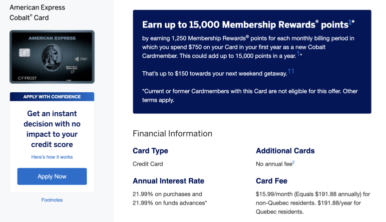
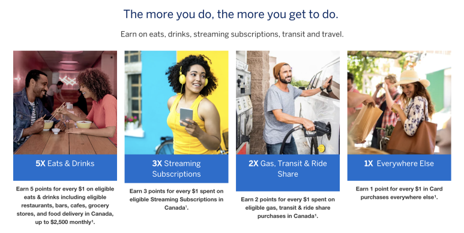

---
categories:
  - in-canada
date: 2026-01-19
description: Notes on Amex Cobalt benefits and earning points when choosing a credit card in Canada
draft: false
gallery:
  - /assets/img/posts/credit-card-recommend-1.png
  - /assets/img/posts/credit-card-recommend-2.png
  - /assets/img/posts/credit-card-recommend-3.png
lang: en
last_updated: 2026-07-22
layout: post
slug: credit-card-recommend
tags:
  - canada
  - credit-card
  - bank
thumbnail: /assets/img/posts/credit-card-recommend-1.png
title: Credit Card Recommendations in Canada
translation_key: credit-card-recommend
---

## Introduction

> **Affiliate disclosure:** This post includes the author's American Express referral link. If a card is approved through that link, the author may receive a points reward. The card costs paid by the reader are the same whether or not the link is used, and the possibility of a reward does not change the criteria used to evaluate the card. Benefits and fees may change, so check the official terms before applying.

When people first arrive in Canada, they usually get a credit card at the same time as opening a bank account. Many keep using the card issued by one of Canada's Big Five banks. Apart from having no annual fee, the benefits are not particularly good... are they?

You may have kept using the card you first got,

without experiencing much inconvenience,

wondering whether you really need to get another one,

and finding it a hassle to research which card to apply for.

Even so, I strongly recommend spending a little time learning about credit cards and making use of them.

In these times of high prices, shouldn't we at least make efforts like this to spend a little more wisely?

## Why Is the Amex Cobalt Good?

The card people in Canada use most is the Amex Cobalt.

Amex, or American Express, has a premium image among Koreans, so many assume its approval requirements are strict, but that is not the case. In fact, its credit limits can be more generous than those of regular banks, so getting the card may be helpful when settling in or planning a large expense.

If you use it well and are willing to pay a modest annual fee, this card can more than pay for itself.

The fee is CAD $15.99 per month, or $191.88 per year.

The card's promotions seem to change frequently. The current promotion offers 1,250 points if you spend $750 in a month. With these terms applying for 12 months, someone who spends about $750 each month would earn a total of 15,000 points.

## What Can You Do with the Points?

Flights are the most common use. Points can also be used for hotels such as Marriott and Hilton, or to buy gift cards.

## Various Other Benefits

If an electronic device purchased with an Amex card is damaged or stolen, you can receive an insurance payment through Amex itself. Coverage lasts up to two years from the purchase date, and claims can be made for up to $1,000. There is also insurance for flight delays and incidents that may occur while traveling. To receive these benefits, you must pay with your Amex card.

Looking into it, there also seems to be something for Amex cardholders related to concerts and performances. It looks as though you need to register your email on the site above in advance to receive alerts. It has a similar feel to Hyundai Card.

## How Do You Earn Points?

The first way is to use the promotion mentioned above, and the second is to use the card. But there are ways to be strategic about using it, too.

The Amex Cobalt earns points according to the following structure.

- Earn 5% of your spending in points on food delivery, cafés, restaurants, and grocery stores.

- Earn 3% on streaming.

- Earn 2% on transportation-related spending.

- Earn a base rate of 1%.

<a href="https://americanexpress.com/en-ca/referral/cobalt?ref=sUNGJWw0jp&CPID=999999538" rel="sponsored nofollow">American Express Cobalt Card referral link</a>

Finally, another way to earn points is through referrals.

Referral rewards and applicant promotions can vary by date and account. Judge the offer based on the terms displayed when you open the link.

One important tip:

Going through a rebate site is another option, but cashback amounts and payout conditions change frequently. If you use <a href="https://www.greatcanadianrebates.ca/" rel="sponsored nofollow">Great Canadian Rebates</a>, check its latest conditions and privacy practices yourself before applying.

## Things to Keep in Mind

To earn points effectively and use them wisely, you need to understand how the card works. Not every purchase earns 5x points, and some businesses do not accept Amex. It is said to be more widely accepted in western Canada than in the east.

Food delivery and grocery stores (5x points): Sobeys group + Jim Pattison group + Shoppers + London Drugs + Rexall + Whole Foods + 7-Eleven.

(Note: Walmart earns the base rate, and Costco does not accept Amex.)

→ You can also buy gift cards at grocery stores and then pay with those gift cards.

The list of streaming services eligible for 3x points changes frequently, so keep that in mind.

Gas stations and public transit earn 2x points.

Everything else earns the base rate.

I hope we can all get through this period of high prices with wise spending habits.

## Official Resources

- [American Express Cobalt Card benefits and earning conditions](https://www.americanexpress.com/ca/en/benefits/cobalt-card/index.html)
- [American Express card fees and terms](https://www.americanexpress.com/en-ca/benefits/upgrade/cobalt-to-gold-card/)
